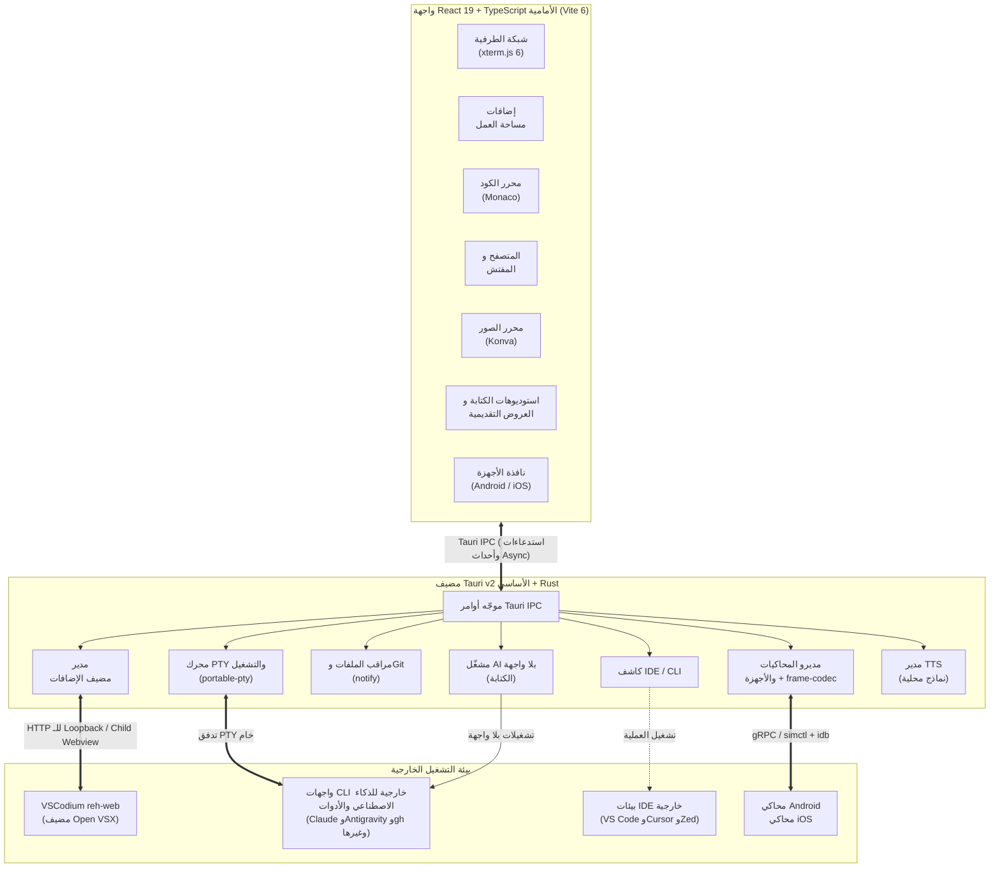

<div align="center">

<a href="https://github.com/wolfenazz/YzPzCode/releases/latest">
  
</a>
<br />
<p align="center">
  <a href="https://github.com/wolfenazz/YzPzCode/releases/latest">
    
  </a>
  <a href="https://github.com/wolfenazz/YzPzCode/blob/main/LICENSE">
    
  </a>
  <a href="docs/userguid.md">
    
  </a>
  <a href="https://github.com/wolfenazz/YzPzCode/issues">
    
  </a>
  
</p>

<p align="center">
  <a href="README.md">English</a> &nbsp;|&nbsp;
  <b>العربية</b> &nbsp;|&nbsp;
  <a href="DEREADME.MD">Deutsch</a> &nbsp;|&nbsp;
  <a href="ESREADME.MD">Español</a> &nbsp;|&nbsp;
  <a href="FRREADME.MD">Français</a> &nbsp;|&nbsp;
  <a href="PTREADME.MD">Português (BR)</a> &nbsp;|&nbsp;
  <a href="TRREADME.MD">Türkçe</a>
</p>

<p align="center">
  <a href="#-لماذا-yzpzcode">لماذا</a> •
  <a href="#-كل-شيء-في-نافذة-واحدة">نظرة عامة</a> •
  <a href="#واجهات-cli-لبرمجة-الذكاء-الاصطناعي-المدعومة">الوكلاء</a> •
  <a href="#إضافات-مساحة-العمل-الرسومية">الإضافات</a> •
  <a href="#استوديوهات-الكتابة-والعروض-التقديمية-والجداول">الاستوديوهات</a> •
  <a href="#نافذة-الأجهزة-المحمولة">الأجهزة</a> •
  <a href="#السرد-المحلي">السرد</a> •
  <a href="#نظام-تشغيل-وبناء-التطبيقات">التشغيل والبناء</a> •
  <a href="#التنزيل-والتثبيت">التنزيل</a> •
  <a href="#المساهمون">المساهمون</a>
</p>

</div>

> [!NOTE]
> **YzPzCode قيد التطوير النشط.** قد تكون الميزات تجريبية أو تتغير بين الإصدارات. نرحب بحرارة بالملاحظات وتقارير الأخطاء وطلبات السحب.

---

## ⚡ لماذا YzPzCode؟

يتحول التطوير بمساعدة الذكاء الاصطناعي عادةً إلى تنقّل متكرر بين تبويبات الطرفية والوكلاء والمتصفحات وبيئات IDE وأدوات CLI المتخصصة. **يستبدل YzPzCode هذا التلاعب بالنوافذ بمركز قيادة أصلي واحد.**

| سير العمل التقليدي | مع YzPzCode |
| :--- | :--- |
| 🪟 أكثر من 8 نوافذ طرفية منفصلة | 🖥️ **مساحة عمل أصلية واحدة** بتخطيطات مخصصة |
| 🔄 تبديل مستمر للسياق عبر `Alt+Tab` | 🎛️ **شبكة طرفية متجاورة** لجلسات PTY حقيقية |
| 🔌 لوحات المساعد محصورة داخل بيئات IDE خارجية | 🧩 **إضافات رسومية** مدمجة في الشبكة |
| ⚙️ نصوص بناء وأوامر تشغيل يدوية | ⚡ **تشغيل وبناء** مع اكتشاف تلقائي لأكثر من 15 منظومة |
| 🧩 محرر خارجي وعارض ملفات | 📝 **محرر مضمّن** مع شجرة ملفات افتراضية وGit |
| 🌐 متصفح منفصل لفحص الواجهات | 🔍 **متصفح داخل التطبيق** مع مفتش بصري يوجّه الوكلاء |
| 📱 نافذة محاكي منفصلة | 📲 **نافذة أجهزة Android وiOS** مع hot reload لـ Flutter |
| 📄 Word وPowerPoint ومحادثة AI منفصلة | ✍️ **استوديوهات الكتابة والعروض التقديمية** باستخدام واجهات CLI نفسها |
| 🔑 فحوصات متكررة لتثبيت أدوات CLI والمصادقة | 🔐 **اكتشاف وتثبيت بنقرة واحدة وتتبع المصادقة** |
| 🎨 Photoshop أو Figma للتعديلات السريعة | 🖌️ **محرر صور متعدد الطبقات** مع أوضاع المزج |

---

## 🧭 كل شيء في نافذة واحدة

<div align="center">
  
</div>

<br />

<table>
  <tr>
    <td align="center" width="16%"><h3>26</h3><sub>واجهات CLI لبرمجة AI</sub></td>
    <td align="center" width="16%"><h3>10</h3><sub>واجهات CLI لخدمات SaaS والأدوات</sub></td>
    <td align="center" width="16%"><h3>14</h3><sub>إضافات رسومية</sub></td>
    <td align="center" width="16%"><h3>15+</h3><sub>منظومات التشغيل والبناء</sub></td>
    <td align="center" width="16%"><h3>30</h3><sub>نوعًا من التقارير</sub></td>
    <td align="center" width="16%"><h3>3</h3><sub>أصوات محلية</sub></td>
  </tr>
</table>

---

## 📸 شاهد التطبيق عمليًا

<div align="center">
  <a href="docs/capture/yzpzcode-showreel.mp4">
    
  </a>
  <br />
  <sub>▶ <a href="docs/capture/yzpzcode-showreel.mp4"><b>شاهد العرض التوضيحي الكامل الممتد 45 ثانية مع الصوت</b></a></sub>
  <br /><br />
  <table>
    <tr>
      <td width="50%" align="center">
        
        <br /><sub><b>شبكة الطرفية ومستكشف مساحة العمل</b></sub>
      </td>
      <td width="50%" align="center">
        
        <br /><sub><b>تخطيط تعاوني متعدد الوكلاء</b></sub>
      </td>
    </tr>
    <tr>
      <td width="50%" align="center">
        
        <br /><sub><b>متصفح webview مدمج متعدد التبويبات</b></sub>
      </td>
      <td width="50%" align="center">
        
        <br /><sub><b>مفتش عميق للعناصر والأنماط البصرية</b></sub>
      </td>
    </tr>
  </table>
</div>

---

##  واجهات CLI لبرمجة الذكاء الاصطناعي المدعومة

يكتشف YzPzCode جلسات PTY لـ 26 وكيلًا خارجيًا لبرمجة الذكاء الاصطناعي ويطلقها ويديرها. وتشمل التكاملات الأساسية:

```
                     ┌─── Claude (Anthropic)
                     ├─── Antigravity (Google)
                     ├─── Codex (OpenAI)
                     ├─── OpenCode
  مضيف YzPzCode ─────┼─── Cursor
                     ├─── Kilo
                     ├─── Hermes
                     ├─── Pi (earendil-works)
                     └─── Command Code
```

| الوكيل | أمر CLI | الدور الأساسي ونقاط القوة |
| :--- | :---: | :--- |
| **Claude Code** | `claude` | استدلال عميق، وإعادة هيكلة مستقلة، وسياق واسع |
| **Antigravity CLI** | `agy` | تنفيذ مستقل للمهام، وسير عمل وكيل، وGoogle AI |
| **Codex CLI** | `codex` | توليد دقيق للكود وكتابة اختبارات الوحدة |
| **OpenCode** | `opencode` | وكيل مفتوح المصدر لسير العمل المحلي القابل للتخصيص |
| **Cursor CLI** | `cursor` | تحرير ملفات قائم على الوكلاء وفهرسة قاعدة الكود |
| **Kilo** | `kilo` | سير عمل سريع للوكلاء أصلي الطرفية |
| **Hermes** | `hermes` | مساعد طرفية مستقل ومضغوط |
| **Pi** | `pi` | إطار وكيل برمجة بسيط مع نقاط ربط للإضافات |
| **Command Code** | `cmd` / `cmdc` | تنسيق تفاعلي للأوامر والنصوص البرمجية |

<details>
<summary><b>إظهار التكاملات الإضافية وعددها 17</b></summary>

<br />

| الوكيل | أمر CLI | الوكيل | أمر CLI |
| :--- | :---: | :--- | :---: |
| **Cline CLI** | `cline` | **Grok CLI** | `grok` |
| **Devin for Terminal** | `devin` | **Trae CLI** | `traecli` |
| **Kimi Code CLI** | `kimi` | **Qoder CLI** | `qoder` |
| **GitHub Copilot CLI** | `copilot` | **Kiro CLI** | `kiro-cli` |
| **Mistral Vibe** | `vibe` | **DeepSeek TUI** | `deepseek` |
| **Aider** | `aider` | **Amp** | `amp` |
| **DeepSeek Reasonix** | `reasonix` | **CodeBuddy Code** | `codebuddy` |
| **DeepSeek Harness** | `dsh` | **AtomCode CLI** | `atomcode` |
| **MiMo Code** | `mimo` | | |

</details>

راجع [مرجع تكاملات CLI](docs/cli-integrations.md) لتعليمات تثبيت المورّدين والتوثيق وملاحظات المنصات.

> [!IMPORTANT]
> يتكامل YzPzCode مع واجهات CLI التابعة لجهات خارجية عبر جسور PTY، وهو **غير تابع لمورّديها ولا يحظى بتأييدهم** ما لم يُذكر خلاف ذلك صراحةً.

---

##  واجهات CLI لخدمات SaaS وأدوات المطورين

يتتبع التطبيق نيابةً عنك حالة التثبيت ومسارات الملفات التنفيذية وحالة المصادقة لواجهات CLI السحابية وواجهات CLI الخاصة بالمطورين الشائعة:

<div align="center">

| الخدمة | الأمر | الخدمة | الأمر |
| :--- | :---: | :--- | :---: |
| **GitHub CLI** | `gh` | **PostHog** | `posthog-cli` |
| **Supabase** | `supabase` | **ElevenLabs** | `elevenlabs` |
| **Stripe** | `stripe` | **Google Workspace** | `gws` |
| **Vercel** | `vercel` | **AgentMail** | `agentmail-cli` |
| **Valyu** | `valyu-cli` | **Ramp** | `ramp` |

</div>

راجع [دليل مرجع واجهات CLI للأدوات](docs/ToolCLIs.md) لسير العمل والأوامر الشائعة وتفاصيل المصادقة.

---

##  إضافات مساحة العمل الرسومية

شغّل مساعدي البرمجة الرسوميين بجوار الأصداف والوكلاء مباشرةً داخل شبكة مساحة العمل. اضغط **`Ctrl+Shift+X`** أو انقر على أيقونة Extensions في الرأس لفتح الكتالوج.

| الإضافة | الناشر | الوصف |
| :--- | :--- | :--- |
| **Google Antigravity** | Google | المساعد الرسمي القائم على الوكلاء من Google، مع محادثة وخطط وتعديلات على الكود. |
| **Kilo Code** | Kilo | اكتب الكود وخطّط ونقّح باستخدام لوحة الإضافة المرئية من Kilo. |
| **Cline** | Cline | مساعد برمجة مستقل مع وضعي plan/act وبوابات الموافقة على الأدوات. |
| **OpenAI Codex** | OpenAI | إضافة البرمجة من OpenAI مع تسجيل الدخول إلى ChatGPT ومساعدة الكود. |
| **Claude Code** | Anthropic | مساعد البرمجة المرئي ولوحة المحادثة من Anthropic. |
| **Continue** | Continue | وكيل مفتوح المصدر ومحادثة كود مع خلفيات نماذج سحابية أو محلية. |
| **Amazon Q Developer** | AWS | محادثة كود وتطوير ميزات inline باستخدام Amazon Q. |
| **Tabby** | TabbyML | مساعد برمجة مستضاف ذاتيًا ومتصل بخادم Tabby خاص. |
| **Windsurf Plugin** | Windsurf | مساعد Codeium مع محادثة كود بالذكاء الاصطناعي وفهرس لقاعدة الكود. |
| **Mistral Vibe** | Mistral AI | وكيل البرمجة المرئي من Mistral مع السياق والمحادثات والأدوات. |
| **Roo Code** | Roo Code | وكيل من عائلة Cline مع أوضاع مخصصة ودعم نماذج متعددة وموافقات لكل خطوة. |
| **Qoder CN** | Alibaba Cloud | مساعد البرمجة القائم على الوكلاء من Alibaba Cloud مع وضعي المحادثة والوكيل؛ يتطلب تسجيل الدخول. |
| **Augment** | Augment Code | وكيل برمجة بمحرك سياق مصمم لقواعد الكود الكبيرة؛ يتطلب تسجيل الدخول. |
| **Nexrall Code** | Nexrall | وكيل برمجة مستقل مع موافقات لكل خطوة ونقاط تحقق وأدوات MCP؛ يتطلب حسابًا. |

- 🎛️ **تخطيطات شبكة متجاورة**: تُثبّت اللوحات داخل شبكة الطرفية مع إعادة ترتيب بالسحب والإفلات، وتغيير حجم تفاعلي، وإعدادات تركيز، وتخطيطات مقسّمة.
- 📌 **إرساء جانبي للمحرر**: أرسِ لوحة إلى يمين المحرر (`Ctrl+Alt+B`) وانقلها بين الشبكة والمرسى من دون إعادة تشغيلها.
- 📨 **تمرير prompt**: أرسل تحديدًا من مفتش المتصفح أو مرجعًا لواجهة مباشرةً إلى لوحة المساعد؛ يُدرج prompt ويُرسل، وتظهر النتيجة في رأس اللوحة.
- 🌈 **وهج النشاط**: تحصل اللوحات على حلقة العمل وتأثير الانتهاء نفسيهما الموجودين في طرفيات الوكلاء.
- 📦 **بيئة تشغيل مُدارة بلا إعداد**: تُجهّز بيئة VSCodium `reh-web` موثّقة مع بصمات SHA-256 مثبتة وحزم Open VSX. لا حاجة إلى تثبيت VS Code أو Node.
- 🛡️ **عزل محكم**: يعمل كل مساعد في webview فرعي معزول على origin خاص به هو `panel-<uuid>.localhost:<port>` مع تخزين دائم، ولا يمكنه استدعاء أوامر مضيف Tauri.
- 🔒 **الثقة في مساحة العمل والاستمرارية**: تُحفظ موافقات الثقة (`workspace-trust.json`) وحالة workbench في IndexedDB (`workbench-state.json`) لكل مساحة عمل.

راجع [توثيق إضافات مساحة العمل الرسومية](docs/extensions.md) لمعمارية النظام ومواصفات بيئة التشغيل وتفاصيل التحقق.

---

##  استوديوهات الكتابة والعروض التقديمية والجداول

<div align="center">
  
</div>

<br />

إلى جانب البرمجة، يفتح مبدّل الوضع في صفحة الإعداد ثلاثة استوديوهات للمستندات. لا تحتاج هذه الاستوديوهات إلى طرفيات أو بيئات IDE، بل تشغّل الذكاء الاصطناعي عبر واجهات CLI المثبتة لديك (Claude Code وCodex وGrok وAntigravity وOpenCode) في مشغّل headless، وتحفظ الملفات في مجلد واحد هو `Documents/YzPzCode`، بحيث يمكن العثور على التقارير والعروض التقديمية ودفاتر العمل مجددًا بعد إعادة التثبيت.

<table>
<tr>
<td width="50%" valign="top">

###  استوديو الكتابة

- **30 نوعًا من التقارير**: اختر نوعًا وأجب عن سؤال واحد في محرر ذي مربع واحد؛ أرفق ملفات والصق مواد وأضف مراجع
- **محرر مقسّم إلى صفحات مع البث**: مخطط مع حالة حية لكل قسم، وجداول وأشكال واستشهادات وحواشٍ، مع الاحتفاظ بموضع القراءة أثناء بث الأقسام
- **المساعد**: اكتب الأقسام المتبقية، أو أعد صياغة التحديد أو القسم، أو اجعل المستند طبيعيًا، أو أعد كتابة المستند كاملًا، مع بطاقة مراجعة لكل تغيير
- **أداة جعل النص طبيعيًا وlint**: درجة طبيعية النص، وفحوص العبارات الجاهزة والافتتاحية والإيقاع والشرطة الطويلة، مع تمييز اختياري
- **لوحة التصميم**: ستة قوالب، وخطوط، وألوان، وعناصر تحكم للصفحة والبنية، وميزة **إعادة التصميم بالذكاء الاصطناعي** مع تراجع بنقرة واحدة
- **صور ويب حقيقية**: صور مرخّصة علنًا من Openverse أو Unsplash أو Pexels مع الإسناد، وليست صورًا مولدة بالذكاء الاصطناعي
- **التصدير**: PDF وWord `.docx` وHTML مستقل؛ واستيراد `.docx` موجود

</td>
<td width="50%" valign="top">

###  استوديو العروض التقديمية

- **عروض مصممة بالذكاء الاصطناعي**: صف العرض؛ يبتكر الذكاء الاصطناعي نظام تصميم، ويكتب قصة مع موجز لكل صفحة، ثم يرسم كل شريحة بصيغة SVG
- **محرر شرائح حقيقي**: تحديد، وتحديد مستطيل، وسحب مع أدلة، وتغيير حجم، وكتابة في موضعها، وأشكال وصور وجداول ومجموعات وشريط تنسيق
- **التحرير بالذكاء الاصطناعي**: غيّر شريحة واحدة أو عدة شرائح أو العرض كاملًا؛ كل تغيير اقتراح مع Keep أو Discard، وتُراجع الدفعات جنبًا إلى جنب
- **الرسوم المتحركة**: تأثيرات الظهور والتأكيد والخروج، وترتيب النقر، وبناء الفقرات، وحركة مصممة بالذكاء الاصطناعي
- **الصور**: أسقط ملفات أو مجلدات، أو اذكر المسارات في prompt، أو أضف صور ويب حقيقية
- **ذهاب وإياب PowerPoint**: استورد `.pptx` بالطريقة التي يرسم بها PowerPoint؛ وصدّر PowerPoint قابلًا للتحرير، وPowerPoint بمظهر "مطابق تمامًا"، وPDF وPNG وHTML
- **وضع المقدم**: عرض بملء الشاشة، ووضع مقدم مع ملاحظات ومؤقت وإيقاع، وانتقالات وسرد

</td>
</tr>
</table>

###  العربية والاتجاه من اليمين إلى اليسار، بدعم أصلي

تعمل العربية والعبرية والفارسية والأردية في كلا الاستوديوهين: يتبع اتجاه الفقرة النص، وتتبع التسميات المطبوعة (Chapter وTable وFigure وContents…) لغة المستند، وتكتب صادرات Word وPowerPoint فقرات ثنائية الاتجاه حقيقية، كما يغذي كتالوج يضم نحو 150 خطًا (لاتينيًا وعربيًا، مع وجوه `@fontsource` مضمّنة) كل منتقيات الخطوط.

---

##  نافذة الأجهزة المحمولة

<div align="center">
  
</div>

<br />

تنزلق نافذة الجهاز من الحافة اليمنى لكل عرض من عروض مساحة العمل (الطرفية والإضافات والمحرر والمتصفح)، وتدفع العرض جانبًا بدلًا من أن تطفو فوقه، لذلك لا تُحجب webviews الأصلية مطلقًا.

- 🤖 **محاكي Android مضمّن**: أنشئ AVDs وشغّلها من التطبيق؛ تُبث الشاشة إلى النافذة (إطارات gRPC عبر crate `frame-codec` المشترك) مع اللمس واللمس المتعدد ولوحة المفاتيح والتمرير والدوران والواجهات ولقطات الشاشة.
- 🍎 **محاكي iOS (macOS)**: الاكتشاف ودورة الحياة عبر `simctl`، والشاشة والإدخال عبر `idb_companion`. خارج macOS يُبلّغ عنه باعتباره غير متاح.
- 🐦 **شريط تشغيل Flutter**: شغّل تطبيق مساحة العمل على الجهاز المختار مع hot reload (وكذلك عند حفظ `.dart`) وhot restart وسجل حي.
- 🛠️ **إعداد موجّه**: يفحص **Settings → Environment** سلسلة أدوات Flutter وAndroid (وXcode على macOS)، ويقدم إصلاحات بنقرة واحدة لأجزاء SDK المفقودة وتسريع العتاد.

---

##  السرد المحلي

<div align="center">
  
</div>

<br />

يمكن قراءة التقارير والشرائح بصوت عالٍ من دون إرسال النص إلى خدمة سحابية. يعمل السرد في بيئة Python محلية مُدارة، ويُنزل النماذج عند الطلب (**Settings → Narration**).

| النموذج | اللغات | الحجم | الملاحظات |
| :--- | :---: | :---: | :--- |
| **SILMA TTS v1** (افتراضي) | العربية + الإنجليزية | ~2.5 GB | صوت ثنائي اللغة متوازن، يراعي التشكيل |
| **Lahgtna-Chatterbox** | العربية | ~1.5 GB | لهجات مصرية وسعودية ومغربية وعراقية |
| **Kokoro-82M** | الإنجليزية | ~350 MB | سريع جدًا، مناسب للتقارير الطويلة |

تُكتشف اللغة من النص، والسرعة هي 0.75× / 1× / 1.25×، ويُخزّن الصوت المُولّد مؤقتًا على القرص (LRU، بحد أقصى 500 MB). انطق التحديد أو قسمًا في استوديو الكتابة، والشرائح في استوديو العروض التقديمية ووضع المقدم.

---

##  نظام تشغيل وبناء التطبيقات

شغّل تطبيقاتك وابنها ونقّحها من دون إعداد. تُكتشف ملفات تعريف المشاريع ونقاط الدخول القابلة للتشغيل عبر أكثر من 15 منظومة، مباشرةً داخل رؤوس الطرفيات.

<div align="center">

| المنظومة | الاكتشاف والتنفيذ |
| :--- | :--- |
| **Python** | يكتشف نصوص `.py` و`main.py` و`app.py` وDjango `manage.py` وخوادم Flask وFastAPI. ويفضّل `.venv` أو `venv` محليًا أو Python النظام. |
| **JavaScript / TypeScript** | يكتشف نصوص dev وstart وbuild في `package.json`. ويستدعي `npm` أو `pnpm` أو `Yarn` أو `Bun` من ملف القفل. |
| **Rust / Go / Flutter** | Cargo (`cargo run`) ووحدات Go (`go run .`) وملفات تعريف مشاريع Flutter (`flutter run`). |
| **C / C++** | يعثر على المصادر التي تحتوي على `main()`، ويترجمها عبر GCC أو Clang إلى `.yzpz-run/` ثم يشغّل الملف الثنائي. |
| **CMake** | يقرأ CMake File API لتحديد أهداف Debug في `.yzpz-build/`، ويبنيها قبل التشغيل. |
| **C# (.NET)** | يكتشف ملفات `.csproj` التنفيذية ويشغّلها في المشاريع والحلول باستخدام .NET SDK. |
| **Java** | تنفيذ مصدر في ملف واحد عبر JDK 11+ وتكوينات تشغيل المشاريع. |
| **Ruby, PHP, Dart, Swift, Lua, Perl, R** | يشغّل نقاط الدخول بالمفسرات المثبتة؛ وأوامر تعريف Rails وLaravel. |

</div>

- ▶️ **تشغيل وبناء بنقرة واحدة** من رأس الطرفية مع تبديل فوري للهدف.
- 💬 **وحدة تحكم stdin تفاعلية**: أرسل إدخالًا إلى البرامج قيد التشغيل (`input()` و`scanf` و`Console.ReadLine()`) من شريط إدخال الطرفية.
- 🌐 **اكتشاف تلقائي لخادم التطوير**: تتحول عناوين localhost في مخرجات الطرفية إلى معاينة بنقرة واحدة في شريط المتصفح.
- ⚙️ **تكوينات تشغيل مخصصة**: أوامر ومتغيرات بيئة ووسائط وأدلة عمل في **Settings → Application runs**، عامة أو لكل مساحة عمل.

راجع [دليل تشغيل التطبيقات](docs/application-runs.md) لمخططات التكوين وتبديل الأهداف المتعددة وتفاصيل المترجمات.

---

##  الميزات الأساسية

<details open>
<summary><b> شبكة طرفية متعددة الوكلاء</b></summary>

<br />

- **واجهة PTY حقيقية**: واجهة xterm.js 6 مدعومة بـ `portable-pty` من Rust
- **أوامر مُدارة**: مهام غير تفاعلية وخلفية مع PID ورمز خروج وبث حي للمخرجات
- **أوضاع فأرة الطرفية**: دعم كامل لتقارير فأرة xterm (النقر والسحب وأي حدث وتتبع التطبيق) لتطبيقات TUI
- **تصيير مسرّع بالعتاد**: مسار canvas/WebGL مع تحديثات للمستطيلات المتسخة لزمن استجابة منخفض
- **نطاق مساحة العمل**: تُعزل الجلسات لكل مساحة عمل للمشروع
- **حوار الإنشاء**: قابل للبحث ومجمّع حسب الأصداف والوكلاء الأساسيين والوكلاء الإضافيين وواجهات CLI لأدوات SaaS، مع شارات حالة حية
- **مؤشر نشاط الوكيل**: خامل ← يعمل ← مكتمل لكل جزء، مع حلقة عمل وتأثير انتهاء وصوت إكمال اختياري
- **تخطيطات ديناميكية**: تتكيف التخطيطات مع عدد الأجزاء، مع إعادة ترتيب بالسحب ومنتقي تخطيط
- **لوحة طرفية للمحرر**: طرفية بأسلوب VS Code تحت المحرر (تبديل عبر <kbd>Ctrl</kbd>+<kbd>`</kbd>، وفتح shell جديد عبر <kbd>Ctrl</kbd>+<kbd>Shift</kbd>+<kbd>`</kbd>) مع منتقي shell وسجل تمرير لكل مساحة عمل
- **ترتيب الطرفيات الخارجية**: وحدات تحكم أصلية (Windows Terminal وmacOS Terminal وLinux) مع ترتيب تلقائي

</details>

<details>
<summary><b> المحرر والمعاينات والتحكم بالمصدر</b></summary>

<br />

- **مساحة عمل متعددة التبويبات**: عروض مقسّمة وإدارة التبويبات (إغلاق البقية / ما على اليمين / المحفوظ)
- **تمييز الصياغة وminimap**: محرّكا Monaco وCodeMirror
- **معاينات غنية**: Markdown وPDF وCSV وExcel (`.xlsx`) وWord (`.docx`) ومخططات Draw.io
- **معاينات الوسائط والملفات الثنائية**: صوت (موجة صوتية ونقل وسرعة وتكرار) وفيديو مبثوث مع دعم HTTP range، إضافةً إلى عرض hex للملفات الثنائية الأخرى
- **مزامنة ملفات معاملاتية**: يحافظ watcher تكراري (`notify`) مع مزامنة مؤجلة على توافق التبويبات المفتوحة مع بيئات IDE والوكلاء الخارجيين
- **Git مدمج**: تبديل الفروع وإحصاءات diff وتهيئة/إلغاء تهيئة الملفات أو المقاطع والتراجع والالتزام والمزامنة البعيدة
- **حافظة نظام التشغيل في المستكشف**: نسخ الملفات وقصها ولصقها (وصور الحافظة) بين المستكشف ونظام التشغيل، مع نتائج لكل عنصر وتراجع
- **فتح في الطرفية**: افتح أي مجلد في جزء مدمج جديد أو طرفية خارجية

</details>

<details>
<summary><b> المتصفح داخل التطبيق والمفتش البصري</b></summary>

<br />

- **بطاقة prompt سريعة**: اختر عنصرًا فتظهر بطاقة صغيرة بجواره: اختر وكيلًا أو لوحة إضافة، واكتب سطرًا واحدًا وأرسله. تفتح **عناصر تحكم إضافية** المفتش الكامل مع نقل المسودة
- **مفتش عميق للعناصر**: CSS المحسوب والعناصر الزائفة ونموذج الصندوق وتسلسل DOM
- **منتقي الأنماط ومولّدها**: التقط الأنماط، وولّد أصناف CSS ذرية، وطبّقها مع سجل تراجع كامل
- **التقاط عنصر واجهة المستخدم**: البنية والتخطيط والطباعة والعناصر الزائفة والأصول وهدف التصميم كمراجع واجهة قابلة لإعادة الاستخدام
- **التبويبات وصفحة البداية ومحاكاة الأجهزة**: تبويبات لكل مساحة عمل، وصفحة بداية تسرد خوادم التطوير الحية، وإعدادات أجهزة ومنافذ عرض مخصصة
- **تكامل خادم التطوير**: معاينة بنقرة واحدة عندما يصدر خادم التطوير عنوان URL محليًا

</details>

<details>
<summary><b> مصمم AI ومحرر الصور متعدد الطبقات</b></summary>

<br />

- **مولّد من prompt إلى UI**: واجهات HTML/CSS/JS متجاوبة انطلاقًا من اللغة الطبيعية
- **لوحة متعددة الطبقات**: طبقات نقطية ومتجهية ونصية وطبقات أشكال مدعومة بـ Konva
- **16 وضع مزج**، وشفافية، ودوران، وإخفاء، وتحديد مستطيل ولاسو، وسجل تاريخ
- **التصدير**: PNG وJPG وWebP وSVG وGIF وBMP وAVIF وTIFF

</details>

<details>
<summary><b> التخصيص</b></summary>

<br />

- 🌗 **وضعي المظهر الداكن والفاتح** مع سمات ديناميكية عبر واجهة المستخدم كاملة
- 🎨 **8 ألوان إبراز**: Default وBlue وPurple وGreen وOrange وRed وPink وCyan
- 🧪 **محرك سمات مخصص**: أنشئ سمة من 9 ألوان وقاعدة فاتحة/داكنة ونصف قطر، مع فحوص تباين WCAG وأكثر من 40 إعدادًا مسبقًا واستيراد/تصدير JSON (**Settings → Appearance → Custom themes**)
- 🌌 **خلفيات متحركة**: الشفق القطبي والمجرة وأشعة الضوء لشاشة الإعداد ومساحات العمل، مع عناصر تحكم للشدة والسرعة والضبابية والشفافية
- 💎 **إطار تطبيق حديث**: تبويبات مبدّل العرض ومؤشرات الحالة ومراقبة العمليات في الزمن الحقيقي داخل التذييل
- 📐 **3 إعدادات مسبقة للكثافة**: Compact وComfortable وSpacious
- ⌨️ **تنسيق الطرفية**: الخطوط والربط بين الحروف وأنماط المؤشر وتتبع الفأرة والشفافية
- ♿ **إتاحة الوصول**: مفتاح لتعطيل الرسوم المتحركة (الحركة المخفّضة)، ومفتاح للمؤشر المخصص

</details>

---

##  المعمارية



<details>
<summary><b>مصفوفة التقنيات</b></summary>

<br />

| الطبقة | التقنيات |
| :--- | :--- |
| **غلاف سطح المكتب** | [Tauri v2](https://v2.tauri.app/)، [Rust](https://www.rust-lang.org/) (إصدار 2021) |
| **التزامن وPTY** | `tokio` و`portable-pty` و`notify` و`which` |
| **مضيف الإضافات** | VSCodium `reh-web` (Open VSX)، وwebviews فرعية معزولة (`panel-*.localhost`) |
| **الواجهة الأمامية** | [React 19](https://react.dev/)، [TypeScript 5.6](https://www.typescriptlang.org/)، [Vite 6](https://vitejs.dev/) |
| **التنسيق والحركة** | [Tailwind CSS v4](https://tailwindcss.com/)، [Framer Motion](https://www.framer.com/motion/) |
| **الطرفية والمحرر** | [@xterm/xterm 6](https://xtermjs.org/)، [Monaco Editor](https://microsoft.github.io/monaco-editor/)، CodeMirror 6 |
| **اللوحة والوسائط** | [Konva](https://konvajs.org/)، `pdfjs`، `xlsx`، `mammoth` |
| **المستندات** | [TipTap](https://tiptap.dev/) (محرر كتابة مقسّم إلى صفحات)، `docx`، `pptxgenjs` + JSZip، ومسار شرائح SVG |
| **الأجهزة المحمولة** | بث gRPC لمحاكي Android، و`simctl` + `idb_companion` (iOS)، وFlutter CLI، وcrate `frame-codec` |
| **الصوت** | بيئة Python محلية مُدارة مع نماذج SILMA TTS وLahgtna-Chatterbox وKokoro |
| **الحالة** | [Zustand 5](https://github.com/pmndrs/zustand) مع تخزين مستمر |

</details>

<details>
<summary><b>بنية المشروع</b></summary>

<br />

```text
yzpzcode/
├── .github/workflows/          # سير عمل إصدارات CI/CD (بناء متعدد المنصات)
├── docs/                       # الأدلة ولقطات الشاشة ورسومات README (docs/readme)
└── app/
    ├── src-tauri/              # الواجهة الخلفية لـ Rust
    │   ├── crates/
    │   │   └── frame-codec/    # برنامج ترميز مشترك لإطارات الشاشة لبث الأجهزة
    │   └── src/
    │       ├── agent/          # تنسيق مهام الوكلاء المستقلة ومنطق إعادة المحاولة
    │       ├── agent_cli/      # اكتشاف واجهات CLI للذكاء الاصطناعي والأدوات وتثبيتها ومصادقتها
    │       ├── android/        # Android SDK والمحاكي المضمّن وتشغيل Flutter وإعداده
    │       ├── ios/            # محاكي iOS (simctl) وبث idb_companion
    │       ├── writing/        # مشغّل AI بلا واجهة للاستوديوهات وطباعة PDF
    │       ├── tts/            # السرد المحلي: بيئة مُدارة وكتالوج نماذج وجسر وذاكرة مؤقتة
    │       ├── browser/        # إدارة Webview وجسر المفتش البصري
    │       ├── commands/       # أوامر Tauri IPC (~100+ نقطة نهاية)
    │       ├── extension_host/ # مدير بيئة VSCodium web المضمّنة وعزل Open VSX وVSIX
    │       ├── terminal/       # جلسات PTY ومحرك التشغيل والأوامر المُدارة
    │       ├── filesystem/     # مراقب تكراري ومزامنة ملفات معاملاتية وعمليات Git وdiffs
    │       ├── ide/            # مشغّل بيئات IDE الخارجية (VS Code وCursor وZed وغيرها)
    │       └── discord_presence/ # تكامل Discord Rich Presence
    │
    └── src/                    # الواجهة الأمامية لـ React 19
        ├── components/
        │   ├── workspace/      # شبكة الطرفية ولوحات الإضافات وطرفية المحرر والمرسى والمتصفح ونافذة الجهاز
        │   ├── writing/        # استوديو الكتابة (المحرر والمحرر المقسّم والمساعد والتصميم والمراجع)
        │   ├── presentation/   # استوديو العروض التقديمية (عروض مصممة بالذكاء الاصطناعي ومحرر الشرائح ووضع المقدم)
        │   ├── studio/         # إطار الاستوديو المشترك (الشريط العلوي وأجزاء المفتش وخيارات الخطوط)
        │   ├── tts/            # عناصر تحكم السرد ومنتقي النماذج
        │   ├── editor/         # تبويبات المحرر ومعاينات الملفات الغنية
        │   ├── explorer/       # شجرة الملفات الافتراضية ولوحات Git
        │   ├── designer/       # استوديو توليد التصميم بالذكاء الاصطناعي
        │   ├── image/          # محرر صور اللوحة متعدد الطبقات
        │   ├── settings/       # لوحة التفضيلات
        │   └── setup/          # معالج الإعداد التفاعلي
        ├── hooks/              # React hooks مخصصة (useTerminal وuseBrowser وuseFileWatcher و...)
        ├── stores/             # مخازن Zustand (appStore وrunConfigStore وextensionStore وdeviceStore و...)
        ├── utils/              # وحدات خالصة بلا تبعيات (writing/ وpresentation/ وtts/...) مع مجموعات node --test
        └── types/              # نظائر TypeScript لبنى Rust
```

</details>

---

##  التنزيل والتثبيت

### الخيار 1: ملفات ثنائية مبنية مسبقًا (موصى به)

احصل على أحدث مثبت من **[صفحة الإصدارات](https://github.com/wolfenazz/YzPzCode/releases/latest)**:

| المنصة | تنسيق الحزمة | المعمارية |
| :--- | :--- | :--- |
| **🪟 Windows** | مثبت `.msi` / `.exe` | x86_64 |
| **🍎 macOS** | مثبت `.dmg` | Apple Silicon (`aarch64`) وIntel (`x86_64`) |
| **🐧 Linux** | `.deb` / `.AppImage` | x86_64 |

> [!TIP]
> **macOS**: بالنسبة إلى بنية غير موقّعة، افتحها عبر **النقر بزر الفأرة الأيمن ← فتح**، أو اسمح بها من *System Settings → Privacy & Security → Open Anyway*.

### الخيار 2: البناء من المصدر

**المتطلبات المسبقة:** Node.js `22.x` أو أحدث، وأحدث سلسلة أدوات Rust المستقرة (`rustup update stable`)، وأدوات بناء C++ (Visual Studio Build Tools على Windows، وXcode CLI Tools على macOS، و`build-essential` على Linux).

```bash
git clone https://github.com/wolfenazz/YzPzCode.git
cd YzPzCode/app

npm install            # تبعيات الواجهة الأمامية
npm run tauri dev      # وضع التطوير (المنفذ 8745)
npm run tauri build    # مثبتات الإنتاج
```

توجد الملفات الثنائية المترجمة في `app/src-tauri/target/release/bundle/`.

---

##  الأمان والخصوصية

بُني YzPzCode وفق مبدأ **المحلية أولًا**:

- 🛡️ **يبقى كودك محليًا**: لا يرفع YzPzCode نفسه ملفات المشاريع أو الكود المصدري إلى خوادم تابعة لجهات خارجية.
- 🔑 **أسرار مخزنة محليًا**: تبقى مفاتيح API والرموز المميزة على جهازك فقط.
- 📡 **اتصالات مباشرة مع المورّدين**: تتجه الطلبات مباشرةً إلى نقاط النهاية الرسمية للمورّدين الذين تهيئهم.
- 🔊 **سرد على الجهاز**: تعمل نماذج تحويل النص إلى كلام محليًا؛ ولا يُرسل شيء إلى خدمة صوتية.

---

##  المساهمة

تجعل المساهمات المصادر المفتوحة مذهلة. نرحب بتقارير الأخطاء والتحسينات والميزات الجديدة. راجع [المشكلات المفتوحة](https://github.com/wolfenazz/YzPzCode/issues) أو ابدأ نقاشًا قبل اقتراح تغييرات معمارية كبيرة.

```bash
# فحص أنواع الواجهة الأمامية
cd app && npx tsc --noEmit

# التحقق من تنسيق Rust وعمليات lint، ثم تشغيل اختبارات Rust
cd src-tauri
cargo fmt --check
cargo clippy -- -D warnings
cargo test

# مجموعات اختبارات الوحدات الخالصة للواجهة الأمامية (من app/)
npm run test:writing
npm run test:presentation
npm run test:browser
npm run test:explorer
npm run test:custom-theme
npm run test:workspace-setup
npm run test:workspace-view
npm run test:device
```

---

##  المساهمون

<div align="center">
  <a href="https://github.com/wolfenazz/YzPzCode/graphs/contributors">
    
  </a>
  <br /><br />
  <sub>
    <a href="https://github.com/wolfenazz"><b>@wolfenazz</b></a> · المنشئ والمهندس المعماري الرئيسي &nbsp;&nbsp;|&nbsp;&nbsp;
    <a href="https://github.com/Noor-Al-Khelaifi"><b>@Noor-Al-Khelaifi</b></a> · مساهم أساسي ومطور
  </sub>
</div>

---

##  الترخيص

YzPzCode برنامج مفتوح المصدر مرخّص بموجب **[Apache License 2.0](LICENSE)**.

<div align="center">
  <br />
  <b>ابنِ باستخدام وكلاء الذكاء الاصطناعي، لا من حولهم.</b>
  <br /><br />
  <a href="https://github.com/wolfenazz/YzPzCode/releases/latest">تنزيل YzPzCode</a> •
  <a href="docs/userguid.md">التوثيق</a> •
  <a href="https://github.com/wolfenazz/YzPzCode/issues/new">الإبلاغ عن خطأ</a> •
  <a href="https://github.com/wolfenazz/YzPzCode/issues/new">طلب ميزة</a>
  <br /><br />
</div>
