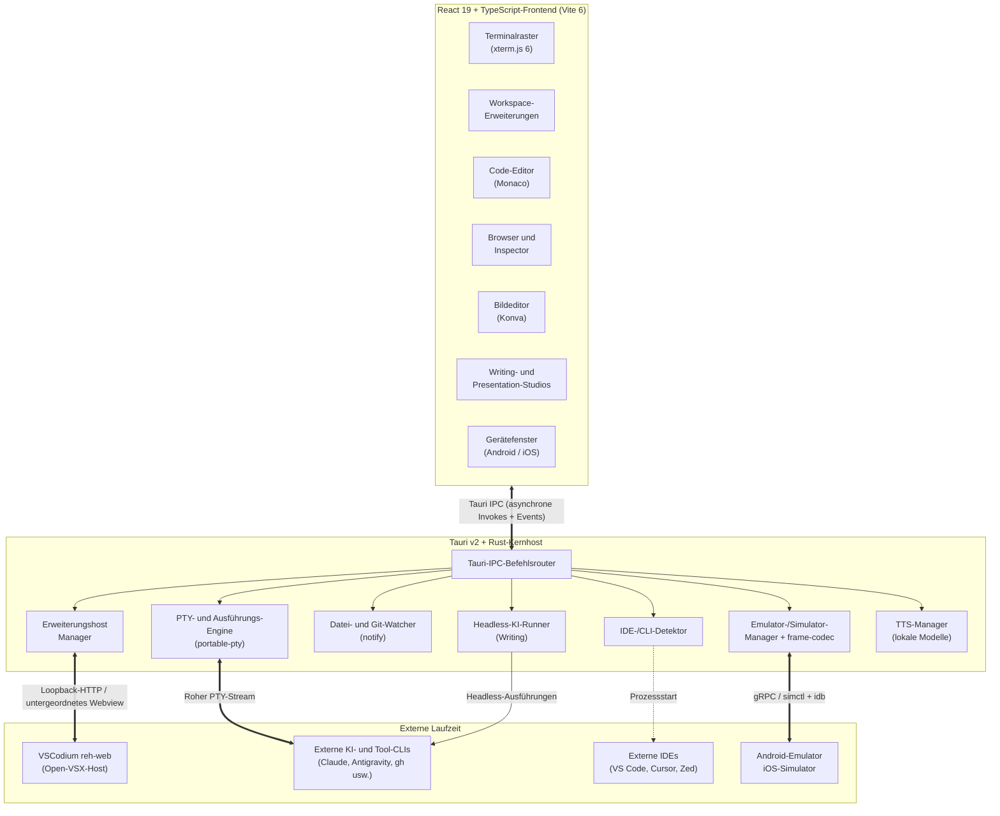

<div align="center">

<a href="https://github.com/wolfenazz/YzPzCode/releases/latest">
  
</a>
<br />
<p align="center">
  <a href="https://github.com/wolfenazz/YzPzCode/releases/latest">
    
  </a>
  <a href="https://github.com/wolfenazz/YzPzCode/blob/main/LICENSE">
    
  </a>
  <a href="docs/userguid.md">
    
  </a>
  <a href="https://github.com/wolfenazz/YzPzCode/issues">
    
  </a>
  
</p>

<p align="center">
  <a href="README.md">English</a> &nbsp;|&nbsp;
  <a href="ARREADME.MD">العربية</a> &nbsp;|&nbsp;
  <b>Deutsch</b> &nbsp;|&nbsp;
  <a href="ESREADME.MD">Español</a> &nbsp;|&nbsp;
  <a href="FRREADME.MD">Français</a> &nbsp;|&nbsp;
  <a href="PTREADME.MD">Português (BR)</a> &nbsp;|&nbsp;
  <a href="TRREADME.MD">Türkçe</a>
</p>

<p align="center">
  <a href="#-warum-yzpzcode">Warum</a> •
  <a href="#-alles-in-einem-fenster">Überblick</a> •
  <a href="#unterstützte-ai-coding-clis">Agenten</a> •
  <a href="#grafische-workspace-erweiterungen">Erweiterungen</a> •
  <a href="#writing--präsentations--und-tabellen-studios">Studios</a> •
  <a href="#fenster-für-mobile-geräte">Geräte</a> •
  <a href="#lokale-sprachausgabe">Sprachausgabe</a> •
  <a href="#system-zum-ausführen-und-bauen-von-anwendungen">Ausführen &amp; Bauen</a> •
  <a href="#download-und-installation">Download</a> •
  <a href="#beitragende">Beitragende</a>
</p>

</div>

> [!NOTE]
> **YzPzCode befindet sich in aktiver Entwicklung.** Funktionen können experimentell sein oder sich zwischen Releases ändern. Feedback, Fehlerberichte und Pull Requests sind herzlich willkommen.

---

## ⚡ Warum YzPzCode?

KI-gestützte Entwicklung wird meist zu einem Wechselspiel zwischen Terminal-Tabs, Agenten, Browsern, IDEs und einzelnen CLIs. **YzPzCode ersetzt dieses Jonglieren mit Fenstern durch eine native Kommandozentrale.**

| Herkömmlicher Workflow | mit YzPzCode |
| :--- | :--- |
| 🪟 8+ voneinander getrennte Terminalfenster | 🖥️ **Ein nativer Workspace** mit eigenen Layouts |
| 🔄 Ständiger Kontextwechsel per `Alt+Tab` | 🎛️ **Nebeneinander angeordnetes Terminalraster** mit echten PTY-Sitzungen |
| 🔌 In externen IDEs eingeschlossene Assistenten- panels | 🧩 **Grafische Erweiterungen**, eingebettet in das Raster |
| ⚙️ Manuelle Build-Skripte und Ausführungsbefehle | ⚡ **Ausführen & Bauen** mit automatisch erkannten 15+ Ökosystemen |
| 🧩 Externer Editor und Dateibetrachter | 📝 **Eingebetteter Editor** mit virtualisiertem Dateibaum und Git |
| 🌐 Separater Browser für UI-Prüfungen | 🔍 **Integrierter Browser** mit visuellem Inspector, der Prompts an Agenten übergibt |
| 📱 Separates Emulatorfenster | 📲 **Fenster für Android- und iOS-Geräte** mit Flutter hot reload |
| 📄 Word, PowerPoint und ein separater KI-Chat | ✍️ **Writing- und Presentation-Studios** mit denselben KI-CLIs |
| 🔑 Wiederholte CLI-Installations- und Authentifizierungsprüfungen | 🔐 **Erkennung, Installation per Klick und Authentifizierungsstatus** |
| 🎨 Photoshop oder Figma für schnelle Bearbeitungen | 🖌️ **Ebenenbasierter Bildeditor** mit Mischmodi |

---

## 🧭 Alles in einem Fenster

<div align="center">
  
</div>

<br />

<table>
  <tr>
    <td align="center" width="16%"><h3>26</h3><sub>AI-Coding-CLIs</sub></td>
    <td align="center" width="16%"><h3>10</h3><sub>SaaS- und Tool-CLIs</sub></td>
    <td align="center" width="16%"><h3>14</h3><sub>grafische Erweiterungen</sub></td>
    <td align="center" width="16%"><h3>15+</h3><sub>Ökosysteme zum Ausführen und Bauen</sub></td>
    <td align="center" width="16%"><h3>30</h3><sub>Berichtsarten</sub></td>
    <td align="center" width="16%"><h3>3</h3><sub>lokale Stimmen</sub></td>
  </tr>
</table>

---

## 📸 In Aktion ansehen

<div align="center">
  <a href="docs/capture/yzpzcode-showreel.mp4">
    
  </a>
  <br />
  <sub>▶ <a href="docs/capture/yzpzcode-showreel.mp4"><b>Das vollständige 45-Sekunden-Showreel mit Ton ansehen</b></a></sub>
  <br /><br />
  <table>
    <tr>
      <td width="50%" align="center">
        
        <br /><sub><b>Terminalraster und Workspace-Explorer</b></sub>
      </td>
      <td width="50%" align="center">
        
        <br /><sub><b>Kollaboratives Multi-Agenten-Layout</b></sub>
      </td>
    </tr>
    <tr>
      <td width="50%" align="center">
        
        <br /><sub><b>Integrierter Webview-Browser mit mehreren Tabs</b></sub>
      </td>
      <td width="50%" align="center">
        
        <br /><sub><b>Tiefer visueller Element- und Style-Inspector</b></sub>
      </td>
    </tr>
  </table>
</div>

---

##  Unterstützte AI-Coding-CLIs

YzPzCode erkennt, startet und verwaltet PTY-Sitzungen für 26 externe KI-Coding-Agenten. Die wichtigsten Integrationen:

```
                     ┌─── Claude (Anthropic)
                     ├─── Antigravity (Google)
                     ├─── Codex (OpenAI)
                     ├─── OpenCode
  YzPzCode Host ─────┼─── Cursor
                     ├─── Kilo
                     ├─── Hermes
                     ├─── Pi (earendil-works)
                     └─── Command Code
```

| Agent | CLI-Befehl | Hauptaufgabe und Stärken |
| :--- | :---: | :--- |
| **Claude Code** | `claude` | Tiefgehendes Reasoning, autonomes Refactoring, großer Kontext |
| **Antigravity CLI** | `agy` | Autonome Aufgabenausführung, agentische Workflows, Google AI |
| **Codex CLI** | `codex` | Präzise Codegenerierung und Erstellung von Unit-Tests |
| **OpenCode** | `opencode` | Open-Source-Agent für anpassbare lokale Workflows |
| **Cursor CLI** | `cursor` | Agentische Dateibearbeitung und Codebase-Indexierung |
| **Kilo** | `kilo` | Schnelle, terminalnative Agenten-Workflows |
| **Hermes** | `hermes` | Kompakter autonomer Terminalassistent |
| **Pi** | `pi` | Minimalistisches Coding-Agent-Harness mit Erweiterungshooks |
| **Command Code** | `cmd` / `cmdc` | Interaktive Orchestrierung von Befehlen und Skripten |

<details>
<summary><b>Die 17 zusätzlichen Integrationen anzeigen</b></summary>

<br />

| Agent | CLI-Befehl | Agent | CLI-Befehl |
| :--- | :---: | :--- | :---: |
| **Cline CLI** | `cline` | **Grok CLI** | `grok` |
| **Devin for Terminal** | `devin` | **Trae CLI** | `traecli` |
| **Kimi Code CLI** | `kimi` | **Qoder CLI** | `qoder` |
| **GitHub Copilot CLI** | `copilot` | **Kiro CLI** | `kiro-cli` |
| **Mistral Vibe** | `vibe` | **DeepSeek TUI** | `deepseek` |
| **Aider** | `aider` | **Amp** | `amp` |
| **DeepSeek Reasonix** | `reasonix` | **CodeBuddy Code** | `codebuddy` |
| **DeepSeek Harness** | `dsh` | **AtomCode CLI** | `atomcode` |
| **MiMo Code** | `mimo` | | |

</details>

Siehe [die Referenz zu CLI-Integrationen](docs/cli-integrations.md) für Installationsanweisungen der Anbieter, Dokumentation und plattformspezifische Hinweise.

> [!IMPORTANT]
> YzPzCode integriert Drittanbieter-CLIs über PTY-Bridges und ist **nicht mit den jeweiligen Anbietern verbunden und wird von ihnen nicht unterstützt**, sofern nicht ausdrücklich angegeben.

---

##  SaaS- und Developer-Tool-CLIs

Installationsstatus, Pfade zu ausführbaren Dateien und Authentifizierungsstatus beliebter Cloud- und Developer-CLIs werden automatisch erfasst:

<div align="center">

| Dienst | Befehl | Dienst | Befehl |
| :--- | :---: | :--- | :---: |
| **GitHub CLI** | `gh` | **PostHog** | `posthog-cli` |
| **Supabase** | `supabase` | **ElevenLabs** | `elevenlabs` |
| **Stripe** | `stripe` | **Google Workspace** | `gws` |
| **Vercel** | `vercel` | **AgentMail** | `agentmail-cli` |
| **Valyu** | `valyu-cli` | **Ramp** | `ramp` |

</div>

Siehe den [Referenzleitfaden zu Tool-CLIs](docs/ToolCLIs.md) für Workflows, häufige Befehle und Authentifizierungsdetails.

---

##  Grafische Workspace-Erweiterungen

Führe grafische Coding-Assistenten direkt neben deinen Shells und Agenten im Workspace-Raster aus. Drücke **`Ctrl+Shift+X`** oder klicke auf das Erweiterungssymbol in der Kopfzeile, um den Katalog zu öffnen.

| Erweiterung | Herausgeber | Beschreibung |
| :--- | :--- | :--- |
| **Google Antigravity** | Google | Googles offizieller agentischer Assistent mit Chat, Plänen und Codeänderungen. |
| **Kilo Code** | Kilo | mit dem visuellen Erweiterungspanel von Kilo programmieren, planen und debuggen. |
| **Cline** | Cline | Autonomer Coding-Assistent mit Plan-/Act-Modi und Freigabestufen für Tools. |
| **OpenAI Codex** | OpenAI | OpenAIs Coding-Erweiterung mit ChatGPT-Anmeldung und Codeunterstützung. |
| **Claude Code** | Anthropic | Visueller Coding-Assistent und Gesprächspanel von Anthropic. |
| **Continue** | Continue | Open-Source-Agent und Code-Chat mit Cloud- oder lokalen Modell-Backends. |
| **Amazon Q Developer** | AWS | Code-Chat und Inline-Feature-Entwicklung mit Amazon Q. |
| **Tabby** | TabbyML | Selbst gehosteter Coding-Assistent, verbunden mit einem privaten Tabby-Server. |
| **Windsurf Plugin** | Windsurf | Codeium-Assistent mit KI-Code-Chat und Codebase-Index. |
| **Mistral Vibe** | Mistral AI | Visueller Coding-Agent von Mistral mit Kontext, Gesprächen und Tools. |
| **Roo Code** | Roo Code | Agent aus der Cline-Familie mit benutzerdefinierten Modi, Multi-Modell-Unterstützung und Freigaben pro Schritt. |
| **Qoder CN** | Alibaba Cloud | Agentischer Coding-Assistent von Alibaba Cloud mit Chat- und Agentenmodi; Anmeldung erforderlich. |
| **Augment** | Augment Code | Coding-Agent mit einer für große Codebasen entwickelten Kontext-Engine; Anmeldung erforderlich. |
| **Nexrall Code** | Nexrall | Autonomer Coding-Agent mit Freigaben pro Schritt, Checkpoints und MCP-Tools; ein Konto ist erforderlich. |

- 🎛️ **Nebeneinander angeordnete Rasterlayouts**: Panels werden innerhalb des Terminalrasters mit Drag-and-drop-Neuordnung, interaktiver Größenänderung, Fokusvoreinstellungen und geteilten Layouts eingebunden.
- 📌 **Editor-Seitenleiste**: Ein Panel rechts am Editor andocken (`Ctrl+Alt+B`) und zwischen Raster und Dock verschieben, ohne es neu zu starten.
- 📨 **Prompt-Übergabe**: Eine Browser-Inspector-Auswahl oder UI-Referenz direkt an ein Assistentenpanel senden; der Prompt wird eingefügt und übermittelt, das Ergebnis erscheint in der Panel-Kopfzeile.
- 🌈 **Aktivitätsleuchten**: Panels erhalten denselben Arbeitsring und Abschlusseffekt wie Agententerminals.
- 📦 **Verwaltete Laufzeit ohne Konfiguration**: Eine verifizierte VSCodium-`reh-web`-Laufzeit wird mit festgelegten SHA-256-Digests und Open-VSX-Paketen bereitgestellt. Keine VS-Code- oder Node-Installation erforderlich.
- 🛡️ **Abgesicherte Sandbox**: Jeder Assistent läuft in einem isolierten untergeordneten Webview auf einer eigenen `panel-<uuid>.localhost:<port>`-Origin mit dauerhaftem Speicher und kann keine Tauri-Host-Befehle aufrufen.
- 🔒 **Workspace-Vertrauen und Persistenz**: Vertrauensfreigaben (`workspace-trust.json`) und der IndexedDB-Workbench-Status (`workbench-state.json`) werden pro Workspace gespeichert.

Siehe die [Dokumentation zu grafischen Workspace-Erweiterungen](docs/extensions.md) für Architektur, Laufzeitspezifikationen und Validierungsdetails.

---

##  Writing-, Präsentations- und Tabellen-Studios

<div align="center">
  
</div>

<br />

Neben dem Coding öffnet der Modus-Schalter der Setup-Seite drei Dokumentstudios. Sie benötigen weder Terminals noch IDEs, führen die KI über bereits installierte CLIs (Claude Code, Codex, Grok, Antigravity, OpenCode) in einem headless Runner aus und speichern alles in einem Ordner, `Documents/YzPzCode`, damit Berichte, Decks und Arbeitsmappen auch nach einer Neuinstallation wieder gefunden werden.

<table>
<tr>
<td width="50%" valign="top">

###  Writing Studio

- **30 Berichtsarten**: Eine Art auswählen und eine Frage in einem einzeiligen Composer beantworten; Dateien anhängen, Material einfügen, Referenzen hinzufügen
- **Seitenweiser Streaming-Editor**: Gliederung mit Live-Abschnittsstatus, Tabellen, Abbildungen, Zitaten und Fußnoten, wobei die Leseposition gehalten wird, während Abschnitte gestreamt werden
- **Assistent**: Verbleibende Abschnitte schreiben, Auswahl oder Abschnitt umformulieren, das gesamte Dokument humanisieren oder neu schreiben, mit einer Review-Karte für jede Änderung
- **Humanizer und Linter**: Natürlichkeitswert mit Prüfungen für Standardformulierungen, Einstiege, Rhythmus und Gedankenstriche, optional mit Hervorhebung
- **Designpanel**: sechs Vorlagen, Schriftarten, Farben mit Seiten- und Struktursteuerung und **mit KI neu gestalten** mit Rückgängigmachen per Klick
- **Echte Webfotos**: Offen lizenzierte Bilder von Openverse, Unsplash oder Pexels mit Quellenangabe, niemals KI-Bilder
- **Export**: PDF, Word `.docx`, eigenständiges HTML; vorhandene `.docx` importieren

</td>
<td width="50%" valign="top">

###  Presentation Studio

- **KI-entworfene Decks**: Deck beschreiben; die KI erfindet ein Designsystem, schreibt eine Storyline mit Briefings pro Seite und zeichnet anschließend jede Folie als SVG
- **Echter Folieneditor**: Auswählen, Auswahlrahmen, mit Hilfslinien ziehen, Größe ändern, direkt tippen, Formen, Bilder, Tabellen, Gruppen, Formatleiste
- **mit KI bearbeiten**: Eine Folie, mehrere Folien oder das gesamte Deck ändern; jede Änderung ist ein Vorschlag mit Behalten oder Verwerfen, Stapel werden nebeneinander geprüft
- **Animation**: Eingangs-, Hervorhebungs- und Ausgangseffekte, Klickreihenfolge, Absatzaufbau und KI-entworfene Bewegung
- **Bilder**: Dateien oder Ordner ablegen, Pfade im Prompt nennen oder echte Webfotos hinzufügen
- **PowerPoint-Roundtrip**: `.pptx` importieren, wie PowerPoint es zeichnet; editierbares PowerPoint, PowerPoint mit „exakter Darstellung“, PDF, PNG und HTML exportieren
- **Präsentationsmodus**: Vollbildshow, Referentenansicht mit Notizen, Timer und Tempo, Übergänge und Sprachausgabe

</td>
</tr>
</table>

###  Arabisch und von rechts nach links, erstklassig unterstützt

Arabisch, Hebräisch, Persisch und Urdu funktionieren in beiden Studios: Die Absatzrichtung folgt dem Text, gedruckte Bezeichnungen (Kapitel, Tabelle, Abbildung, Inhaltsverzeichnis …) folgen der Dokumentsprache, Word- und PowerPoint-Exporte schreiben echte bidirektionale Absätze und ein Katalog mit etwa 150 Schriftarten (Latein und Arabisch, mit gebündelten `@fontsource`-Schriften) versorgt jede Schriftauswahl.

---

##  Fenster für mobile Geräte

<div align="center">
  
</div>

<br />

Ein Gerätefenster gleitet am rechten Rand jeder Workspace-Ansicht (Terminal, Erweiterungen, Editor, Browser) herein und schiebt die Ansicht zur Seite, statt darüber zu schweben, sodass native Webviews nie verdeckt werden.

- 🤖 **Eingebetteter Android-Emulator**: AVDs in der App erstellen und starten; der Bildschirm wird in das Fenster gestreamt (gRPC-Frames über das gemeinsame `frame-codec`-Crate) mit Touch, Multi-Touch, Tastatur, Scrollen, Drehung, Skins und Screenshots.
- 🍎 **iOS-Simulator (macOS)**: Erkennung und Lebenszyklus über `simctl`, Bildschirm und Eingaben über `idb_companion`. Außerhalb von macOS wird er als nicht verfügbar gemeldet.
- 🐦 **Flutter-Ausführungsleiste**: Die Workspace-App auf dem ausgewählten Gerät mit hot reload ausführen (auch beim Speichern von `.dart`), hot restart und Live-Log.
- 🛠️ **Geführte Einrichtung**: **Settings → Environment** prüft die Toolchain von Flutter, Android (und Xcode unter macOS) und bietet Ein-Klick-Korrekturen für fehlende SDK-Bestandteile und Hardwarebeschleunigung.

---

##  Lokale Sprachausgabe

<div align="center">
  
</div>

<br />

Berichte und Folien können vorgelesen werden, ohne Text an einen Cloud-Dienst zu senden. Die Sprachausgabe läuft in einer verwalteten lokalen Python-Umgebung und lädt Modelle bei Bedarf herunter (**Settings → Narration**).

| Modell | Sprachen | Größe | Hinweise |
| :--- | :---: | :---: | :--- |
| **SILMA TTS v1** (Standard) | Arabisch + Englisch | ~2.5 GB | Ausgewogene zweisprachige Stimme, Tashkeel-aware |
| **Lahgtna-Chatterbox** | Arabisch | ~1.5 GB | Ägyptische, saudische, marokkanische und irakische Dialekte |
| **Kokoro-82M** | Englisch | ~350 MB | Sehr schnell, geeignet für lange Berichte |

Die Sprache wird aus dem Text erkannt, die Geschwindigkeit beträgt 0.75× / 1× / 1.25× und synthetisiertes Audio wird auf dem Datenträger zwischengespeichert (LRU, Begrenzung 500 MB). Im Writing Studio können Auswahl oder Abschnitt vorgelesen werden, ebenso Folien im Presentation Studio und im Präsentationsmodus.

---

##  System zum Ausführen und Bauen von Anwendungen

Anwendungen ohne Konfiguration starten, bauen und debuggen. Projektmanifeste und ausführbare Einstiegspunkte werden in 15+ Ökosystemen direkt in den Terminal-Kopfzeilen erkannt.

<div align="center">

| Ökosystem | Erkennung und Ausführung |
| :--- | :--- |
| **Python** | Erkennt `.py`-Skripte, `main.py`, `app.py`, Djangos `manage.py` sowie Flask- und FastAPI-Server. Bevorzugt lokales `.venv`, `venv` oder System-Python. |
| **JavaScript / TypeScript** | Findet Dev-, Start- und Build-Skripte in `package.json`. Ruft anhand der Lockdatei `npm`, `pnpm`, `Yarn` oder `Bun` auf. |
| **Rust / Go / Flutter** | Cargo (`cargo run`), Go-Module (`go run .`) und Flutter-Projektmanifeste (`flutter run`). |
| **C / C++** | Findet Quellen mit `main()`, kompiliert über GCC oder Clang nach `.yzpz-run/` und führt die Binärdatei aus. |
| **CMake** | Liest die CMake File API, um Debug-Ziele in `.yzpz-build/` zu finden, und baut vor dem Start. |
| **C# (.NET)** | Findet und startet ausführbare `.csproj`-Dateien in Projekten und Lösungen mit dem .NET SDK. |
| **Java** | Ausführung von Einzeldateiquellen über JDK 11+ und Startkonfigurationen von Projekten. |
| **Ruby, PHP, Dart, Swift, Lua, Perl, R** | Führt Einstiegspunkte mit installierten Interpretern aus; Manifestbefehle für Rails und Laravel. |

</div>

- ▶️ **Ausführen und Bauen per Klick** über die Terminal-Kopfzeile mit sofortigem Wechsel des Ziels.
- 💬 **Interaktive stdin-Konsole**: Eingaben an laufende Programme senden (`input()`, `scanf()`, `Console.ReadLine()`) über die Terminal-Eingabeleiste.
- 🌐 **Automatische Erkennung von Dev-Servern**: Localhost-URLs in der Terminalausgabe werden zu einer Vorschau per Klick in der Browserleiste.
- ⚙️ **Benutzerdefinierte Ausführungskonfigurationen**: Befehle, Umgebungsvariablen, Argumente und Arbeitsverzeichnisse unter **Settings → Application runs**, global oder pro Workspace.

Siehe den [Leitfaden zu Anwendungsausführungen](docs/application-runs.md) für Konfigurationsschemas, den Wechsel zwischen mehreren Zielen und Compilerdetails.

---

##  Kernfunktionen

<details open>
<summary><b> Multi-Agenten-Terminalraster</b></summary>

<br />

- **Echtes PTY-Backend**: xterm.js-6-Frontend, betrieben durch Rusts `portable-pty`
- **Verwaltete Befehle**: nicht interaktive und Hintergrundaufgaben mit PID, Exit-Code und Live-Output-Streaming
- **Terminal-Mausmodi**: vollständige xterm-Mausberichterstattung (Klick, Ziehen, beliebiges Ereignis, Application Tracking) für TUIs
- **Hardwarebeschleunigtes Rendering**: Canvas-/WebGL-Pipeline mit Dirty-Rectangle-Aktualisierungen für geringe Latenz
- **Workspace-Sichtbarkeit**: Sitzungen sind pro Projekt-Workspace isoliert
- **Startdialog**: durchsuchbar, gruppiert nach Shells, primären Agenten, zusätzlichen Agenten und SaaS-Tool-CLIs, mit Live-Status-Badges
- **Agentenaktivitätsanzeige**: idle → working → done pro Bereich, mit Arbeitsring, Abschlusseffekt und optionalem Abschlussklang
- **Dynamische Layouts**: Layouts passen sich der Anzahl der Bereiche an, mit Drag-and-drop-Neuordnung und Layoutauswahl
- **Editor-Terminalpanel**: VS-Code-artiges Terminal unter dem Editor (<kbd>Ctrl</kbd>+<kbd>`</kbd> schaltet um, <kbd>Ctrl</kbd>+<kbd>Shift</kbd>+<kbd>`</kbd> öffnet eine neue Shell) mit Shell-Auswahl und Scrollback pro Workspace
- **Kachelung externer Terminals**: native Konsolen (Windows Terminal, macOS Terminal, Linux) mit automatischer Kachelung

</details>

<details>
<summary><b> Editor, Vorschauen und Quellcodeverwaltung</b></summary>

<br />

- **Workspace mit mehreren Tabs**: geteilte Ansichten und Tab-Verwaltung (andere / rechte / gespeicherte schließen)
- **Syntaxhervorhebung und Minimap**: Monaco- und CodeMirror-Engines
- **Umfangreiche Vorschauen**: Markdown, PDF, CSV, Excel (`.xlsx`), Word (`.docx`) und Draw.io-Diagramme
- **Medien- und Binärvorschauen**: Audio (Wellenform, Transport, Geschwindigkeit, Schleife) und per HTTP-Range-Unterstützung gestreamtes Video sowie eine Hexansicht für andere Binärdateien
- **Transaktionale Dateisynchronisierung**: Ein rekursiver Watcher (`notify`) mit entprellter Synchronisierung hält offene Tabs mit externen IDEs und Agenten synchron
- **Integriertes Git**: Branch-Wechsel, Diff-Statistiken, Dateien oder Hunks stagen/unstagen, verwerfen, committen und mit Remotes synchronisieren
- **OS-Zwischenablage im Explorer**: Dateien (und Zwischenablagebilder) zwischen Explorer und Betriebssystem kopieren, ausschneiden und einfügen, mit Ergebnissen pro Element und Rückgängigmachen
- **Im Terminal öffnen**: jeden Ordner in einem neuen integrierten Bereich oder einem externen Terminal öffnen

</details>

<details>
<summary><b> In-App-Browser und visueller Inspector</b></summary>

<br />

- **Schnelle Prompt-Karte**: Element auswählen und eine kleine Karte erscheint daneben: Agent oder Erweiterungspanel auswählen, eine Zeile eingeben, senden. **Weitere Steuerungen** öffnet den vollständigen Inspector mit übernommener Eingabe
- **Tiefer Element-Inspector**: berechnetes CSS, Pseudoelemente, Box-Modell und DOM-Hierarchie
- **Style-Picker und -Generator**: Styles erfassen, atomare CSS-Klassen erzeugen und mit vollständigem Rückgängig-Stapel anwenden
- **UI-Element-Erfassung**: Struktur, Layout, Typografie, Pseudoelemente, Assets und Designabsicht als wiederverwendbare UI-Referenzen
- **Tabs, Startseite und Gerätesimulation**: Tabs pro Workspace, eine Startseite mit Live-Dev-Servern, Gerätevoreinstellungen und benutzerdefinierten Viewports
- **Dev-Server-Integration**: Vorschau per Klick, sobald ein Dev-Server eine lokale URL ausgibt

</details>

<details>
<summary><b> KI-Designer und ebenenbasierter Bildeditor</b></summary>

<br />

- **Prompt-zu-UI-Generator**: responsive HTML/CSS/JS-Oberflächen aus natürlicher Sprache
- **Ebenenbasierte Canvas**: Raster-, Vektor-, Text- und Formebenen, betrieben durch Konva
- **16 Mischmodi**, Deckkraft, Drehung, Maskierung, Auswahlrahmen- und Lasso-Auswahl, Verlauf
- **Export**: PNG, JPG, WebP, SVG, GIF, BMP, AVIF, TIFF

</details>

<details>
<summary><b> Anpassung</b></summary>

<br />

- 🌗 **Dunkel-/Hellmodus** mit dynamischem Theme im gesamten UI
- 🎨 **8 Akzentfarben**: Standard, Blau, Violett, Grün, Orange, Rot, Pink, Cyan
- 🧪 **Benutzerdefinierte Theme-Engine**: Theme aus 9 Farben, einer hellen/dunklen Basis und einem Radius erstellen, mit WCAG-Kontrastprüfungen, 40+ Voreinstellungen und JSON-Import/-Export (**Settings → Appearance → Custom themes**)
- 🌌 **Animierte Hintergründe**: Aurora, Galaxie und Lichtstrahlen für Setup-Bildschirm und Workspaces, mit Steuerungen für Intensität, Geschwindigkeit, Unschärfe und Deckkraft
- 💎 **Modernes App-Chrome**: Tabs für die Ansichtsumschaltung, Statusanzeigen und Echtzeit-Prozessüberwachung in der Fußzeile
- 📐 **3 Dichtevoreinstellungen**: Kompakt, Komfortabel, Geräumig
- ⌨️ **Terminalgestaltung**: Schriftarten, Ligaturen, Cursorstile, Mausverfolgung und Deckkraft
- ♿ **Barrierefreiheit**: Schalter zum Deaktivieren von Animationen (reduzierte Bewegung), Schalter für benutzerdefinierten Cursor

</details>

---

##  Architektur



<details>
<summary><b>Technologiematrix</b></summary>

<br />

| Ebene | Technologien |
| :--- | :--- |
| **Desktop-Shell** | [Tauri v2](https://v2.tauri.app/), [Rust](https://www.rust-lang.org/) (2021 Edition) |
| **Nebenläufigkeit und PTY** | `tokio`, `portable-pty`, `notify`, `which` |
| **Erweiterungshost** | VSCodium `reh-web` (Open VSX), sandboxed untergeordnete Webviews (`panel-*.localhost`) |
| **Frontend** | [React 19](https://react.dev/), [TypeScript 5.6](https://www.typescriptlang.org/), [Vite 6](https://vitejs.dev/) |
| **Styling und Bewegung** | [Tailwind CSS v4](https://tailwindcss.com/), [Framer Motion](https://www.framer.com/motion/) |
| **Terminal und Editor** | [@xterm/xterm 6](https://xtermjs.org/), [Monaco Editor](https://microsoft.github.io/monaco-editor/), CodeMirror 6 |
| **Canvas und Medien** | [Konva](https://konvajs.org/), `pdfjs`, `xlsx`, `mammoth` |
| **Dokumente** | [TipTap](https://tiptap.dev/) (seitenweiser Writing-Editor), `docx`, `pptxgenjs` + JSZip, SVG-Folienpipeline |
| **Mobile Geräte** | Android-Emulator-gRPC-Streaming, `simctl` + `idb_companion` (iOS), Flutter CLI, `frame-codec`-Crate |
| **Sprache** | Verwaltete lokale Python-Umgebung mit SILMA-TTS-, Lahgtna-Chatterbox- und Kokoro-Modellen |
| **Status** | [Zustand 5](https://github.com/pmndrs/zustand) mit persistentem Speicher |

</details>

<details>
<summary><b>Projektstruktur</b></summary>

<br />

```text
yzpzcode/
├── .github/workflows/          # CI/CD-Release-Workflows (plattformübergreifende Builds)
├── docs/                       # Leitfäden, Screenshots und README-Grafiken (docs/readme)
└── app/
    ├── src-tauri/              # Rust-Backend
    │   ├── crates/
    │   │   └── frame-codec/    # Gemeinsamer Codec für Bildschirm-Frames beim Gerätestreaming
    │   └── src/
    │       ├── agent/          # Orchestrierung autonomer Agentenaufgaben und Retry-Logik
    │       ├── agent_cli/      # Erkennung, Installation und Authentifizierung von KI- und Tool-CLIs
    │       ├── android/        # Android SDK, eingebetteter Emulator, Flutter-Ausführung und Einrichtung
    │       ├── ios/            # iOS-Simulator (simctl) und idb_companion-Streaming
    │       ├── writing/        # Headless-KI-Runner für die Studios, PDF-Druck
    │       ├── tts/            # Lokale Sprachausgabe: verwaltete Umgebung, Modellkatalog, Bridge, Cache
    │       ├── browser/        # Webview-Verwaltung und Bridge für den visuellen Inspector
    │       ├── commands/       # Tauri-IPC-Befehle (~100+ Endpunkte)
    │       ├── extension_host/ # Eingebetteter VSCodium-Web-Runtime-Manager, Open-VSX- und VSIX-Sandboxing
    │       ├── terminal/       # PTY-Sitzungen, Ausführungs-Engine und verwaltete Befehle
    │       ├── filesystem/     # Rekursiver Watcher, transaktionale Dateisynchronisierung, Git-Operationen und Diffs
    │       ├── ide/            # Launcher für externe IDEs (VS Code, Cursor, Zed usw.)
    │       └── discord_presence/ # Discord-Rich-Presence-Integration
    │
    └── src/                    # React-19-Frontend
        ├── components/
        │   ├── workspace/      # Terminalraster, Erweiterungspanels, Editor-Terminal, Dock, Browser, Gerätefenster
        │   ├── writing/        # Writing Studio (Composer, seitenweiser Editor, Assistent, Design, Referenzen)
        │   ├── presentation/   # Presentation Studio (KI-entworfene Decks, Folieneditor, Präsentationsmodus)
        │   ├── studio/         # Gemeinsames Studio-Chrome (Topbar, Inspector-Teile, Schriftoptionen)
        │   ├── tts/            # Sprachausgabesteuerung und Modellauswahl
        │   ├── editor/         # Editor-Tabs und umfangreiche Dateivorschauen
        │   ├── explorer/       # Virtualisierter Dateibaum und Git-Panels
        │   ├── designer/       # Studio für KI-gestützte Designgenerierung
        │   ├── image/          # Ebenenbasierter Canvas-Bildeditor
        │   ├── settings/       # Einstellungsbereich
        │   └── setup/          # Interaktiver Onboarding-Assistent
        ├── hooks/              # Eigene React-Hooks (useTerminal, useBrowser, useFileWatcher, ...)
        ├── stores/             # Zustand-Stores (appStore, runConfigStore, extensionStore, deviceStore, ...)
        ├── utils/              # Reine, abhängigkeitenfreie Module (writing/, presentation/, tts/, ...) mit node --test-Suites
        └── types/              # TypeScript-Spiegelungen der Rust-Strukturen
```

</details>

---

##  Download und Installation

### Option 1: Vorab erstellte Binärdateien (empfohlen)

Den neuesten Installer von der **[Releases-Seite](https://github.com/wolfenazz/YzPzCode/releases/latest)** herunterladen:

| Plattform | Paketformat | Architektur |
| :--- | :--- | :--- |
| **🪟 Windows** | `.msi` / `.exe`-Installer | x86_64 |
| **🍎 macOS** | `.dmg`-Installer | Apple Silicon (`aarch64`) und Intel (`x86_64`) |
| **🐧 Linux** | `.deb` / `.AppImage` | x86_64 |

> [!TIP]
> **macOS**: Bei einem unsignierten Build mit **Rechtsklick → Öffnen** öffnen oder unter *System Settings → Privacy & Security → Open Anyway* zulassen.

### Option 2: Aus dem Quellcode bauen

**Voraussetzungen:** Node.js `22.x` oder höher, die aktuelle stabile Rust-Toolchain (`rustup update stable`) und C++-Buildtools (Visual Studio Build Tools unter Windows, Xcode CLI Tools unter macOS, `build-essential` unter Linux).

```bash
git clone https://github.com/wolfenazz/YzPzCode.git
cd YzPzCode/app

npm install            # Frontend-Abhängigkeiten
npm run tauri dev      # Entwicklungsmodus (Port 8745)
npm run tauri build    # Produktions-Installer
```

Die kompilierten Binärdateien werden unter `app/src-tauri/target/release/bundle/` abgelegt.

---

##  Sicherheit und Datenschutz

YzPzCode ist **local-first** aufgebaut:

- 🛡️ **Der Code bleibt lokal**: Projektdateien und Quellcode werden von YzPzCode selbst nie auf Server von Drittanbietern hochgeladen.
- 🔑 **Lokal gespeicherte Geheimnisse**: API-Schlüssel und Tokens verbleiben ausschließlich auf dem eigenen Rechner.
- 📡 **Direkte Verbindungen zu Anbietern**: Anfragen gehen direkt an die offiziellen Endpunkte der konfigurierten Anbieter.
- 🔊 **Sprachausgabe auf dem Gerät**: Text-to-Speech-Modelle laufen lokal; nichts wird an einen Sprachdienst gesendet.

---

##  Beiträge leisten

Beiträge machen Open Source großartig. Fehlerberichte, Verbesserungen und neue Funktionen sind gleichermaßen willkommen. Die [offenen Issues](https://github.com/wolfenazz/YzPzCode/issues) prüfen oder vor größeren architektonischen Änderungen zunächst eine Diskussion beginnen.

```bash
# Frontend-Typprüfung
cd app && npx tsc --noEmit

# Rust-Formatierung und Lints prüfen, dann Rust-Tests ausführen
cd src-tauri
cargo fmt --check
cargo clippy -- -D warnings
cargo test

# Reine Frontend-Modul-Suites (aus app/)
npm run test:writing
npm run test:presentation
npm run test:browser
npm run test:explorer
npm run test:custom-theme
npm run test:workspace-setup
npm run test:workspace-view
npm run test:device
```

---

##  Beitragende

<div align="center">
  <a href="https://github.com/wolfenazz/YzPzCode/graphs/contributors">
    
  </a>
  <br /><br />
  <sub>
    <a href="https://github.com/wolfenazz"><b>@wolfenazz</b></a> · Ersteller und leitender Architekt &nbsp;&nbsp;|&nbsp;&nbsp;
    <a href="https://github.com/Noor-Al-Khelaifi"><b>@Noor-Al-Khelaifi</b></a> · Hauptbeitragender und Entwickler
  </sub>
</div>

---

##  Lizenz

YzPzCode ist Open-Source-Software und unter der **[Apache License 2.0](LICENSE)** lizenziert.

<div align="center">
  <br />
  <b>Mit deinen KI-Agenten bauen, nicht um sie herum.</b>
  <br /><br />
  <a href="https://github.com/wolfenazz/YzPzCode/releases/latest">YzPzCode herunterladen</a> •
  <a href="docs/userguid.md">Dokumentation</a> •
  <a href="https://github.com/wolfenazz/YzPzCode/issues/new">Fehler melden</a> •
  <a href="https://github.com/wolfenazz/YzPzCode/issues/new">Funktion anfordern</a>
  <br /><br />
</div>
