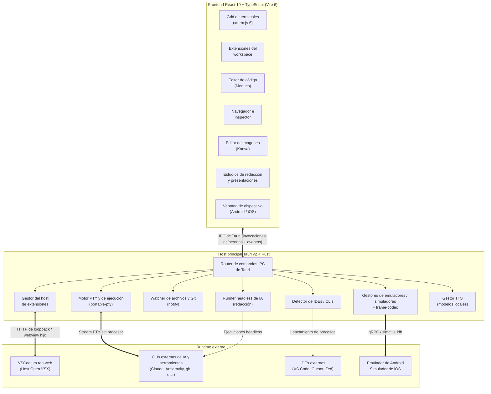

<div align="center">

<a href="https://github.com/wolfenazz/YzPzCode/releases/latest">
  
</a>
<br />
<p align="center">
  <a href="https://github.com/wolfenazz/YzPzCode/releases/latest">
    
  </a>
  <a href="https://github.com/wolfenazz/YzPzCode/blob/main/LICENSE">
    
  </a>
  <a href="docs/userguid.md">
    
  </a>
  <a href="https://github.com/wolfenazz/YzPzCode/issues">
    
  </a>
  
</p>

<p align="center">
  <a href="README.md">English</a> &nbsp;|&nbsp;
  <a href="ARREADME.MD">العربية</a> &nbsp;|&nbsp;
  <a href="DEREADME.MD">Deutsch</a> &nbsp;|&nbsp;
  <b>Español</b> &nbsp;|&nbsp;
  <a href="FRREADME.MD">Français</a> &nbsp;|&nbsp;
  <a href="PTREADME.MD">Português (BR)</a> &nbsp;|&nbsp;
  <a href="TRREADME.MD">Türkçe</a>
</p>

<p align="center">
  <a href="#-por-qué-yzpzcode">Por qué</a> •
  <a href="#-todo-en-una-ventana">Descripción general</a> •
  <a href="#clis-de-coding-con-ia-compatibles">Agentes</a> •
  <a href="#extensiones-gráficas-del-workspace">Extensiones</a> •
  <a href="#estudios-de-redacción-presentaciones-y-hojas-de-cálculo">Estudios</a> •
  <a href="#ventana-de-dispositivo-móvil">Dispositivos</a> •
  <a href="#narración-local">Narración</a> •
  <a href="#sistema-de-ejecución-y-build-de-aplicaciones">Run &amp; Build</a> •
  <a href="#descarga-e-instalación">Descarga</a> •
  <a href="#contribuidores">Contribuidores</a>
</p>

</div>

> [!NOTE]
> **YzPzCode está en desarrollo activo.** Las funciones pueden ser experimentales o evolucionar entre versiones. Se agradecen los comentarios, los informes de errores y las pull requests.

---

## ⚡ ¿Por qué YzPzCode?

El desarrollo asistido por IA suele convertirse en un ir y venir entre pestañas de terminal, agentes, navegadores, IDEs y CLIs puntuales. **YzPzCode reemplaza el cambio constante de ventanas por un único centro de comandos nativo.**

| Flujo de trabajo tradicional | Con YzPzCode |
| :--- | :--- |
| 🪟 8+ ventanas de terminal desconectadas | 🖥️ **Un único workspace nativo** con layouts personalizados |
| 🔄 Cambio constante de contexto con `Alt+Tab` | 🎛️ **Grid de terminales en paralelo** con sesiones PTY reales |
| 🔌 Paneles de asistentes encerrados en IDEs externos | 🧩 **Extensiones gráficas** integradas en el grid |
| ⚙️ Scripts de build y comandos de ejecución manuales | ⚡ **Run & build** con detección automática de 15+ ecosistemas |
| 🧩 Editor y visor de archivos externos | 📝 **Editor integrado** con árbol de archivos virtualizado y Git |
| 🌐 Un navegador separado para comprobar la UI | 🔍 **Navegador integrado** con inspector visual que envía prompts a los agentes |
| 📱 Una ventana de emulador separada | 📲 **Ventana de dispositivos Android e iOS** con hot reload de Flutter |
| 📄 Word, PowerPoint y un chat de IA separado | ✍️ **Estudios de redacción y presentaciones** sobre los mismos AI CLIs |
| 🔑 Comprobaciones repetitivas de instalación y autenticación de CLIs | 🔐 **Detección, instalación en un clic y seguimiento de autenticación** |
| 🎨 Photoshop o Figma para ediciones rápidas | 🖌️ **Editor de imágenes por capas** con modos de fusión |

---

## 🧭 Todo en una ventana

<div align="center">
  
</div>

<br />

<table>
  <tr>
    <td align="center" width="16%"><h3>26</h3><sub>AI coding CLIs</sub></td>
    <td align="center" width="16%"><h3>10</h3><sub>SaaS y tool CLIs</sub></td>
    <td align="center" width="16%"><h3>14</h3><sub>extensiones gráficas</sub></td>
    <td align="center" width="16%"><h3>15+</h3><sub>ecosistemas de run &amp; build</sub></td>
    <td align="center" width="16%"><h3>30</h3><sub>tipos de informes</sub></td>
    <td align="center" width="16%"><h3>3</h3><sub>voces locales</sub></td>
  </tr>
</table>

---

## 📸 Míralo en acción

<div align="center">
  <a href="docs/capture/yzpzcode-showreel.mp4">
    
  </a>
  <br />
  <sub>▶ <a href="docs/capture/yzpzcode-showreel.mp4"><b>Ver el showreel completo de 45 segundos con sonido</b></a></sub>
  <br /><br />
  <table>
    <tr>
      <td width="50%" align="center">
        
        <br /><sub><b>Grid de terminales y explorador del workspace</b></sub>
      </td>
      <td width="50%" align="center">
        
        <br /><sub><b>Layout colaborativo multiagente</b></sub>
      </td>
    </tr>
    <tr>
      <td width="50%" align="center">
        
        <br /><sub><b>Navegador webview integrado con varias pestañas</b></sub>
      </td>
      <td width="50%" align="center">
        
        <br /><sub><b>Inspector visual profundo de elementos y estilos</b></sub>
      </td>
    </tr>
  </table>
</div>

---

##  CLIs de coding con IA compatibles

YzPzCode detecta, inicia y gestiona sesiones PTY para 26 agentes externos de coding con IA. Integraciones principales:

```
                     ┌─── Claude (Anthropic)
                     ├─── Antigravity (Google)
                     ├─── Codex (OpenAI)
                     ├─── OpenCode
  YzPzCode Host ─────┼─── Cursor
                     ├─── Kilo
                     ├─── Hermes
                     ├─── Pi (earendil-works)
                     └─── Command Code
```

| Agente | Comando CLI | Función principal y fortalezas |
| :--- | :---: | :--- |
| **Claude Code** | `claude` | Razonamiento profundo, refactorización autónoma y contexto amplio |
| **Antigravity CLI** | `agy` | Ejecución autónoma de tareas, flujos agentic e IA de Google |
| **Codex CLI** | `codex` | Generación precisa de código y creación de pruebas unitarias |
| **OpenCode** | `opencode` | Agente open source para flujos de trabajo locales personalizables |
| **Cursor CLI** | `cursor` | Edición agentic de archivos e indexación del codebase |
| **Kilo** | `kilo` | Flujos de trabajo agentic rápidos y nativos de terminal |
| **Hermes** | `hermes` | Asistente de terminal autónomo y compacto |
| **Pi** | `pi` | Harness minimalista para agentes de coding con hooks de extensiones |
| **Command Code** | `cmd` / `cmdc` | Orquestación interactiva de comandos y scripts |

<details>
<summary><b>Mostrar las 17 integraciones adicionales</b></summary>

<br />

| Agente | Comando CLI | Agente | Comando CLI |
| :--- | :---: | :--- | :---: |
| **Cline CLI** | `cline` | **Grok CLI** | `grok` |
| **Devin for Terminal** | `devin` | **Trae CLI** | `traecli` |
| **Kimi Code CLI** | `kimi` | **Qoder CLI** | `qoder` |
| **GitHub Copilot CLI** | `copilot` | **Kiro CLI** | `kiro-cli` |
| **Mistral Vibe** | `vibe` | **DeepSeek TUI** | `deepseek` |
| **Aider** | `aider` | **Amp** | `amp` |
| **DeepSeek Reasonix** | `reasonix` | **CodeBuddy Code** | `codebuddy` |
| **DeepSeek Harness** | `dsh` | **AtomCode CLI** | `atomcode` |
| **MiMo Code** | `mimo` | | |

</details>

Consulta [la referencia de integración de CLIs](docs/cli-integrations.md) para consultar instrucciones de instalación de proveedores, documentación y notas sobre plataformas.

> [!IMPORTANT]
> YzPzCode se integra con CLIs de terceros mediante puentes PTY y **no está afiliado ni respaldado por sus respectivos proveedores**, salvo que se indique explícitamente.

---

##  CLIs de SaaS y herramientas para desarrolladores

Se realiza un seguimiento del estado de instalación, las rutas de los ejecutables y el estado de autenticación de las principales CLIs de cloud y para desarrolladores:

<div align="center">

| Servicio | Comando | Servicio | Comando |
| :--- | :---: | :--- | :---: |
| **GitHub CLI** | `gh` | **PostHog** | `posthog-cli` |
| **Supabase** | `supabase` | **ElevenLabs** | `elevenlabs` |
| **Stripe** | `stripe` | **Google Workspace** | `gws` |
| **Vercel** | `vercel` | **AgentMail** | `agentmail-cli` |
| **Valyu** | `valyu-cli` | **Ramp** | `ramp` |

</div>

Consulta [la guía de referencia de Tool CLIs](docs/ToolCLIs.md) para conocer flujos de trabajo, comandos habituales y detalles de autenticación.

---

##  Extensiones gráficas del workspace

Ejecuta asistentes gráficos de coding junto a tus shells y agentes, dentro del grid del workspace. Pulsa **`Ctrl+Shift+X`** o haz clic en el icono de Extensions del encabezado para abrir el catálogo.

| Extensión | Publicador | Descripción |
| :--- | :--- | :--- |
| **Google Antigravity** | Google | Asistente agentic oficial de Google con chat, planes y ediciones de código. |
| **Kilo Code** | Kilo | Escribe código, crea planes y depura con el panel de extensión visual de Kilo. |
| **Cline** | Cline | Asistente autónomo de coding con modos plan/act y controles de aprobación de herramientas. |
| **OpenAI Codex** | OpenAI | Extensión de coding de OpenAI con inicio de sesión de ChatGPT y asistencia para programar. |
| **Claude Code** | Anthropic | Asistente visual de coding de Anthropic y panel de conversación. |
| **Continue** | Continue | Agente open source y chat de código con backends de modelos cloud o locales. |
| **Amazon Q Developer** | AWS | Chat de código y desarrollo de funciones inline con Amazon Q. |
| **Tabby** | TabbyML | Asistente de coding autoalojado conectado a un servidor privado de Tabby. |
| **Windsurf Plugin** | Windsurf | Asistente de Codeium con chat de código mediante IA e índice del codebase. |
| **Mistral Vibe** | Mistral AI | Agente visual de coding de Mistral con contexto, conversaciones y herramientas. |
| **Roo Code** | Roo Code | Agente de la familia de Cline con modos personalizados, compatibilidad con varios modelos y aprobaciones por paso. |
| **Qoder CN** | Alibaba Cloud | Asistente agentic de coding de Alibaba Cloud con modos de chat y agente; requiere iniciar sesión. |
| **Augment** | Augment Code | Agente de coding con un motor de contexto creado para codebases grandes; requiere iniciar sesión. |
| **Nexrall Code** | Nexrall | Agente autónomo de coding con aprobaciones por paso, checkpoints y herramientas MCP; requiere una cuenta. |

- 🎛️ **Layouts de grid en paralelo**: los paneles se montan dentro del grid de terminales con reordenación mediante arrastrar y soltar, redimensionado interactivo, presets de foco y layouts divididos.
- 📌 **Dock lateral del editor**: acopla un panel a la derecha del editor (`Ctrl+Alt+B`) y muévelo entre el grid y el dock sin reiniciarlo.
- 📨 **Transferencia de prompts**: envía una selección del inspector del navegador o una referencia de UI directamente a un panel de asistente; el prompt se inserta y se envía, y el resultado aparece en el encabezado del panel.
- 🌈 **Brillo de actividad**: los paneles reciben el mismo anillo de trabajo y efecto de finalización que las terminales de agentes.
- 📦 **Runtime gestionado sin configuración**: se aprovisiona un runtime `reh-web` verificado de VSCodium con digests SHA-256 fijados y paquetes de Open VSX. No se necesita instalar VS Code ni Node.
- 🛡️ **Sandboxing reforzado**: cada asistente se ejecuta en un webview hijo aislado, en su propio origen `panel-<uuid>.localhost:<port>`, con almacenamiento persistente, y no puede llamar a comandos del host de Tauri.
- 🔒 **Confianza y persistencia del workspace**: las aprobaciones de confianza (`workspace-trust.json`) y el estado de workbench de IndexedDB (`workbench-state.json`) se conservan por workspace.

Consulta [la documentación de las extensiones gráficas del workspace](docs/extensions.md) para conocer la arquitectura, las especificaciones del runtime y los detalles de validación.

---

##  Estudios de redacción, presentaciones y hojas de cálculo

<div align="center">
  
</div>

<br />

Además de programar, el selector de modo de la página de configuración abre tres estudios de documentos. No necesitan terminales ni IDEs, ejecutan la IA mediante los CLIs que ya tengas instalados (Claude Code, Codex, Grok, Antigravity, OpenCode) en un runner headless, y guardan todo en una única carpeta, `Documents/YzPzCode`, para que los informes, decks y workbooks vuelvan a encontrarse después de una reinstalación.

<table>
<tr>
<td width="50%" valign="top">

###  Writing Studio

- **30 tipos de informes**: elige un tipo y responde una pregunta en un composer de un solo cuadro; adjunta archivos, pega material y añade referencias
- **Editor paginado con streaming**: esquema con estado de sección en tiempo real, tablas, figuras, citas y notas al pie, manteniendo tu posición de lectura mientras llegan las secciones
- **Asistente**: redacta las secciones restantes, reescribe la selección o una sección, humaniza o reescribe el documento completo, con una tarjeta de revisión para cada cambio
- **Humanizer y lint**: puntuación de naturalidad y comprobaciones de frases hechas, aperturas, ritmo y em dashes, con resaltado opcional
- **Panel de diseño**: seis plantillas, fuentes, colores, controles de página y estructura, y **Restyle with AI** con deshacer en un clic
- **Fotos web reales**: imágenes con licencia abierta de Openverse, Unsplash o Pexels con atribución, nunca imágenes de IA
- **Exportación**: PDF, Word `.docx`, HTML independiente; importación de `.docx` existentes

</td>
<td width="50%" valign="top">

###  Presentation Studio

- **Decks diseñados con IA**: describe el deck; la IA inventa un sistema de diseño, escribe una historia con briefs por página y después dibuja cada slide como SVG
- **Editor de slides real**: seleccionar, marquee, arrastrar con guías, redimensionar, escribir en el lugar, formas, imágenes, tablas, grupos y barra de formato
- **Editar con IA**: cambia una slide, varias o el deck completo; cada cambio es una propuesta con Keep o Discard, y los lotes se revisan en paralelo
- **Animación**: efectos de entrada, énfasis y salida, orden de clic, builds de párrafos y movimiento diseñado por IA
- **Imágenes**: suelta archivos o carpetas, menciona rutas en el prompt o añade fotos web reales
- **Ida y vuelta con PowerPoint**: importa `.pptx` tal como lo dibuja PowerPoint; exporta PowerPoint editable, PowerPoint con "exact look", PDF, PNG y HTML
- **Presenter mode**: presentación a pantalla completa, vista del presentador con notas, temporizador y ritmo, transiciones y narración

</td>
</tr>
</table>

###  Árabe y escritura de derecha a izquierda, como función principal

El árabe, el hebreo, el persa y el urdu funcionan en ambos estudios: la dirección de los párrafos sigue al texto, las etiquetas impresas (Chapter, Table, Figure, Contents…) siguen el idioma del documento, las exportaciones a Word y PowerPoint escriben párrafos bidireccionales reales, y un catálogo de aproximadamente 150 fuentes (latinas y árabes, con familias `@fontsource` incluidas) alimenta cada selector de fuentes.

---

##  Ventana de dispositivo móvil

<div align="center">
  
</div>

<br />

Una ventana de dispositivo entra desde el borde derecho de cada vista del workspace (terminal, extensiones, editor y navegador) y desplaza la vista en lugar de flotar sobre ella, por lo que los webviews nativos nunca quedan cubiertos.

- 🤖 **Emulador de Android integrado**: crea e inicia AVDs desde la aplicación; la pantalla se envía a la ventana (frames gRPC mediante el crate compartido `frame-codec`) con toque, multi-toque, teclado, desplazamiento, rotación, skins y capturas de pantalla.
- 🍎 **iOS Simulator (macOS)**: descubrimiento y ciclo de vida mediante `simctl`, pantalla y entrada mediante `idb_companion`. Fuera de macOS se informa como no disponible.
- 🐦 **Barra de ejecución de Flutter**: ejecuta la aplicación del workspace en el dispositivo elegido con hot reload (también al guardar `.dart`), hot restart y un log en tiempo real.
- 🛠️ **Configuración guiada**: **Settings → Environment** inspecciona el toolchain de Flutter, Android (y Xcode en macOS) y ofrece correcciones en un clic para partes del SDK que falten y para la aceleración de hardware.

---

##  Narración local

<div align="center">
  
</div>

<br />

Los informes y las slides pueden leerse en voz alta sin enviar texto a un servicio cloud. La narración se ejecuta en un entorno local de Python gestionado y descarga los modelos bajo demanda (**Settings → Narration**).

| Modelo | Idiomas | Tamaño | Notas |
| :--- | :---: | :---: | :--- |
| **SILMA TTS v1** (predeterminado) | Árabe + inglés | ~2.5 GB | Voz bilingüe equilibrada, compatible con Tashkeel |
| **Lahgtna-Chatterbox** | Árabe | ~1.5 GB | Dialectos egipcio, saudí, marroquí e iraquí |
| **Kokoro-82M** | Inglés | ~350 MB | Muy rápido, adecuado para informes largos |

El idioma se detecta a partir del texto, la velocidad es 0.75× / 1× / 1.25× y el audio sintetizado se guarda en caché en el disco (LRU, tope de 500 MB). Narra la selección o una sección en el Writing Studio, y las slides en el Presentation Studio y en presenter mode.

---

##  Sistema de ejecución y build de aplicaciones

Inicia, compila y depura tus aplicaciones sin configuración. Los manifiestos de proyecto y los puntos de entrada ejecutables se descubren en 15+ ecosistemas, directamente en los encabezados de las terminales.

<div align="center">

| Ecosistema | Detección y ejecución |
| :--- | :--- |
| **Python** | Detecta scripts `.py`, `main.py`, `app.py`, `manage.py` de Django y servidores de Flask y FastAPI. Da preferencia a un `.venv`, `venv` o Python del sistema local. |
| **JavaScript / TypeScript** | Descubre los scripts dev, start y build de `package.json`. Invoca `npm`, `pnpm`, `Yarn` o `Bun` a partir del lockfile. |
| **Rust / Go / Flutter** | Manifiestos de Cargo (`cargo run`), módulos de Go (`go run .`) y proyectos de Flutter (`flutter run`). |
| **C / C++** | Encuentra fuentes con `main()`, compila mediante GCC o Clang en `.yzpz-run/` y ejecuta el binario. |
| **CMake** | Lee la CMake File API para localizar targets Debug en `.yzpz-build/` y compila antes de iniciar. |
| **C# (.NET)** | Descubre y ejecuta archivos `.csproj` ejecutables en proyectos y soluciones con el SDK de .NET. |
| **Java** | Ejecución de código fuente de un solo archivo mediante JDK 11+ y configuraciones de lanzamiento de proyectos. |
| **Ruby, PHP, Dart, Swift, Lua, Perl, R** | Ejecuta puntos de entrada con los intérpretes instalados y comandos de manifiesto de Rails y Laravel. |

</div>

- ▶️ **Run & build en un clic** desde el encabezado de la terminal, con cambio instantáneo de target.
- 💬 **Consola stdin interactiva**: envía entrada a programas en ejecución (`input()`, `scanf()`, `Console.ReadLine()`) desde la barra de entrada de la terminal.
- 🌐 **Detección automática del dev server**: las URLs de localhost de la salida de la terminal se convierten en una preview de un clic en la barra del navegador.
- ⚙️ **Configuraciones de ejecución personalizadas**: comandos, variables de entorno, argumentos y directorios de trabajo en **Settings → Application runs**, globales o por workspace.

Consulta [la guía de application runs](docs/application-runs.md) para conocer los esquemas de configuración, el cambio entre varios targets y los detalles del compilador.

---

##  Funciones principales

<details open>
<summary><b> Grid de terminales multiagente</b></summary>

<br />

- **Backend PTY real**: frontend xterm.js 6 impulsado por `portable-pty` de Rust
- **Comandos gestionados**: tareas no interactivas y en segundo plano con PID, código de salida y streaming de salida en tiempo real
- **Modos de ratón de terminal**: informe completo del ratón de xterm (clic, arrastre, cualquier evento y seguimiento de aplicación) para TUIs
- **Renderizado acelerado por hardware**: pipeline de canvas/WebGL con actualizaciones de rectángulos modificados para una latencia baja
- **Ámbito del workspace**: las sesiones están aisladas por workspace de proyecto
- **Diálogo de creación**: búsqueda y agrupación por shells, agentes principales, agentes adicionales y tool CLIs de SaaS, con badges de estado en tiempo real
- **Indicador de actividad del agente**: inactivo → trabajando → terminado por panel, con anillo de trabajo, efecto de finalización y sonido opcional
- **Layouts dinámicos**: los layouts se adaptan al número de paneles, con reordenación por arrastre y selector de layout
- **Panel de terminal del editor**: terminal al estilo de VS Code bajo el editor (<kbd>Ctrl</kbd>+<kbd>`</kbd> alterna, <kbd>Ctrl</kbd>+<kbd>Shift</kbd>+<kbd>`</kbd> abre un shell nuevo), con selector de shell y scrollback por workspace
- **Mosaico de terminales externas**: consolas nativas (Windows Terminal, macOS Terminal, Linux) con mosaico automático

</details>

<details>
<summary><b> Editor, previews y control de código fuente</b></summary>

<br />

- **Workspace con varias pestañas**: vistas divididas y gestión de pestañas (cerrar otras / derecha / guardadas)
- **Resaltado de sintaxis y minimap**: motores Monaco y CodeMirror
- **Previews enriquecidas**: Markdown, PDF, CSV, Excel (`.xlsx`), Word (`.docx`) y diagramas de Draw.io
- **Previews de medios y binarias**: audio (forma de onda, transporte, velocidad y bucle) y vídeo enviado con compatibilidad con rangos HTTP, además de una vista hexadecimal para otros archivos binarios
- **Sincronización transaccional de archivos**: un watcher recursivo (`notify`) con sincronización con debounce mantiene las pestañas abiertas al día con IDEs y agentes externos
- **Git integrado**: cambio de ramas, estadísticas de diff, stage/unstage de archivos o hunks, descarte, registro y sincronización remota
- **Portapapeles del sistema en el explorador**: copia, corta y pega archivos (e imágenes del portapapeles) entre el explorador y el sistema operativo, con resultados por elemento y deshacer
- **Abrir en terminal**: cualquier carpeta en un panel integrado nuevo o en una terminal externa

</details>

<details>
<summary><b> Navegador integrado e inspector visual</b></summary>

<br />

- **Tarjeta de prompt rápido**: selecciona un elemento y aparece una tarjeta pequeña junto a él: elige un agente o panel de extensión, escribe una línea y envíala. **More controls** abre el inspector completo conservando el borrador
- **Inspector profundo de elementos**: CSS calculado, pseudo-elementos, box model y jerarquía DOM
- **Selector y generador de estilos**: captura estilos, genera clases CSS atómicas y aplícalas con un stack completo de deshacer
- **Captura de elementos de UI**: estructura, layout, tipografía, pseudo-elementos, assets e intención de diseño como referencias de UI reutilizables
- **Pestañas, página de inicio y emulación de dispositivos**: pestañas por workspace, página de inicio con dev servers activos, presets de dispositivos y viewports personalizados
- **Integración con dev server**: preview en un clic cuando un dev server publica una URL local

</details>

<details>
<summary><b> Diseñador de IA y editor de imágenes por capas</b></summary>

<br />

- **Generador de prompt a UI**: interfaces HTML/CSS/JS responsivas a partir de lenguaje natural
- **Lienzo por capas**: capas raster, vectoriales, de texto y de formas impulsadas por Konva
- **16 modos de fusión**, opacidad, rotación, máscaras, selecciones marquee y lazo e historial
- **Exportación**: PNG, JPG, WebP, SVG, GIF, BMP, AVIF y TIFF

</details>

<details>
<summary><b> Personalización</b></summary>

<br />

- 🌗 **Modos oscuro y claro** con temas dinámicos en toda la UI
- 🎨 **8 colores de acento**: Default, Blue, Purple, Green, Orange, Red, Pink, Cyan
- 🧪 **Motor de temas personalizados**: crea un tema a partir de 9 colores, una base clara/oscura y un radio, con comprobaciones de contraste WCAG, más de 40 presets e importación/exportación JSON (**Settings → Appearance → Custom themes**)
- 🌌 **Fondos animados**: aurora, galaxia y rayos de luz para la pantalla de configuración y los workspaces, con controles de intensidad, velocidad, desenfoque y opacidad
- 💎 **Chrome moderno de la aplicación**: pestañas de cambio de vista, indicadores de estado y monitorización de procesos en tiempo real en el pie
- 📐 **3 presets de densidad**: Compact, Comfortable, Spacious
- ⌨️ **Estilo de terminal**: fuentes, ligaduras, estilos de cursor, seguimiento del ratón y opacidad
- ♿ **Accesibilidad**: interruptor para desactivar animaciones (movimiento reducido) e interruptor de cursor personalizado

</details>

---

##  Arquitectura



<details>
<summary><b>Matriz tecnológica</b></summary>

<br />

| Capa | Tecnologías |
| :--- | :--- |
| **Shell de escritorio** | [Tauri v2](https://v2.tauri.app/), [Rust](https://www.rust-lang.org/) (2021 Edition) |
| **Concurrencia y PTY** | `tokio`, `portable-pty`, `notify`, `which` |
| **Host de extensiones** | VSCodium `reh-web` (Open VSX), webviews hijos aislados (`panel-*.localhost`) |
| **Frontend** | [React 19](https://react.dev/), [TypeScript 5.6](https://www.typescriptlang.org/), [Vite 6](https://vitejs.dev/) |
| **Estilos y motion** | [Tailwind CSS v4](https://tailwindcss.com/), [Framer Motion](https://www.framer.com/motion/) |
| **Terminal y editor** | [@xterm/xterm 6](https://xtermjs.org/), [Monaco Editor](https://microsoft.github.io/monaco-editor/), CodeMirror 6 |
| **Canvas y de medios** | [Konva](https://konvajs.org/), `pdfjs`, `xlsx`, `mammoth` |
| **Documentos** | [TipTap](https://tiptap.dev/) (editor de redacción paginado), `docx`, `pptxgenjs` + JSZip, pipeline de slides SVG |
| **Dispositivos móviles** | Streaming gRPC del emulador de Android, `simctl` + `idb_companion` (iOS), Flutter CLI, crate `frame-codec` |
| **Voz** | Entorno local de Python gestionado con los modelos SILMA TTS, Lahgtna-Chatterbox y Kokoro |
| **Estado** | [Zustand 5](https://github.com/pmndrs/zustand) con almacenamiento persistente |

</details>

<details>
<summary><b>Estructura del proyecto</b></summary>

<br />

```text
yzpzcode/
├── .github/workflows/          # Flujos de trabajo de lanzamiento CI/CD (builds multiplataforma)
├── docs/                       # Guías, capturas y gráficos del README (docs/readme)
└── app/
    ├── src-tauri/              # Backend Rust
    │   ├── crates/
    │   │   └── frame-codec/    # Codec compartido de frames de pantalla para streaming de dispositivos
    │   └── src/
    │       ├── agent/          # Orquestación de tareas de agentes autónomos y lógica de reintentos
    │       ├── agent_cli/      # Detección, instalación y autenticación de AI y tool CLIs
    │       ├── android/        # Android SDK, emulador integrado, ejecución y configuración de Flutter
    │       ├── ios/            # iOS Simulator (simctl) y streaming de idb_companion
    │       ├── writing/        # Runner headless de IA para los estudios e impresión PDF
    │       ├── tts/            # Narración local: entorno gestionado, catálogo de modelos, puente y caché
    │       ├── browser/        # Gestión de webviews y puente del inspector visual
    │       ├── commands/       # Comandos IPC de Tauri (~100+ endpoints)
    │       ├── extension_host/ # Gestor del runtime web VSCodium integrado, Open VSX y sandboxing VSIX
    │       ├── terminal/       # Sesiones PTY, motor de ejecución y comandos gestionados
    │       ├── filesystem/     # Watcher recursivo, sincronización transaccional de archivos, operaciones y diffs de Git
    │       ├── ide/            # Lanzador de IDEs externos (VS Code, Cursor, Zed, etc.)
    │       └── discord_presence/ # Integración con Discord Rich Presence
    │
    └── src/                    # Frontend React 19
        ├── components/
        │   ├── workspace/      # Grid de terminales, paneles de extensiones, terminal del editor, dock, navegador y ventana de dispositivo
        │   ├── writing/        # Writing Studio (composer, editor paginado, asistente, diseño y referencias)
        │   ├── presentation/   # Presentation Studio (decks diseñados con IA, editor de slides y presenter mode)
        │   ├── studio/         # Chrome compartido de estudios (barra superior, partes del inspector y opciones de fuentes)
        │   ├── tts/            # Controles de narración y selector de modelos
        │   ├── editor/         # Pestañas del editor y previews enriquecidas de archivos
        │   ├── explorer/       # Árbol de archivos virtualizado y paneles de Git
        │   ├── designer/       # Estudio de generación de diseños con IA
        │   ├── image/          # Editor de imágenes en lienzo por capas
        │   ├── settings/       # Panel de preferencias
        │   └── setup/          # Asistente interactivo de onboarding
        ├── hooks/              # Hooks personalizados de React (useTerminal, useBrowser, useFileWatcher, ...)
        ├── stores/             # Stores de Zustand (appStore, runConfigStore, extensionStore, deviceStore, ...)
        ├── utils/              # Módulos puros e independientes de dependencias (writing/, presentation/, tts/), con suites node --test
        └── types/              # Réplicas TypeScript de las estructuras Rust
```

</details>

---

##  Descarga e instalación

### Opción 1: Binarios precompilados (recomendado)

Descarga el instalador más reciente desde la **[página de Releases](https://github.com/wolfenazz/YzPzCode/releases/latest)**:

| Plataforma | Formato del paquete | Arquitectura |
| :--- | :--- | :--- |
| **🪟 Windows** | Instalador `.msi` / `.exe` | x86_64 |
| **🍎 macOS** | Instalador `.dmg` | Apple Silicon (`aarch64`) e Intel (`x86_64`) |
| **🐧 Linux** | `.deb` / `.AppImage` | x86_64 |

> [!TIP]
> **macOS**: para un build sin firmar, ábrelo con **Clic derecho → Abrir**, o permítelo en *System Settings → Privacy & Security → Open Anyway*.

### Opción 2: Compilar desde el código fuente

**Requisitos previos:** Node.js `22.x` o superior, el toolchain estable más reciente de Rust (`rustup update stable`) y herramientas de build de C++ (Visual Studio Build Tools en Windows, Xcode CLI Tools en macOS, `build-essential` en Linux).

```bash
git clone https://github.com/wolfenazz/YzPzCode.git
cd YzPzCode/app

npm install            # dependencias del frontend
npm run tauri dev      # modo de desarrollo (puerto 8745)
npm run tauri build    # instaladores de producción
```

Los binarios compilados se generan en `app/src-tauri/target/release/bundle/`.

---

##  Seguridad y privacidad

YzPzCode está construido con un enfoque **local-first**:

- 🛡️ **Tu código permanece local**: los archivos del proyecto y el código fuente nunca son subidos por el propio YzPzCode a servidores de terceros.
- 🔑 **Secretos almacenados localmente**: las claves API y los tokens solo permanecen en tu equipo.
- 📡 **Conexiones directas con proveedores**: las solicitudes van directamente a los endpoints oficiales de los proveedores que configures.
- 🔊 **Narración en el dispositivo**: los modelos de texto a voz se ejecutan localmente; no se envía nada a un servicio de voz.

---

##  Contribuir

Las contribuciones hacen increíble al open source. Se agradecen los informes de errores, las mejoras y las nuevas funciones. Consulta las [incidencias abiertas](https://github.com/wolfenazz/YzPzCode/issues) o inicia un debate antes de proponer cambios arquitectónicos importantes.

```bash
# Comprobar los tipos del frontend
cd app && npx tsc --noEmit

# Comprobar el formato y los lints de Rust, y después ejecutar las pruebas de Rust
cd src-tauri
cargo fmt --check
cargo clippy -- -D warnings
cargo test

# Suites de módulos puros del frontend (desde app/)
npm run test:writing
npm run test:presentation
npm run test:browser
npm run test:explorer
npm run test:custom-theme
npm run test:workspace-setup
npm run test:workspace-view
npm run test:device
```

---

##  Contribuidores

<div align="center">
  <a href="https://github.com/wolfenazz/YzPzCode/graphs/contributors">
    
  </a>
  <br /><br />
  <sub>
    <a href="https://github.com/wolfenazz"><b>@wolfenazz</b></a> · Creador y arquitecto principal &nbsp;&nbsp;|&nbsp;&nbsp;
    <a href="https://github.com/Noor-Al-Khelaifi"><b>@Noor-Al-Khelaifi</b></a> · Contribuidor principal y desarrollador
  </sub>
</div>

---

##  Licencia

YzPzCode es software open source distribuido bajo la **[Apache License 2.0](LICENSE)**.

<div align="center">
  <br />
  <b>Construye con tus agentes de IA, no alrededor de ellos.</b>
  <br /><br />
  <a href="https://github.com/wolfenazz/YzPzCode/releases/latest">Descargar YzPzCode</a> •
  <a href="docs/userguid.md">Documentación</a> •
  <a href="https://github.com/wolfenazz/YzPzCode/issues/new">Informar de un error</a> •
  <a href="https://github.com/wolfenazz/YzPzCode/issues/new">Solicitar una función</a>
  <br /><br />
</div>
