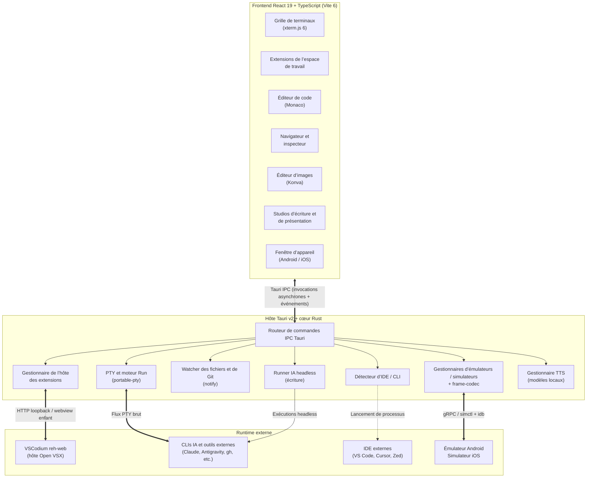

<div align="center">

<a href="https://github.com/wolfenazz/YzPzCode/releases/latest">
  
</a>
<br />
<p align="center">
  <a href="https://github.com/wolfenazz/YzPzCode/releases/latest">
    
  </a>
  <a href="https://github.com/wolfenazz/YzPzCode/blob/main/LICENSE">
    
  </a>
  <a href="docs/userguid.md">
    
  </a>
  <a href="https://github.com/wolfenazz/YzPzCode/issues">
    
  </a>
  
</p>

<p align="center">
  <a href="README.md">English</a> &nbsp;|&nbsp;
  <a href="ARREADME.MD">العربية</a> &nbsp;|&nbsp;
  <a href="DEREADME.MD">Deutsch</a> &nbsp;|&nbsp;
  <a href="ESREADME.MD">Español</a> &nbsp;|&nbsp;
  <b>Français</b> &nbsp;|&nbsp;
  <a href="PTREADME.MD">Português (BR)</a> &nbsp;|&nbsp;
  <a href="TRREADME.MD">Türkçe</a>
</p>

<p align="center">
  <a href="#-pourquoi-yzpzcode">Pourquoi</a> •
  <a href="#-tout-dans-une-seule-fenêtre">Vue d’ensemble</a> •
  <a href="#clis-de-codage-ia-prises-en-charge">Agents</a> •
  <a href="#extensions-graphiques-de-lespace-de-travail">Extensions</a> •
  <a href="#studios-décriture-de-présentation-et-de-feuilles-de-calcul">Studios</a> •
  <a href="#fenêtre-des-appareils-mobiles">Appareils</a> •
  <a href="#narration-locale">Narration</a> •
  <a href="#système-dexécution-et-de-build-des-applications">Run &amp; Build</a> •
  <a href="#téléchargement-et-installation">Téléchargement</a> •
  <a href="#contributeurs">Contributeurs</a>
</p>

</div>

> [!NOTE]
> **YzPzCode est en développement actif.** Certaines fonctionnalités peuvent être expérimentales ou évoluer d’une version à l’autre. Vos retours, rapports de bugs et pull requests sont les bienvenus.

---

## ⚡ Pourquoi YzPzCode ?

Le développement assisté par IA se transforme souvent en va-et-vient entre onglets de terminal, agents, navigateurs, IDE et CLIs ponctuelles. **YzPzCode remplace cette jonglerie entre fenêtres par un centre de commande natif unique.**

| Workflow traditionnel | Avec YzPzCode |
| :--- | :--- |
| 🪟 8+ fenêtres de terminal déconnectées | 🖥️ **Un espace de travail natif** avec des layouts personnalisés |
| 🔄 Changements de contexte constants avec `Alt+Tab` | 🎛️ **Grille de terminaux côte à côte** composée de vraies sessions PTY |
| 🔌 Panneaux d’assistant enfermés dans des IDE externes | 🧩 **Extensions graphiques** intégrées à la grille |
| ⚙️ Scripts de build et commandes d’exécution manuels | ⚡ **Run & build** avec détection automatique de 15+ écosystèmes |
| 🧩 Éditeur et visionneuse de fichiers externes | 📝 **Éditeur intégré** avec arborescence de fichiers virtualisée et Git |
| 🌐 Un navigateur séparé pour vérifier l’UI | 🔍 **Navigateur intégré** avec inspecteur visuel qui envoie des prompts aux agents |
| 📱 Une fenêtre d’émulateur séparée | 📲 **Fenêtre d’appareil Android et iOS** avec hot reload Flutter |
| 📄 Word, PowerPoint et une conversation IA séparée | ✍️ **Studios d’écriture et de présentation** utilisant les mêmes CLIs IA |
| 🔑 Installations et vérifications d’authentification CLI répétitives | 🔐 **Détection, installation en un clic et suivi de l’authentification** |
| 🎨 Photoshop ou Figma pour les retouches rapides | 🖌️ **Éditeur d’images par calques** avec modes de fusion |

---

## 🧭 Tout dans une seule fenêtre

<div align="center">
  
</div>

<br />

<table>
  <tr>
    <td align="center" width="16%"><h3>26</h3><sub>CLIs de codage IA</sub></td>
    <td align="center" width="16%"><h3>10</h3><sub>CLIs SaaS et outils</sub></td>
    <td align="center" width="16%"><h3>14</h3><sub>extensions graphiques</sub></td>
    <td align="center" width="16%"><h3>15+</h3><sub>écosystèmes run &amp; build</sub></td>
    <td align="center" width="16%"><h3>30</h3><sub>types de rapports</sub></td>
    <td align="center" width="16%"><h3>3</h3><sub>voix locales</sub></td>
  </tr>
</table>

---

## 📸 Voyez-le en action

<div align="center">
  <a href="docs/capture/yzpzcode-showreel.mp4">
    
  </a>
  <br />
  <sub>▶ <a href="docs/capture/yzpzcode-showreel.mp4"><b>Regarder le showreel complet de 45 secondes avec le son</b></a></sub>
  <br /><br />
  <table>
    <tr>
      <td width="50%" align="center">
        
        <br /><sub><b>Grille de terminaux et explorateur de l’espace de travail</b></sub>
      </td>
      <td width="50%" align="center">
        
        <br /><sub><b>Layout collaboratif multi-agents</b></sub>
      </td>
    </tr>
    <tr>
      <td width="50%" align="center">
        
        <br /><sub><b>Navigateur webview intégré à plusieurs onglets</b></sub>
      </td>
      <td width="50%" align="center">
        
        <br /><sub><b>Inspecteur approfondi des éléments et styles visuels</b></sub>
      </td>
    </tr>
  </table>
</div>

---

##  CLIs de codage IA prises en charge

YzPzCode détecte, lance et gère les sessions PTY de 26 agents de codage IA externes. Les intégrations principales :

```
                     ┌─── Claude (Anthropic)
                     ├─── Antigravity (Google)
                     ├─── Codex (OpenAI)
                     ├─── OpenCode
  Hôte YzPzCode ─────┼─── Cursor
                     ├─── Kilo
                     ├─── Hermes
                     ├─── Pi (earendil-works)
                     └─── Command Code
```

| Agent | Commande CLI | Rôle principal et points forts |
| :--- | :---: | :--- |
| **Claude Code** | `claude` | Raisonnement approfondi, refactorisation autonome, contexte étendu |
| **Antigravity CLI** | `agy` | Exécution autonome de tâches, workflows agentiques, Google AI |
| **Codex CLI** | `codex` | Génération de code précise et rédaction de tests unitaires |
| **OpenCode** | `opencode` | Agent open source pour des workflows locaux personnalisables |
| **Cursor CLI** | `cursor` | Édition agentique des fichiers et indexation du codebase |
| **Kilo** | `kilo` | Workflows d’agent rapides et natifs du terminal |
| **Hermes** | `hermes` | Assistant de terminal autonome et compact |
| **Pi** | `pi` | Harness d’agent de codage minimaliste avec hooks d’extension |
| **Command Code** | `cmd` / `cmdc` | Orchestration interactive de commandes et de scripts |

<details>
<summary><b>Afficher les 17 intégrations supplémentaires</b></summary>

<br />

| Agent | Commande CLI | Agent | Commande CLI |
| :--- | :---: | :--- | :---: |
| **Cline CLI** | `cline` | **Grok CLI** | `grok` |
| **Devin for Terminal** | `devin` | **Trae CLI** | `traecli` |
| **Kimi Code CLI** | `kimi` | **Qoder CLI** | `qoder` |
| **GitHub Copilot CLI** | `copilot` | **Kiro CLI** | `kiro-cli` |
| **Mistral Vibe** | `vibe` | **DeepSeek TUI** | `deepseek` |
| **Aider** | `aider` | **Amp** | `amp` |
| **DeepSeek Reasonix** | `reasonix` | **CodeBuddy Code** | `codebuddy` |
| **DeepSeek Harness** | `dsh` | **AtomCode CLI** | `atomcode` |
| **MiMo Code** | `mimo` | | |

</details>

Consultez [la référence des intégrations CLI](docs/cli-integrations.md) pour les instructions d’installation des fournisseurs, la documentation et les notes de plateforme.

> [!IMPORTANT]
> YzPzCode s’intègre aux CLIs tierces via des ponts PTY et **n’est affilié à aucun de leurs fournisseurs et ne bénéficie pas de leur aval**, sauf indication explicite.

---

##  CLIs SaaS et outils pour développeurs

L’état de l’installation, les chemins des exécutables et l’état de l’authentification des CLIs cloud et développeur courantes sont suivis pour vous :

<div align="center">

| Service | Commande | Service | Commande |
| :--- | :---: | :--- | :---: |
| **GitHub CLI** | `gh` | **PostHog** | `posthog-cli` |
| **Supabase** | `supabase` | **ElevenLabs** | `elevenlabs` |
| **Stripe** | `stripe` | **Google Workspace** | `gws` |
| **Vercel** | `vercel` | **AgentMail** | `agentmail-cli` |
| **Valyu** | `valyu-cli` | **Ramp** | `ramp` |

</div>

Consultez [le guide de référence des Tool CLIs](docs/ToolCLIs.md) pour les workflows, les commandes courantes et les détails d’authentification.

---

##  Extensions graphiques de l’espace de travail

Exécutez des assistants de codage graphiques juste à côté de vos shells et agents, à l’intérieur de la grille de l’espace de travail. Appuyez sur **`Ctrl+Shift+X`** ou cliquez sur l’icône Extensions dans l’en-tête pour ouvrir le catalogue.

| Extension | Éditeur | Description |
| :--- | :--- | :--- |
| **Google Antigravity** | Google | Assistant agentique officiel de Google avec chat, plans et modifications de code. |
| **Kilo Code** | Kilo | Codez, planifiez et déboguez avec le panneau d’extension visuel de Kilo. |
| **Cline** | Cline | Assistant de codage autonome avec modes plan/act et étapes d’approbation des outils. |
| **OpenAI Codex** | OpenAI | Extension de codage d’OpenAI avec connexion ChatGPT et assistance au code. |
| **Claude Code** | Anthropic | Assistant de codage visuel et panneau de conversation d’Anthropic. |
| **Continue** | Continue | Agent open source et chat de code avec backends de modèles cloud ou locaux. |
| **Amazon Q Developer** | AWS | Chat de code et développement de fonctionnalités inline avec Amazon Q. |
| **Tabby** | TabbyML | Assistant de codage auto-hébergé connecté à un serveur Tabby privé. |
| **Windsurf Plugin** | Windsurf | Assistant Codeium avec chat de code IA et index du codebase. |
| **Mistral Vibe** | Mistral AI | Agent de codage visuel de Mistral avec contexte, conversations et outils. |
| **Roo Code** | Roo Code | Agent de la famille Cline avec modes personnalisés, prise en charge multi-modèles et approbations par étape. |
| **Qoder CN** | Alibaba Cloud | Assistant de codage agentique d’Alibaba Cloud avec modes chat et agent ; connexion requise. |
| **Augment** | Augment Code | Agent de codage avec moteur de contexte conçu pour les grands codebases ; connexion requise. |
| **Nexrall Code** | Nexrall | Agent de codage autonome avec approbations par étape, points de contrôle et outils MCP ; compte requis. |

- 🎛️ **Layouts côte à côte** : les panneaux s’intègrent à la grille de terminaux avec réorganisation par glisser-déposer, redimensionnement interactif, préréglages de focus et layouts fractionnés.
- 📌 **Dock latéral de l’éditeur** : ancrez un panneau à droite de l’éditeur (`Ctrl+Alt+B`) et déplacez-le entre la grille et le dock sans le redémarrer.
- 📨 **Transfert de prompt** : envoyez directement une sélection de l’inspecteur du navigateur ou une référence UI à un panneau d’assistant ; le prompt est inséré et envoyé, et le résultat apparaît dans l’en-tête du panneau.
- 🌈 **Halo d’activité** : les panneaux reçoivent le même anneau d’activité et le même effet de fin que les terminaux d’agents.
- 📦 **Runtime géré sans configuration** : un runtime VSCodium `reh-web` vérifié est provisionné avec des condensats SHA-256 épinglés et des paquets Open VSX. Aucun besoin d’installer VS Code ou Node.
- 🛡️ **Sandbox renforcée** : chaque assistant s’exécute dans une webview enfant isolée sur sa propre origine `panel-<uuid>.localhost:<port>` avec stockage persistant, et ne peut pas appeler les commandes de l’hôte Tauri.
- 🔒 **Confiance et persistance de l’espace de travail** : les autorisations de confiance (`workspace-trust.json`) et l’état workbench IndexedDB (`workbench-state.json`) sont conservés par espace de travail.

Consultez [la documentation des extensions graphiques de l’espace de travail](docs/extensions.md) pour l’architecture, les spécifications du runtime et les détails de validation.

---

##  Studios d’écriture, de présentation et de feuilles de calcul

<div align="center">
  
</div>

<br />

En plus du codage, le sélecteur de mode de la page de configuration ouvre trois studios de documents. Ils n’ont besoin ni de terminaux ni d’IDE, exécutent l’IA via les CLIs déjà installées (Claude Code, Codex, Grok, Antigravity, OpenCode) dans un runner headless et enregistrent les fichiers dans un seul dossier, `Documents/YzPzCode`, afin que les rapports, présentations et classeurs soient à nouveau accessibles après une réinstallation.

<table>
<tr>
<td width="50%" valign="top">

###  Writing Studio

- **30 types de rapports** : choisissez un type et répondez à une question dans un composer à champ unique ; joignez des fichiers, collez du contenu et ajoutez des références
- **Éditeur paginé en streaming** : plan avec état en direct des sections, tableaux, figures, citations et notes de bas de page, en conservant votre position de lecture pendant l’arrivée des sections
- **Assistant** : rédigez les sections restantes, réécrivez la sélection ou la section, humanisez ou réécrivez tout le document, avec une carte de révision pour chaque modification
- **Humanizer et lint** : score de naturel, vérifications des expressions toutes faites, amorces, rythme et tirets cadratins, avec surlignage facultatif
- **Panneau de design** : six modèles, polices, couleurs, contrôles de page et de structure, ainsi que **Restyle with AI** avec annulation en un clic
- **Photos web réelles** : images sous licence libre provenant d’Openverse, Unsplash ou Pexels avec attribution, jamais d’images IA
- **Exportation** : PDF, Word `.docx`, HTML autonome ; importation de `.docx` existants

</td>
<td width="50%" valign="top">

###  Presentation Studio

- **Présentations conçues par l’IA** : décrivez la présentation ; l’IA invente un système de design, rédige une storyline avec un brief par page, puis dessine chaque diapositive en SVG
- **Vrai éditeur de diapositives** : sélection, sélection rectangulaire, déplacement avec repères, redimensionnement, saisie sur place, formes, images, tableaux, groupes, barre de formatage
- **Modifier avec l’IA** : modifiez une diapositive, plusieurs diapositives ou toute la présentation ; chaque changement est une proposition avec Keep ou Discard, les lots sont examinés côte à côte
- **Animation** : effets d’entrée, d’emphase et de sortie, ordre des clics, apparitions de paragraphes et mouvements conçus par l’IA
- **Images** : déposez des fichiers ou dossiers, mentionnez des chemins dans le prompt ou ajoutez de vraies photos web
- **Aller-retour PowerPoint** : importez un `.pptx` tel que PowerPoint le dessine ; exportez un PowerPoint modifiable, un PowerPoint « rendu exact », un PDF, un PNG et du HTML
- **Mode présentateur** : présentation plein écran, vue présentateur avec notes, minuteur et rythme, transitions et narration

</td>
</tr>
</table>

###  Arabe et écriture de droite à gauche, au premier plan

L’arabe, l’hébreu, le persan et l’ourdou fonctionnent dans les deux studios : la direction des paragraphes suit le texte, les libellés imprimés (Chapitre, Tableau, Figure, Sommaire…) suivent la langue du document, les exports Word et PowerPoint écrivent de vrais paragraphes bidirectionnels, et un catalogue d’environ 150 polices (latines et arabes, avec des fontes `@fontsource` intégrées) alimente chaque sélecteur de polices.

---

##  Fenêtre des appareils mobiles

<div align="center">
  
</div>

<br />

Une fenêtre d’appareil coulisse depuis le bord droit de chaque vue de l’espace de travail (terminal, extensions, éditeur, navigateur) et repousse la vue sur le côté au lieu de la recouvrir, afin que les webviews natives ne soient jamais masquées.

- 🤖 **Émulateur Android intégré** : créez et démarrez des AVD depuis l’application ; l’écran est diffusé dans la fenêtre (images gRPC via le crate partagé `frame-codec`) avec toucher, multi-touch, clavier, défilement, rotation, skins et captures d’écran.
- 🍎 **iOS Simulator (macOS)** : découverte et cycle de vie via `simctl`, écran et entrées via `idb_companion`. En dehors de macOS, il est signalé comme indisponible.
- 🐦 **Barre Flutter run** : exécutez l’application de l’espace de travail sur l’appareil choisi avec hot reload (également lors de l’enregistrement d’un fichier `.dart`), hot restart et journal en direct.
- 🛠️ **Configuration guidée** : **Settings → Environment** inspecte la toolchain Flutter, Android (et Xcode sur macOS) et propose des corrections en un clic pour les composants SDK manquants et l’accélération matérielle.

---

##  Narration locale

<div align="center">
  
</div>

<br />

Les rapports et les diapositives peuvent être lus à voix haute sans envoyer le texte à un service cloud. La narration s’exécute dans un environnement Python local géré et télécharge les modèles à la demande (**Settings → Narration**).

| Modèle | Langues | Taille | Notes |
| :--- | :---: | :---: | :--- |
| **SILMA TTS v1** (par défaut) | Arabe + anglais | ~2.5 GB | Voix bilingue équilibrée, sensible au Tashkeel |
| **Lahgtna-Chatterbox** | Arabe | ~1.5 GB | Dialectes égyptien, saoudien, marocain et irakien |
| **Kokoro-82M** | Anglais | ~350 MB | Très rapide, adapté aux longs rapports |

La langue est détectée à partir du texte, la vitesse est de 0.75× / 1× / 1.25×, et l’audio synthétisé est mis en cache sur le disque (LRU, plafond de 500 MB). Faites narrer la sélection ou une section dans le Writing Studio, ainsi que les diapositives dans le Presentation Studio et le mode présentateur.

---

##  Système d’exécution et de build des applications

Lancez, construisez et déboguez vos applications sans configuration. Les manifestes de projet et les points d’entrée exécutables sont détectés dans 15+ écosystèmes, directement dans les en-têtes des terminaux.

<div align="center">

| Écosystème | Détection et exécution |
| :--- | :--- |
| **Python** | Détecte les scripts `.py`, `main.py`, `app.py`, `manage.py` de Django et les serveurs Flask et FastAPI. Privilégie un Python local dans `.venv`, `venv` ou le Python système. |
| **JavaScript / TypeScript** | Repère les scripts dev, start et build de `package.json`. Lance `npm`, `pnpm`, `Yarn` ou `Bun` à partir du lockfile. |
| **Rust / Go / Flutter** | Cargo (`cargo run`), modules Go (`go run .`) et manifestes de projets Flutter (`flutter run`). |
| **C / C++** | Trouve les sources contenant `main()`, compile via GCC ou Clang dans `.yzpz-run/` et exécute le binaire. |
| **CMake** | Lit la CMake File API pour localiser les cibles Debug dans `.yzpz-build/`, en construisant avant le lancement. |
| **C# (.NET)** | Détecte et exécute les fichiers `.csproj` exécutables dans les projets et solutions avec le SDK .NET. |
| **Java** | Exécution de sources à fichier unique via JDK 11+ et configurations de lancement de projets. |
| **Ruby, PHP, Dart, Swift, Lua, Perl, R** | Exécute les points d’entrée avec les interpréteurs installés ; commandes de manifestes Rails et Laravel. |

</div>

- ▶️ **Run & build en un clic** depuis l’en-tête du terminal avec changement instantané de cible.
- 💬 **Console stdin interactive** : envoyez des entrées aux programmes en cours (`input()`, `scanf()`, `Console.ReadLine()`) depuis la barre de saisie du terminal.
- 🌐 **Détection automatique du dev server** : les URLs localhost dans la sortie du terminal deviennent un aperçu en un clic dans la barre du navigateur.
- ⚙️ **Configurations d’exécution personnalisées** : commandes, variables d’environnement, arguments et répertoires de travail dans **Settings → Application runs**, globalement ou par espace de travail.

Consultez [le guide des exécutions d’applications](docs/application-runs.md) pour les schémas de configuration, le changement multi-cible et les détails des compilateurs.

---

##  Fonctionnalités principales

<details open>
<summary><b> Grille de terminaux multi-agents</b></summary>

<br />

- **Backend PTY réel** : frontend xterm.js 6 alimenté par `portable-pty` de Rust
- **Commandes gérées** : tâches non interactives et en arrière-plan avec PID, code de sortie et streaming de sortie en direct
- **Modes souris du terminal** : prise en charge complète des événements souris xterm (clic, glisser, tout événement, suivi applicatif) pour les TUI
- **Rendu accéléré par le matériel** : pipeline canvas/WebGL avec mises à jour par rectangles modifiés pour une faible latence
- **Portée de l’espace de travail** : les sessions sont isolées par workspace de projet
- **Dialogue de lancement** : recherche, regroupement par shells, agents principaux, agents supplémentaires et CLIs d’outils SaaS, avec badges d’état en direct
- **Indicateur d’activité de l’agent** : idle → working → done par panneau, avec anneau d’activité, effet de fin et son de complétion facultatif
- **Layouts dynamiques** : les layouts s’adaptent au nombre de panneaux, avec réorganisation par glisser-déposer et sélecteur de layout
- **Panneau terminal de l’éditeur** : terminal de type VS Code sous l’éditeur (<kbd>Ctrl</kbd>+<kbd>`</kbd> bascule, <kbd>Ctrl</kbd>+<kbd>Shift</kbd>+<kbd>`</kbd> ouvre un nouveau shell), avec sélecteur de shell et scrollback par workspace
- **Mosaïque de terminaux externes** : consoles natives (Windows Terminal, macOS Terminal, Linux) avec mosaïque automatique

</details>

<details>
<summary><b> Éditeur, aperçus et contrôle de version</b></summary>

<br />

- **Workspace multi-onglets** : vues fractionnées et gestion des onglets (fermer les autres / à droite / enregistrés)
- **Coloration syntaxique et minimap** : moteurs Monaco et CodeMirror
- **Aperçus riches** : Markdown, PDF, CSV, Excel (`.xlsx`), Word (`.docx`) et diagrammes Draw.io
- **Aperçus multimédias et binaires** : audio (forme d’onde, transport, vitesse, boucle) et vidéo diffusés avec prise en charge HTTP range, ainsi qu’une vue hexadécimale pour les autres fichiers binaires
- **Synchronisation transactionnelle des fichiers** : un watcher récursif (`notify`) avec synchronisation temporisée maintient les onglets ouverts alignés sur les IDE et agents externes
- **Git intégré** : changement de branche, statistiques de diff, stage/unstage des fichiers ou hunks, abandon, validation et synchronisation distante
- **Presse-papiers de l’OS dans l’explorateur** : copiez, coupez et collez des fichiers (et des images du presse-papiers) entre l’explorateur et le système d’exploitation, avec résultat par élément et annulation
- **Ouvrir dans le terminal** : ouvrez n’importe quel dossier dans un nouveau panneau intégré ou un terminal externe

</details>

<details>
<summary><b> Navigateur intégré et inspecteur visuel</b></summary>

<br />

- **Carte de prompt rapide** : sélectionnez un élément et une petite carte apparaît à côté : choisissez un agent ou un panneau d’extension, saisissez une ligne et envoyez. **More controls** ouvre l’inspecteur complet en conservant le brouillon
- **Inspecteur approfondi des éléments** : CSS calculé, pseudo-éléments, modèle de boîte et hiérarchie DOM
- **Sélecteur et générateur de styles** : capturez des styles, générez des classes CSS atomiques et appliquez-les avec une pile d’annulation complète
- **Capture d’élément UI** : structure, layout, typographie, pseudo-éléments, assets et intention de design sous forme de références UI réutilisables
- **Onglets, page de démarrage et émulation d’appareil** : onglets par workspace, page de démarrage listant les dev servers actifs, préréglages d’appareils et viewports personnalisés
- **Intégration du dev server** : aperçu en un clic lorsqu’un dev server émet une URL locale

</details>

<details>
<summary><b> Designer IA et éditeur d’images par calques</b></summary>

<br />

- **Générateur prompt-vers-UI** : interfaces HTML/CSS/JS responsives à partir du langage naturel
- **Canvas par calques** : calques raster, vectoriels, texte et formes alimentés par Konva
- **16 modes de fusion**, opacité, rotation, masquage, sélections rectangulaires et au lasso, historique
- **Exportation** : PNG, JPG, WebP, SVG, GIF, BMP, AVIF, TIFF

</details>

<details>
<summary><b> Personnalisation</b></summary>

<br />

- 🌗 **Modes sombre / clair** avec thème dynamique dans toute l’UI
- 🎨 **8 couleurs d’accent** : Default, Blue, Purple, Green, Orange, Red, Pink, Cyan
- 🧪 **Moteur de thèmes personnalisés** : créez un thème à partir de 9 couleurs, d’une base claire/sombre et d’un rayon, avec contrôles de contraste WCAG, 40+ préréglages et import/export JSON (**Settings → Appearance → Custom themes**)
- 🌌 **Arrière-plans animés** : aurore, galaxie et rayons lumineux pour l’écran de configuration et les workspaces, avec contrôles d’intensité, vitesse, flou et opacité
- 💎 **Chrome d’application moderne** : onglets de changement de vue, indicateurs d’état et supervision des processus en temps réel dans le footer
- 📐 **3 préréglages de densité** : Compact, Comfortable, Spacious
- ⌨️ **Style du terminal** : polices, ligatures, styles de curseur, suivi de la souris et opacité
- ♿ **Accessibilité** : bouton de désactivation des animations (mouvement réduit), bouton de curseur personnalisé

</details>

---

##  Architecture



<details>
<summary><b>Matrice technologique</b></summary>

<br />

| Couche | Technologies |
| :--- | :--- |
| **Shell desktop** | [Tauri v2](https://v2.tauri.app/), [Rust](https://www.rust-lang.org/) (2021 Edition) |
| **Concurrence et PTY** | `tokio`, `portable-pty`, `notify`, `which` |
| **Hôte d’extensions** | VSCodium `reh-web` (Open VSX), webviews enfants sandboxées (`panel-*.localhost`) |
| **Frontend** | [React 19](https://react.dev/), [TypeScript 5.6](https://www.typescriptlang.org/), [Vite 6](https://vitejs.dev/) |
| **Styles et motion** | [Tailwind CSS v4](https://tailwindcss.com/), [Framer Motion](https://www.framer.com/motion/) |
| **Terminal et éditeur** | [@xterm/xterm 6](https://xtermjs.org/), [Monaco Editor](https://microsoft.github.io/monaco-editor/), CodeMirror 6 |
| **Canvas et médias** | [Konva](https://konvajs.org/), `pdfjs`, `xlsx`, `mammoth` |
| **Documents** | [TipTap](https://tiptap.dev/) (éditeur d’écriture paginé), `docx`, `pptxgenjs` + JSZip, pipeline de diapositives SVG |
| **Appareils mobiles** | Streaming gRPC de l’émulateur Android, `simctl` + `idb_companion` (iOS), CLI Flutter, crate `frame-codec` |
| **Voix** | Environnement Python local géré avec les modèles SILMA TTS, Lahgtna-Chatterbox et Kokoro |
| **État** | [Zustand 5](https://github.com/pmndrs/zustand) avec stockage persistant |

</details>

<details>
<summary><b>Structure du projet</b></summary>

<br />

```text
yzpzcode/
├── .github/workflows/          # Workflows de release CI/CD (builds multiplateformes)
├── docs/                       # Guides, captures d’écran et graphiques du README (docs/readme)
└── app/
    ├── src-tauri/              # Backend Rust
    │   ├── crates/
    │   │   └── frame-codec/    # Codec partagé des images d’écran pour le streaming des appareils
    │   └── src/
    │       ├── agent/          # Orchestration des tâches des agents autonomes et logique de retry
    │       ├── agent_cli/      # Détection, installation et authentification des CLIs d’IA et des outils
    │       ├── android/        # SDK Android, émulateur intégré, exécution et configuration de Flutter
    │       ├── ios/            # iOS Simulator (simctl) et streaming via idb_companion
    │       ├── writing/        # Runner IA headless pour les studios, génération de PDF
    │       ├── tts/            # Narration locale : environnement géré, catalogue de modèles, pont et cache
    │       ├── browser/        # Gestion des webviews et pont de l’inspecteur visuel
    │       ├── commands/       # Commandes IPC de Tauri (~100+ endpoints)
    │       ├── extension_host/ # Gestionnaire du runtime web VSCodium intégré, sandboxing Open VSX et VSIX
    │       ├── terminal/       # Sessions PTY, moteur d’exécution et commandes gérées
    │       ├── filesystem/     # Watcher récursif, synchronisation transactionnelle, opérations Git et diffs
    │       ├── ide/            # Lanceur d’IDE externes (VS Code, Cursor, Zed, etc.)
    │       └── discord_presence/ # Intégration de Discord Rich Presence
    │
    └── src/                    # Frontend React 19
        ├── components/
        │   ├── workspace/      # Grille de terminaux, panneaux d’extensions, terminal de l’éditeur, dock, navigateur, fenêtre d’appareil
        │   ├── writing/        # Writing Studio (composer, éditeur paginé, assistant, design, références)
        │   ├── presentation/   # Presentation Studio (présentations conçues par l’IA, éditeur de diapositives, mode présentateur)
        │   ├── studio/         # Interface partagée des studios (barre supérieure, éléments d’inspecteur, options de polices)
        │   ├── tts/            # Contrôles de narration et sélecteur de modèles
        │   ├── editor/         # Onglets de l’éditeur et aperçus de fichiers riches
        │   ├── explorer/       # Arborescence de fichiers virtualisée et panneaux Git
        │   ├── designer/       # Studio de génération de designs IA
        │   ├── image/          # Éditeur d’images sur canvas par calques
        │   ├── settings/       # Panneau des préférences
        │   └── setup/          # Assistant interactif de prise en main
        ├── hooks/              # Hooks React personnalisés (useTerminal, useBrowser, useFileWatcher, ...)
        ├── stores/             # Stores Zustand (appStore, runConfigStore, extensionStore, deviceStore, ...)
        ├── utils/              # Modules purs et sans dépendances (writing/, presentation/, tts/...) avec des suites node --test
        └── types/              # Miroirs TypeScript des structs Rust
```

</details>

---

##  Téléchargement et installation

### Option 1 : binaires précompilés (recommandé)

Téléchargez le dernier installateur depuis la **[page des Releases](https://github.com/wolfenazz/YzPzCode/releases/latest)** :

| Plateforme | Format du paquet | Architecture |
| :--- | :--- | :--- |
| **🪟 Windows** | Installateur `.msi` / `.exe` | x86_64 |
| **🍎 macOS** | Installateur `.dmg` | Apple Silicon (`aarch64`) et Intel (`x86_64`) |
| **🐧 Linux** | `.deb` / `.AppImage` | x86_64 |

> [!TIP]
> **macOS** : pour un build non signé, ouvrez-le avec **Clic droit → Ouvrir**, ou autorisez-le dans *Réglages système → Confidentialité et sécurité → Ouvrir quand même*.

### Option 2 : compiler depuis les sources

**Prérequis :** Node.js `22.x` ou supérieur, la dernière toolchain Rust stable (`rustup update stable`) et les outils de build C++ (Visual Studio Build Tools sur Windows, Xcode CLI Tools sur macOS, `build-essential` sur Linux).

```bash
git clone https://github.com/wolfenazz/YzPzCode.git
cd YzPzCode/app

npm install            # dépendances du frontend
npm run tauri dev      # mode de développement (port 8745)
npm run tauri build    # installateurs de production
```

Les binaires compilés sont placés dans `app/src-tauri/target/release/bundle/`.

---

##  Sécurité et confidentialité

YzPzCode est conçu selon une approche **local-first** :

- 🛡️ **Votre code reste local** : les fichiers de projet et le code source ne sont jamais envoyés aux serveurs tiers par YzPzCode lui-même.
- 🔑 **Secrets stockés localement** : les clés API et les tokens restent uniquement sur votre machine.
- 📡 **Connexions directes aux fournisseurs** : les requêtes vont directement aux endpoints officiels des fournisseurs que vous configurez.
- 🔊 **Narration sur l’appareil** : les modèles de synthèse vocale s’exécutent localement ; rien n’est envoyé à un service vocal.

---

##  Contribuer

Les contributions rendent l’open source extraordinaire. Les rapports de bugs, améliorations et nouvelles fonctionnalités sont tous appréciés. Consultez les [issues ouvertes](https://github.com/wolfenazz/YzPzCode/issues) ou lancez une discussion avant de proposer des changements architecturaux majeurs.

```bash
# Vérifier les types du frontend
cd app && npx tsc --noEmit

# Vérifier le formatage et les lints Rust, puis exécuter les tests Rust
cd src-tauri
cargo fmt --check
cargo clippy -- -D warnings
cargo test

# Suites des modules purs du frontend (depuis app/)
npm run test:writing
npm run test:presentation
npm run test:browser
npm run test:explorer
npm run test:custom-theme
npm run test:workspace-setup
npm run test:workspace-view
npm run test:device
```

---

##  Contributeurs

<div align="center">
  <a href="https://github.com/wolfenazz/YzPzCode/graphs/contributors">
    
  </a>
  <br /><br />
  <sub>
    <a href="https://github.com/wolfenazz"><b>@wolfenazz</b></a> · Créateur et architecte principal &nbsp;&nbsp;|&nbsp;&nbsp;
    <a href="https://github.com/Noor-Al-Khelaifi"><b>@Noor-Al-Khelaifi</b></a> · Contributeur principal et développeur
  </sub>
</div>

---

##  Licence

YzPzCode est un logiciel open source distribué sous **[Apache License 2.0](LICENSE)**.

<div align="center">
  <br />
  <b>Construisez avec vos agents IA, pas autour d’eux.</b>
  <br /><br />
  <a href="https://github.com/wolfenazz/YzPzCode/releases/latest">Télécharger YzPzCode</a> •
  <a href="docs/userguid.md">Documentation</a> •
  <a href="https://github.com/wolfenazz/YzPzCode/issues/new">Signaler un bug</a> •
  <a href="https://github.com/wolfenazz/YzPzCode/issues/new">Demander une fonctionnalité</a>
  <br /><br />
</div>
