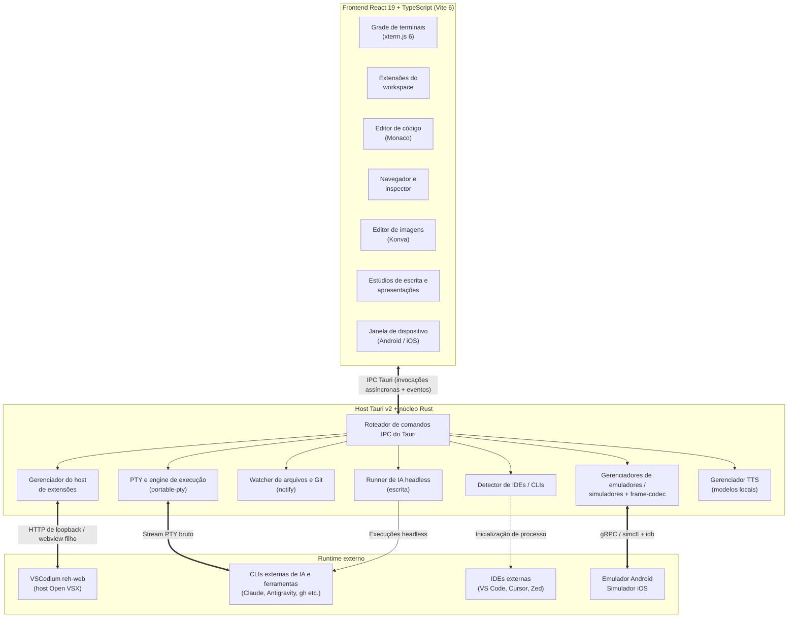

<div align="center">

<a href="https://github.com/wolfenazz/YzPzCode/releases/latest">
  
</a>
<br />
<p align="center">
  <a href="https://github.com/wolfenazz/YzPzCode/releases/latest">
    
  </a>
  <a href="https://github.com/wolfenazz/YzPzCode/blob/main/LICENSE">
    
  </a>
  <a href="docs/userguid.md">
    
  </a>
  <a href="https://github.com/wolfenazz/YzPzCode/issues">
    
  </a>
  
</p>

<p align="center">
  <a href="README.md">English</a> &nbsp;|&nbsp;
  <a href="ARREADME.MD">العربية</a> &nbsp;|&nbsp;
  <a href="DEREADME.MD">Deutsch</a> &nbsp;|&nbsp;
  <a href="ESREADME.MD">Español</a> &nbsp;|&nbsp;
  <a href="FRREADME.MD">Français</a> &nbsp;|&nbsp;
  <b>Português (BR)</b> &nbsp;|&nbsp;
  <a href="TRREADME.MD">Türkçe</a>
</p>

<p align="center">
  <a href="#-por-que-o-yzpzcode">Por quê</a> •
  <a href="#-tudo-em-uma-janela">Visão geral</a> •
  <a href="#clis-de-programação-com-ia-compatíveis">Agentes</a> •
  <a href="#extensões-gráficas-do-workspace">Extensões</a> •
  <a href="#estúdios-de-escrita-apresentações-e-planilhas">Estúdios</a> •
  <a href="#janela-de-dispositivo-móvel">Dispositivos</a> •
  <a href="#narração-local">Narração</a> •
  <a href="#sistema-de-execução-e-build-de-aplicações">Executar e buildar</a> •
  <a href="#download-e-instalação">Download</a> •
  <a href="#contribuidores">Contribuidores</a>
</p>

</div>

> [!NOTE]
> **O YzPzCode está em desenvolvimento ativo.** Os recursos podem ser experimentais ou evoluir entre versões. Feedback, relatos de bugs e pull requests são muito bem-vindos.

---

## ⚡ Por que o YzPzCode?

O desenvolvimento assistido por IA geralmente vira uma alternância entre abas de terminal, agentes, navegadores, IDEs e CLIs isoladas. **O YzPzCode substitui essa dança de janelas por um centro de comando nativo.**

| Fluxo tradicional | Com o YzPzCode |
| :--- | :--- |
| 🪟 8+ janelas de terminal desconectadas | 🖥️ **Um workspace nativo** com layouts personalizados |
| 🔄 Troca constante de contexto com `Alt+Tab` | 🎛️ **Grade de terminais lado a lado** com sessões PTY reais |
| 🔌 Painéis de assistentes presos dentro de IDEs externas | 🧩 **Extensões gráficas** incorporadas à grade |
| ⚙️ Scripts de build e comandos de execução manuais | ⚡ **Execução e build** com mais de 15 ecossistemas detectados automaticamente |
| 🧩 Editor e visualizador de arquivos externos | 📝 **Editor integrado** com árvore de arquivos virtualizada e Git |
| 🌐 Um navegador separado para verificar a UI | 🔍 **Navegador integrado** com inspector visual que envia prompts aos agentes |
| 📱 Uma janela de emulador separada | 📲 **Janela de dispositivo Android e iOS** com hot reload do Flutter |
| 📄 Word, PowerPoint e um chat de IA separado | ✍️ **Estúdios de Escrita e Apresentações** usando as mesmas CLIs de IA |
| 🔑 Instalações de CLI e verificações de autenticação repetitivas | 🔐 **Detecção, instalação com um clique e acompanhamento da autenticação** |
| 🎨 Photoshop ou Figma para edições rápidas | 🖌️ **Editor de imagens em camadas** com modos de mesclagem |

---

## 🧭 Tudo em uma janela

<div align="center">
  
</div>

<br />

<table>
  <tr>
    <td align="center" width="16%"><h3>26</h3><sub>CLIs de programação com IA</sub></td>
    <td align="center" width="16%"><h3>10</h3><sub>CLIs SaaS e de ferramentas</sub></td>
    <td align="center" width="16%"><h3>14</h3><sub>extensões gráficas</sub></td>
    <td align="center" width="16%"><h3>15+</h3><sub>ecossistemas de execução e build</sub></td>
    <td align="center" width="16%"><h3>30</h3><sub>tipos de relatório</sub></td>
    <td align="center" width="16%"><h3>3</h3><sub>vozes locais</sub></td>
  </tr>
</table>

---

## 📸 Veja em ação

<div align="center">
  <a href="docs/capture/yzpzcode-showreel.mp4">
    
  </a>
  <br />
  <sub>▶ <a href="docs/capture/yzpzcode-showreel.mp4"><b>Assista ao showreel completo de 45 segundos com som</b></a></sub>
  <br /><br />
  <table>
    <tr>
      <td width="50%" align="center">
        
        <br /><sub><b>Grade de terminais e explorador do workspace</b></sub>
      </td>
      <td width="50%" align="center">
        
        <br /><sub><b>Layout colaborativo multiagente</b></sub>
      </td>
    </tr>
    <tr>
      <td width="50%" align="center">
        
        <br /><sub><b>Navegador webview integrado com várias abas</b></sub>
      </td>
      <td width="50%" align="center">
        
        <br /><sub><b>Inspector visual aprofundado de elementos e estilos</b></sub>
      </td>
    </tr>
  </table>
</div>

---

##  CLIs de programação com IA compatíveis

O YzPzCode detecta, inicia e gerencia sessões PTY para 26 agentes externos de programação com IA. As integrações principais:

```
                     ┌─── Claude (Anthropic)
                     ├─── Antigravity (Google)
                     ├─── Codex (OpenAI)
                     ├─── OpenCode
  Host do YzPzCode ──┼─── Cursor
                     ├─── Kilo
                     ├─── Hermes
                     ├─── Pi (earendil-works)
                     └─── Command Code
```

| Agente | Comando da CLI | Função principal e pontos fortes |
| :--- | :---: | :--- |
| **Claude Code** | `claude` | Raciocínio profundo, refatoração autônoma, contexto amplo |
| **Antigravity CLI** | `agy` | Execução autônoma de tarefas, fluxos agentivos, IA do Google |
| **Codex CLI** | `codex` | Geração precisa de código e criação de testes unitários |
| **OpenCode** | `opencode` | Agente open source para fluxos locais personalizáveis |
| **Cursor CLI** | `cursor` | Edição agentiva de arquivos e indexação da base de código |
| **Kilo** | `kilo` | Fluxos rápidos de agentes nativos do terminal |
| **Hermes** | `hermes` | Assistente de terminal autônomo e compacto |
| **Pi** | `pi` | Harness minimalista de agente de programação com hooks de extensão |
| **Command Code** | `cmd` / `cmdc` | Orquestração interativa de comandos e scripts |

<details>
<summary><b>Mostrar as 17 integrações adicionais</b></summary>

<br />

| Agente | Comando da CLI | Agente | Comando da CLI |
| :--- | :---: | :--- | :---: |
| **Cline CLI** | `cline` | **Grok CLI** | `grok` |
| **Devin for Terminal** | `devin` | **Trae CLI** | `traecli` |
| **Kimi Code CLI** | `kimi` | **Qoder CLI** | `qoder` |
| **GitHub Copilot CLI** | `copilot` | **Kiro CLI** | `kiro-cli` |
| **Mistral Vibe** | `vibe` | **DeepSeek TUI** | `deepseek` |
| **Aider** | `aider` | **Amp** | `amp` |
| **DeepSeek Reasonix** | `reasonix` | **CodeBuddy Code** | `codebuddy` |
| **DeepSeek Harness** | `dsh` | **AtomCode CLI** | `atomcode` |
| **MiMo Code** | `mimo` | | |

</details>

Veja [a referência de integrações de CLI](docs/cli-integrations.md) para instruções de instalação dos fornecedores, documentação e observações sobre plataformas.

> [!IMPORTANT]
> O YzPzCode integra CLIs de terceiros por meio de bridges PTY e **não tem vínculo nem é endossado por seus respectivos fornecedores**, salvo indicação explícita.

---

##  CLIs SaaS e de ferramentas para desenvolvedores

O status de instalação, os caminhos dos executáveis e o estado de autenticação das CLIs populares de nuvem e desenvolvimento são acompanhados para você:

<div align="center">

| Serviço | Comando | Serviço | Comando |
| :--- | :---: | :--- | :---: |
| **GitHub CLI** | `gh` | **PostHog** | `posthog-cli` |
| **Supabase** | `supabase` | **ElevenLabs** | `elevenlabs` |
| **Stripe** | `stripe` | **Google Workspace** | `gws` |
| **Vercel** | `vercel` | **AgentMail** | `agentmail-cli` |
| **Valyu** | `valyu-cli` | **Ramp** | `ramp` |

</div>

Veja [o guia de referência das Tool CLIs](docs/ToolCLIs.md) para fluxos, comandos comuns e detalhes de autenticação.

---

##  Extensões gráficas do workspace

Execute assistentes gráficos de programação ao lado dos seus shells e agentes, dentro da grade do workspace. Pressione **`Ctrl+Shift+X`** ou clique no ícone de extensões no cabeçalho para abrir o catálogo.

| Extensão | Publicador | Descrição |
| :--- | :--- | :--- |
| **Google Antigravity** | Google | Assistente agentivo oficial do Google, com chat, planos e edições de código. |
| **Kilo Code** | Kilo | Programe, planeje e depure com o painel visual de extensão do Kilo. |
| **Cline** | Cline | Assistente autônomo de programação com modos plan/act e etapas de aprovação de ferramentas. |
| **OpenAI Codex** | OpenAI | Extensão de programação da OpenAI com login do ChatGPT e assistência de código. |
| **Claude Code** | Anthropic | Assistente visual de programação da Anthropic e painel de conversas. |
| **Continue** | Continue | Agente open source e chat de código com backends de modelos locais ou em nuvem. |
| **Amazon Q Developer** | AWS | Chat de código e desenvolvimento de recursos inline com o Amazon Q. |
| **Tabby** | TabbyML | Assistente de programação self-hosted conectado a um servidor Tabby privado. |
| **Windsurf Plugin** | Windsurf | Assistente Codeium com chat de código por IA e índice da base de código. |
| **Mistral Vibe** | Mistral AI | Agente visual de programação da Mistral com contexto, conversas e ferramentas. |
| **Roo Code** | Roo Code | Agente da família Cline com modos personalizados, suporte a vários modelos e aprovações por etapa. |
| **Qoder CN** | Alibaba Cloud | Assistente agentivo de programação da Alibaba Cloud com modos de chat e agente; requer login. |
| **Augment** | Augment Code | Agente de programação com mecanismo de contexto criado para bases de código grandes; requer login. |
| **Nexrall Code** | Nexrall | Agente autônomo de programação com aprovações por etapa, checkpoints e ferramentas MCP; requer uma conta. |

- 🎛️ **Layouts de grade lado a lado**: os painéis são montados dentro da grade de terminais, com reordenação por arrastar e soltar, redimensionamento interativo, predefinições de foco e layouts divididos.
- 📌 **Dock lateral do editor**: fixe um painel à direita do editor (`Ctrl+Alt+B`) e mova-o entre a grade e o dock sem reiniciá-lo.
- 📨 **Transferência de prompt**: envie uma seleção do inspector do navegador ou uma referência de UI diretamente para um painel de assistente; o prompt é inserido e enviado, e o resultado aparece no cabeçalho do painel.
- 🌈 **Brilho de atividade**: os painéis recebem o mesmo anel de trabalho e efeito de conclusão dos terminais de agentes.
- 📦 **Runtime gerenciado sem configuração**: um runtime VSCodium `reh-web` verificado é provisionado com digests SHA-256 fixados e pacotes Open VSX. Não é necessário instalar VS Code ou Node.
- 🛡️ **Sandbox reforçado**: cada assistente é executado em um webview filho isolado, em sua própria origem `panel-<uuid>.localhost:<port>` com armazenamento persistente, e não pode chamar comandos do host Tauri.
- 🔒 **Confiança e persistência do workspace**: as aprovações de confiança (`workspace-trust.json`) e o estado do workbench no IndexedDB (`workbench-state.json`) são mantidos por workspace.

Veja [a documentação das extensões gráficas do workspace](docs/extensions.md) para conhecer a arquitetura, as especificações do runtime e os detalhes de validação.

---

##  Estúdios de escrita, apresentações e planilhas

<div align="center">
  
</div>

<br />

Além da programação, o seletor de modo da página de configuração abre três estúdios de documentos. Eles não precisam de terminais nem IDEs, executam a IA pelas CLIs que você já instalou (Claude Code, Codex, Grok, Antigravity, OpenCode) em um runner headless e salvam tudo em uma pasta, `Documents/YzPzCode`, para que relatórios, apresentações e planilhas sejam encontrados novamente após uma reinstalação.

<table>
<tr>
<td width="50%" valign="top">

###  Writing Studio

- **30 tipos de relatório**: escolha um tipo e responda a uma pergunta em um composer de caixa única; anexe arquivos, cole material e adicione referências
- **Editor paginado com streaming**: outline com status de seção ao vivo, tabelas, figuras, citações e notas de rodapé, mantendo sua posição de leitura enquanto as seções chegam
- **Assistente**: escreva as seções restantes, reescreva a seleção ou seção, humanize ou reescreva o documento inteiro, com um card de revisão para cada alteração
- **Humanizer e lint**: pontuação de naturalidade, verificações de frases prontas, aberturas, ritmo e travessões, com destaque opcional
- **Painel de design**: seis templates, fontes, cores, controles de página e estrutura, além de **Restyle with AI** com desfazer em um clique
- **Fotos reais da web**: imagens com licença aberta do Openverse, Unsplash ou Pexels, com crédito, nunca imagens geradas por IA
- **Exportação**: PDF, Word `.docx`, HTML independente; importação de `.docx` existente

</td>
<td width="50%" valign="top">

###  Presentation Studio

- **Apresentações projetadas por IA**: descreva a apresentação; a IA cria um sistema de design, escreve uma narrativa com briefs por página e então desenha cada slide como SVG
- **Editor de slides real**: selecionar, marquee, arrastar com guias, redimensionar, digitar no local, formas, imagens, tabelas, grupos e barra de formatação
- **Editar com IA**: altere um slide, vários ou a apresentação inteira; cada alteração é uma proposta com Keep ou Discard, e os lotes são revisados lado a lado
- **Animação**: efeitos de entrada, ênfase e saída, ordem de cliques, construção de parágrafos e movimento projetado por IA
- **Imagens**: solte arquivos ou pastas, mencione caminhos no prompt ou adicione fotos reais da web
- **Ida e volta com PowerPoint**: importe `.pptx` como o PowerPoint o desenha; exporte PowerPoint editável, PowerPoint com "visual exato", PDF, PNG e HTML
- **Modo de apresentação**: exibição em tela cheia, visão do apresentador com notas, cronômetro e ritmo, transições e narração

</td>
</tr>
</table>

###  Árabe e escrita da direita para a esquerda, com suporte de primeira classe

Árabe, hebraico, persa e urdu funcionam nos dois estúdios: a direção dos parágrafos acompanha o texto, os rótulos impressos (Chapter, Table, Figure, Contents…) seguem o idioma do documento, as exportações para Word e PowerPoint escrevem parágrafos bidirecionais reais, e um catálogo com cerca de 150 fontes (latinas e árabes, com faces `@fontsource` incluídas) alimenta todos os seletores de fonte.

---

##  Janela de dispositivo móvel

<div align="center">
  
</div>

<br />

Uma janela de dispositivo desliza pela borda direita de cada visualização do workspace (terminal, extensões, editor, navegador) e desloca a visualização para o lado em vez de flutuar sobre ela, para que webviews nativos nunca sejam encobertos.

- 🤖 **Emulador Android integrado**: crie e inicie AVDs pelo app; a tela é exibida na janela (frames gRPC pelo crate compartilhado `frame-codec`) com toque, multitoque, teclado, rolagem, rotação, skins e capturas de tela.
- 🍎 **Simulador iOS (macOS)**: descoberta e ciclo de vida por meio do `simctl`, tela e entrada por meio do `idb_companion`. Fora do macOS, é reportado como indisponível.
- 🐦 **Barra de execução do Flutter**: execute o app do workspace no dispositivo escolhido com hot reload (também ao salvar `.dart`), hot restart e log ao vivo.
- 🛠️ **Configuração guiada**: **Settings → Environment** inspeciona o toolchain do Flutter, Android (e Xcode no macOS) e oferece correções com um clique para partes ausentes do SDK e aceleração de hardware.

---

##  Narração local

<div align="center">
  
</div>

<br />

Relatórios e slides podem ser lidos em voz alta sem enviar texto para um serviço na nuvem. A narração é executada em um ambiente Python local gerenciado e baixa os modelos sob demanda (**Settings → Narration**).

| Modelo | Idiomas | Tamanho | Observações |
| :--- | :---: | :---: | :--- |
| **SILMA TTS v1** (padrão) | Árabe + inglês | ~2.5 GB | Voz bilíngue equilibrada, ciente de Tashkeel |
| **Lahgtna-Chatterbox** | Árabe | ~1.5 GB | Dialetos egípcio, saudita, marroquino e iraquiano |
| **Kokoro-82M** | Inglês | ~350 MB | Muito rápido, adequado para relatórios longos |

O idioma é detectado a partir do texto, a velocidade é 0.75× / 1× / 1.25×, e o áudio sintetizado é armazenado em cache no disco (LRU, teto de 500 MB). Narre a seleção ou uma seção no Writing Studio, e os slides no Presentation Studio e no modo de apresentação.

---

##  Sistema de execução e build de aplicações

Inicie, faça build e depure suas aplicações sem configuração. Manifestos de projetos e pontos de entrada executáveis são descobertos em mais de 15 ecossistemas, diretamente nos cabeçalhos dos terminais.

<div align="center">

| Ecossistema | Detecção e execução |
| :--- | :--- |
| **Python** | Detecta scripts `.py`, `main.py`, `app.py`, `manage.py` do Django e servidores Flask e FastAPI. Prefere um Python local em `.venv`, `venv` ou o Python do sistema. |
| **JavaScript / TypeScript** | Descobre scripts de desenvolvimento, inicialização e build em `package.json`. Invoca `npm`, `pnpm`, `Yarn` ou `Bun` a partir do lockfile. |
| **Rust / Go / Flutter** | Cargo (`cargo run`), módulos Go (`go run .`) e manifestos de projeto Flutter (`flutter run`). |
| **C / C++** | Encontra fontes com `main()`, compila via GCC ou Clang em `.yzpz-run/` e executa o binário. |
| **CMake** | Lê a CMake File API para localizar targets Debug em `.yzpz-build/`, compilando antes da inicialização. |
| **C# (.NET)** | Descobre e executa arquivos `.csproj` executáveis em projetos e soluções com o SDK do .NET. |
| **Java** | Execução de fonte em arquivo único via JDK 11+ e configurações de inicialização de projetos. |
| **Ruby, PHP, Dart, Swift, Lua, Perl, R** | Executa pontos de entrada com os interpretadores instalados; comandos de manifesto do Rails e Laravel. |

</div>

- ▶️ **Execução e build com um clique** no cabeçalho do terminal, com troca instantânea de target.
- 💬 **Console interativo de stdin**: envie entrada para programas em execução (`input()`, `scanf`, `Console.ReadLine()`) pela barra de entrada do terminal.
- 🌐 **Descoberta automática de dev server**: URLs localhost na saída do terminal se tornam uma prévia com um clique na barra do navegador.
- ⚙️ **Configurações de execução personalizadas**: comandos, variáveis de ambiente, argumentos e diretórios de trabalho em **Settings → Application runs**, globalmente ou por workspace.

Veja [o guia de execuções de aplicações](docs/application-runs.md) para esquemas de configuração, troca entre vários targets e detalhes do compilador.

---

##  Recursos principais

<details open>
<summary><b> Grade de terminais multiagente</b></summary>

<br />

- **Backend PTY real**: frontend xterm.js 6 alimentado pelo `portable-pty` do Rust
- **Comandos gerenciados**: tarefas não interativas e em segundo plano com PID, código de saída e streaming de saída ao vivo
- **Modos de mouse do terminal**: suporte completo a mouse do xterm (clique, arrastar, qualquer evento, rastreamento de aplicação) para TUIs
- **Renderização acelerada por hardware**: pipeline canvas/WebGL com atualizações de retângulos sujos para baixa latência
- **Escopo por workspace**: sessões são isoladas por workspace de projeto
- **Diálogo de criação**: pesquisável, agrupado por shells, agentes principais, agentes adicionais e Tool CLIs SaaS, com badges de status ao vivo
- **Indicador de atividade do agente**: ocioso → trabalhando → concluído por painel, com anel de trabalho, efeito de conclusão e som opcional
- **Layouts dinâmicos**: os layouts se adaptam ao número de painéis, com reordenação por arrastar e seletor de layout
- **Painel de terminal do editor**: terminal no estilo VS Code sob o editor (<kbd>Ctrl</kbd>+<kbd>`</kbd> alterna, <kbd>Ctrl</kbd>+<kbd>Shift</kbd>+<kbd>`</kbd> abre um novo shell), com seletor de shell e scrollback por workspace
- **Organização de terminais externos**: consoles nativos (Windows Terminal, macOS Terminal, Linux) com organização automática

</details>

<details>
<summary><b> Editor, prévias e controle de código-fonte</b></summary>

<br />

- **Workspace com várias abas**: visualizações divididas e gerenciamento de abas (fechar outras / à direita / salvas)
- **Destaque de sintaxe e minimap**: engines Monaco e CodeMirror
- **Pré-visualizações avançadas**: Markdown, PDF, CSV, Excel (`.xlsx`), Word (`.docx`) e diagramas Draw.io
- **Pré-visualizações de mídia e binários**: áudio (forma de onda, transporte, velocidade, loop) e vídeo exibido com suporte a HTTP range, além de uma visualização hexadecimal para outros arquivos binários
- **Sincronização transacional de arquivos**: um watcher recursivo (`notify`) com sincronização com debounce mantém as abas abertas alinhadas com IDEs e agentes externos
- **Git integrado**: troca de branch, estatísticas de diff, stage/unstage de arquivos ou hunks, descarte, registro e sincronização remota
- **Clipboard do sistema no explorer**: copie, recorte e cole arquivos (e imagens do clipboard) entre o explorer e o sistema operacional, com resultados por item e desfazer
- **Abrir no terminal**: qualquer pasta em um novo painel integrado ou em um terminal externo

</details>

<details>
<summary><b> Navegador integrado e inspector visual</b></summary>

<br />

- **Card de prompt rápido**: escolha um elemento e um card pequeno aparece ao lado dele: selecione um agente ou painel de extensão, digite uma linha e envie. **Mais controles** abre o inspector completo com o rascunho preservado
- **Inspector aprofundado de elementos**: CSS calculado, pseudo-elementos, box model e hierarquia DOM
- **Seletor e gerador de estilos**: capture estilos, gere classes CSS atômicas e aplique-as com uma pilha completa de desfazer
- **Captura de elemento de UI**: estrutura, layout, tipografia, pseudo-elementos, assets e intenção de design como referências de UI reutilizáveis
- **Abas, página inicial e emulação de dispositivos**: abas por workspace, página inicial listando dev servers ativos, predefinições de dispositivos e viewports personalizados
- **Integração com dev server**: prévia com um clique quando um dev server gera uma URL local

</details>

<details>
<summary><b> Designer de IA e editor de imagens em camadas</b></summary>

<br />

- **Gerador de prompt para UI**: interfaces HTML/CSS/JS responsivas a partir de linguagem natural
- **Canvas em camadas**: camadas raster, vetoriais, de texto e de formas alimentadas pelo Konva
- **16 modos de mesclagem**, opacidade, rotação, máscaras, seleções marquee e laço, histórico
- **Exportação**: PNG, JPG, WebP, SVG, GIF, BMP, AVIF, TIFF

</details>

<details>
<summary><b> Personalização</b></summary>

<br />

- 🌗 **Modos escuro / claro** com tema dinâmico em toda a UI
- 🎨 **8 cores de destaque**: Default, Blue, Purple, Green, Orange, Red, Pink, Cyan
- 🧪 **Engine de temas personalizados**: crie um tema a partir de 9 cores, uma base clara/escura e um raio, com verificações de contraste WCAG, mais de 40 predefinições e importação/exportação JSON (**Settings → Appearance → Custom themes**)
- 🌌 **Planos de fundo animados**: aurora, galáxia e raios de luz para a tela de configuração e os workspaces, com controles de intensidade, velocidade, desfoque e opacidade
- 💎 **Chrome moderno do app**: abas de troca de visualização, indicadores de status e monitoramento de processos em tempo real no rodapé
- 📐 **3 predefinições de densidade**: Compact, Comfortable, Spacious
- ⌨️ **Estilo do terminal**: fontes, ligaturas, estilos de cursor, rastreamento do mouse e opacidade
- ♿ **Acessibilidade**: alternância para desativar animações (movimento reduzido), alternância de cursor personalizado

</details>

---

##  Arquitetura



<details>
<summary><b>Matriz de tecnologias</b></summary>

<br />

| Camada | Tecnologias |
| :--- | :--- |
| **Shell desktop** | [Tauri v2](https://v2.tauri.app/), [Rust](https://www.rust-lang.org/) (2021 Edition) |
| **Concorrência e PTY** | `tokio`, `portable-pty`, `notify`, `which` |
| **Host de extensões** | VSCodium `reh-web` (Open VSX), webviews filhos isolados (`panel-*.localhost`) |
| **Frontend** | [React 19](https://react.dev/), [TypeScript 5.6](https://www.typescriptlang.org/), [Vite 6](https://vitejs.dev/) |
| **Estilo e movimento** | [Tailwind CSS v4](https://tailwindcss.com/), [Framer Motion](https://www.framer.com/motion/) |
| **Terminal e editor** | [@xterm/xterm 6](https://xtermjs.org/), [Monaco Editor](https://microsoft.github.io/monaco-editor/), CodeMirror 6 |
| **Canvas e mídia** | [Konva](https://konvajs.org/), `pdfjs`, `xlsx`, `mammoth` |
| **Documentos** | [TipTap](https://tiptap.dev/) (editor de escrita paginado), `docx`, `pptxgenjs` + JSZip, pipeline de slides SVG |
| **Dispositivos móveis** | Streaming gRPC do emulador Android, `simctl` + `idb_companion` (iOS), CLI Flutter, crate `frame-codec` |
| **Fala** | Ambiente Python local gerenciado com os modelos SILMA TTS, Lahgtna-Chatterbox e Kokoro |
| **Estado** | [Zustand 5](https://github.com/pmndrs/zustand) com armazenamento persistente |

</details>

<details>
<summary><b>Estrutura do projeto</b></summary>

<br />

```text
yzpzcode/
├── .github/workflows/          # Fluxos de lançamento de CI/CD (builds multiplataforma)
├── docs/                       # Guias, capturas de tela e gráficos do README (docs/readme)
└── app/
    ├── src-tauri/              # Backend em Rust
    │   ├── crates/
    │   │   └── frame-codec/    # Codec compartilhado de quadros de tela para transmissão em dispositivos
    │   └── src/
    │       ├── agent/          # Orquestração de tarefas de agentes autônomos e lógica de novas tentativas
    │       ├── agent_cli/      # Detecção, instalação e autenticação de CLIs de IA e ferramentas
    │       ├── android/        # SDK do Android, emulador integrado, execução e configuração do Flutter
    │       ├── ios/            # Simulador do iOS (simctl) e transmissão pelo idb_companion
    │       ├── writing/        # Runner de IA sem interface para os estúdios, geração de PDFs
    │       ├── tts/            # Narração local: ambiente gerenciado, catálogo de modelos, ponte e cache
    │       ├── browser/        # Gerenciamento de webviews e ponte do inspector visual
    │       ├── commands/       # Comandos IPC do Tauri (~100+ endpoints)
    │       ├── extension_host/ # Gerenciador do runtime web VSCodium integrado, sandbox do Open VSX e VSIX
    │       ├── terminal/       # Sessões PTY, mecanismo de execução e comandos gerenciados
    │       ├── filesystem/     # Monitor recursivo, sincronização transacional de arquivos, operações Git e diferenças
    │       ├── ide/            # Inicializador de IDEs externas (VS Code, Cursor, Zed etc.)
    │       └── discord_presence/ # Integração com o Discord Rich Presence
    │
    └── src/                    # Frontend React 19
        ├── components/
        │   ├── workspace/      # Grade de terminais, painéis de extensão, terminal do editor, dock, navegador e janela de dispositivo
        │   ├── writing/        # Writing Studio (compositor, editor paginado, assistente, design e referências)
        │   ├── presentation/   # Presentation Studio (apresentações projetadas por IA, editor de slides, modo de apresentação)
        │   ├── studio/         # Elementos visuais compartilhados dos estúdios (barra superior, partes do inspector e opções de fonte)
        │   ├── tts/            # Controles de narração e seletor de modelos
        │   ├── editor/         # Abas do editor e prévias avançadas de arquivos
        │   ├── explorer/       # Árvore de arquivos virtualizada e painéis Git
        │   ├── designer/       # Estúdio de geração de designs por IA
        │   ├── image/          # Editor de imagens em canvas com camadas
        │   ├── settings/       # Painel de preferências
        │   └── setup/          # Assistente interativo de integração inicial
        ├── hooks/              # Hooks React personalizados (useTerminal, useBrowser, useFileWatcher, ...)
        ├── stores/             # Stores Zustand (appStore, runConfigStore, extensionStore, deviceStore, ...)
        ├── utils/              # Módulos puros e sem dependências (writing/, presentation/, tts/), com suítes node --test
        └── types/              # Réplicas TypeScript das structs Rust
```

</details>

---

##  Download e instalação

### Opção 1: Binários pré-compilados (recomendado)

Baixe o instalador mais recente na **[página de Releases](https://github.com/wolfenazz/YzPzCode/releases/latest)**:

| Plataforma | Formato do pacote | Arquitetura |
| :--- | :--- | :--- |
| **🪟 Windows** | instalador `.msi` / `.exe` | x86_64 |
| **🍎 macOS** | instalador `.dmg` | Apple Silicon (`aarch64`) e Intel (`x86_64`) |
| **🐧 Linux** | `.deb` / `.AppImage` | x86_64 |

> [!TIP]
> **macOS**: para um build não assinado, abra com **Clique direito → Abrir**, ou permita em *Ajustes do Sistema → Privacidade e Segurança → Abrir mesmo assim*.

### Opção 2: Compilar a partir do código-fonte

**Pré-requisitos:** Node.js `22.x` ou superior, o toolchain Rust estável mais recente (`rustup update stable`) e ferramentas de build C++ (Visual Studio Build Tools no Windows, Xcode CLI Tools no macOS, `build-essential` no Linux).

```bash
git clone https://github.com/wolfenazz/YzPzCode.git
cd YzPzCode/app

npm install            # dependências do frontend
npm run tauri dev      # modo de desenvolvimento (porta 8745)
npm run tauri build    # instaladores de produção
```

Os binários compilados são colocados em `app/src-tauri/target/release/bundle/`.

---

##  Segurança e privacidade

O YzPzCode foi criado com uma abordagem **local-first**:

- 🛡️ **Seu código permanece local**: arquivos de projeto e código-fonte nunca são enviados a servidores de terceiros pelo próprio YzPzCode.
- 🔑 **Segredos armazenados localmente**: chaves de API e tokens ficam somente na sua máquina.
- 📡 **Conexões diretas com provedores**: as solicitações vão diretamente para os endpoints oficiais dos provedores que você configurar.
- 🔊 **Narração no dispositivo**: os modelos de conversão de texto em fala são executados localmente; nada é enviado a um serviço de voz.

---

##  Contribuindo

Contribuições tornam o open source incrível. Relatos de bugs, melhorias e novos recursos são sempre bem-vindos. Consulte as [issues abertas](https://github.com/wolfenazz/YzPzCode/issues) ou inicie uma discussão antes de propor mudanças arquiteturais importantes.

```bash
# Verificar os tipos do frontend
cd app && npx tsc --noEmit

# Verificar a formatação e os lints do Rust, depois executar os testes do Rust
cd src-tauri
cargo fmt --check
cargo clippy -- -D warnings
cargo test

# Suítes de módulos puros do frontend (a partir de app/)
npm run test:writing
npm run test:presentation
npm run test:browser
npm run test:explorer
npm run test:custom-theme
npm run test:workspace-setup
npm run test:workspace-view
npm run test:device
```

---

##  Contribuidores

<div align="center">
  <a href="https://github.com/wolfenazz/YzPzCode/graphs/contributors">
    
  </a>
  <br /><br />
  <sub>
    <a href="https://github.com/wolfenazz"><b>@wolfenazz</b></a> · Criador e arquiteto principal &nbsp;&nbsp;|&nbsp;&nbsp;
    <a href="https://github.com/Noor-Al-Khelaifi"><b>@Noor-Al-Khelaifi</b></a> · Contribuidor e desenvolvedor principal
  </sub>
</div>

---

##  Licença

O YzPzCode é um software open source licenciado sob a **[Apache License 2.0](LICENSE)**.

<div align="center">
  <br />
  <b>Construa com seus agentes de IA, não ao redor deles.</b>
  <br /><br />
  <a href="https://github.com/wolfenazz/YzPzCode/releases/latest">Baixe o YzPzCode</a> •
  <a href="docs/userguid.md">Documentação</a> •
  <a href="https://github.com/wolfenazz/YzPzCode/issues/new">Relate um bug</a> •
  <a href="https://github.com/wolfenazz/YzPzCode/issues/new">Solicite um recurso</a>
  <br /><br />
</div>
