<div align="center">

<a href="https://github.com/wolfenazz/YzPzCode/releases/latest">
  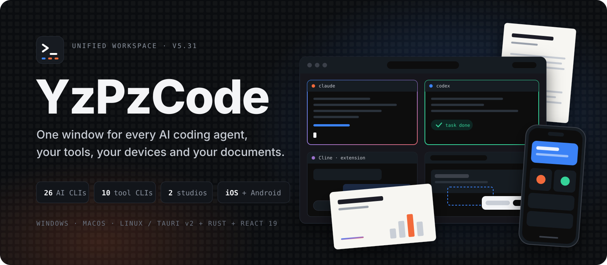
</a>
<br />
<p align="center">
  <a href="https://github.com/wolfenazz/YzPzCode/releases/latest">
    
  </a>
  <a href="https://github.com/wolfenazz/YzPzCode/blob/main/LICENSE">
    
  </a>
  <a href="docs/userguid.md">
    
  </a>
  <a href="https://github.com/wolfenazz/YzPzCode/issues">
    
  </a>
  
</p>

<p align="center">
  <b>English</b> &nbsp;|&nbsp;
  <a href="ARREADME.MD">العربية</a> &nbsp;|&nbsp;
  <a href="DEREADME.MD">Deutsch</a> &nbsp;|&nbsp;
  <a href="ESREADME.MD">Español</a> &nbsp;|&nbsp;
  <a href="FRREADME.MD">Français</a> &nbsp;|&nbsp;
  <a href="PTREADME.MD">Português (BR)</a> &nbsp;|&nbsp;
  <a href="TRREADME.MD">Türkçe</a>
</p>

<p align="center">
  <a href="#-why-yzpzcode">Why</a> •
  <a href="#-everything-in-one-window">Overview</a> •
  <a href="#supported-ai-coding-clis">Agents</a> •
  <a href="#graphical-workspace-extensions">Extensions</a> •
  <a href="#writing-presentation--sheets-studios">Studios</a> •
  <a href="#mobile-device-window">Devices</a> •
  <a href="#local-narration">Narration</a> •
  <a href="#application-run--build-system">Run &amp; Build</a> •
  <a href="#download--installation">Download</a> •
  <a href="#contributors">Contributors</a>
</p>

</div>

> [!NOTE]
> **YzPzCode is under active development.** Features may be experimental or evolve between releases. Feedback, bug reports and pull requests are warmly welcomed.

---

## ⚡ Why YzPzCode?

AI-assisted development usually turns into a shuffle between terminal tabs, agents, browsers, IDEs and one-off CLIs. **YzPzCode replaces the window juggling with one native command center.**

| Traditional workflow | With YzPzCode |
| :--- | :--- |
| 🪟 8+ disconnected terminal windows | 🖥️ **One native workspace** with custom layouts |
| 🔄 Constant `Alt+Tab` context switching | 🎛️ **Side-by-side terminal grid** of real PTY sessions |
| 🔌 Assistant panels locked inside external IDEs | 🧩 **Graphical extensions** embedded in the grid |
| ⚙️ Manual build scripts and run commands | ⚡ **Run & build** with 15+ ecosystems auto-detected |
| 🧩 External editor and file viewer | 📝 **Embedded editor** with a virtualized file tree and Git |
| 🌐 A separate browser for UI checks | 🔍 **In-app browser** with a visual inspector that prompts agents |
| 📱 A separate emulator window | 📲 **Android and iOS device window** with Flutter hot reload |
| 📄 Word, PowerPoint and a separate AI chat | ✍️ **Writing & Presentation studios** on the same AI CLIs |
| 🔑 Repetitive CLI install and auth checks | 🔐 **Detection, one-click install and auth tracking** |
| 🎨 Photoshop or Figma for quick edits | 🖌️ **Layered image editor** with blend modes |

---

## 🧭 Everything in one window

<div align="center">
  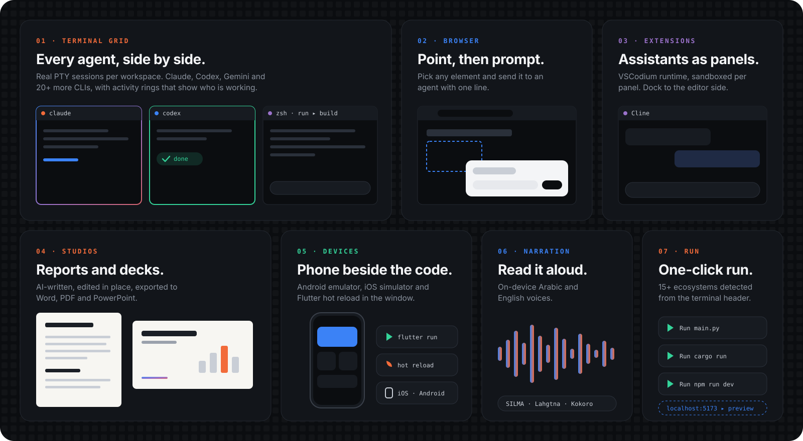
</div>

<br />

<table>
  <tr>
    <td align="center" width="16%"><h3>26</h3><sub>AI coding CLIs</sub></td>
    <td align="center" width="16%"><h3>10</h3><sub>SaaS &amp; tool CLIs</sub></td>
    <td align="center" width="16%"><h3>14</h3><sub>graphical extensions</sub></td>
    <td align="center" width="16%"><h3>15+</h3><sub>run &amp; build ecosystems</sub></td>
    <td align="center" width="16%"><h3>30</h3><sub>report kinds</sub></td>
    <td align="center" width="16%"><h3>3</h3><sub>local voices</sub></td>
  </tr>
</table>

---

## 📸 See it in action

<div align="center">
  <a href="docs/capture/yzpzcode-showreel.mp4">
    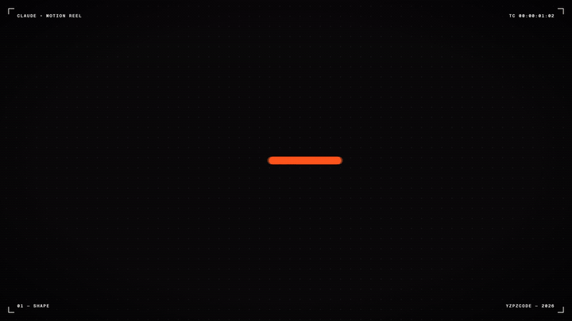
  </a>
  <br />
  <sub>▶ <a href="docs/capture/yzpzcode-showreel.mp4"><b>Watch the full 45-second showreel with sound</b></a></sub>
  <br /><br />
  <table>
    <tr>
      <td width="50%" align="center">
        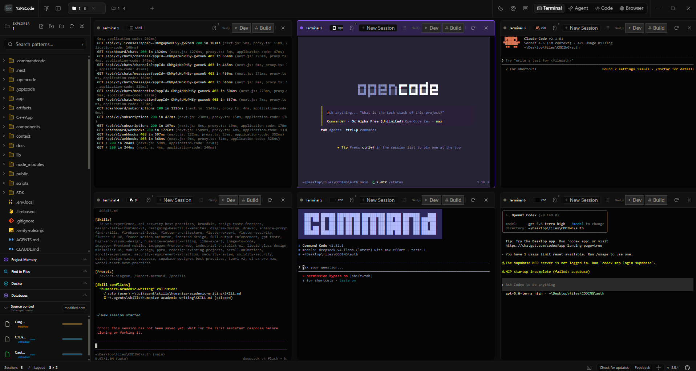
        <br /><sub><b>Terminal grid &amp; workspace explorer</b></sub>
      </td>
      <td width="50%" align="center">
        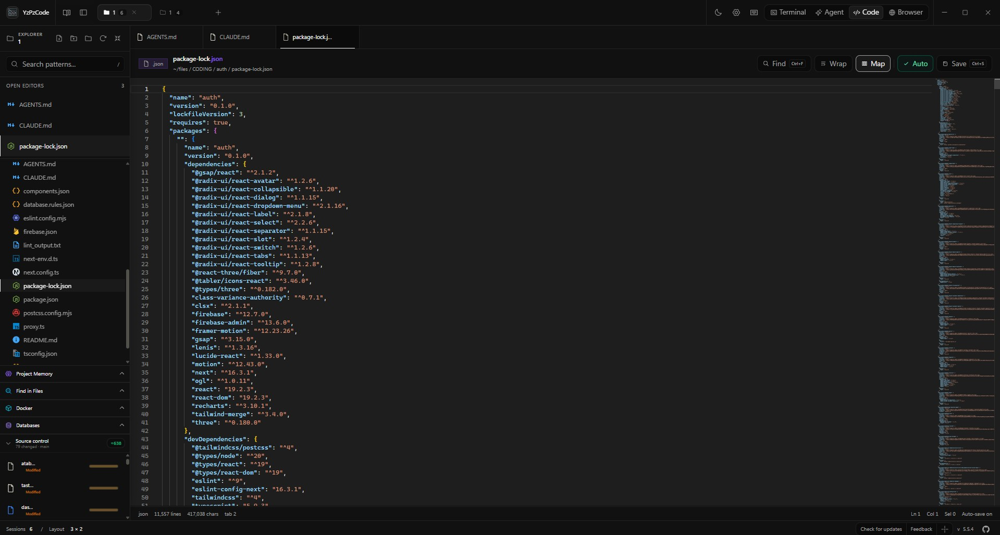
        <br /><sub><b>Multi-agent collaborative layout</b></sub>
      </td>
    </tr>
    <tr>
      <td width="50%" align="center">
        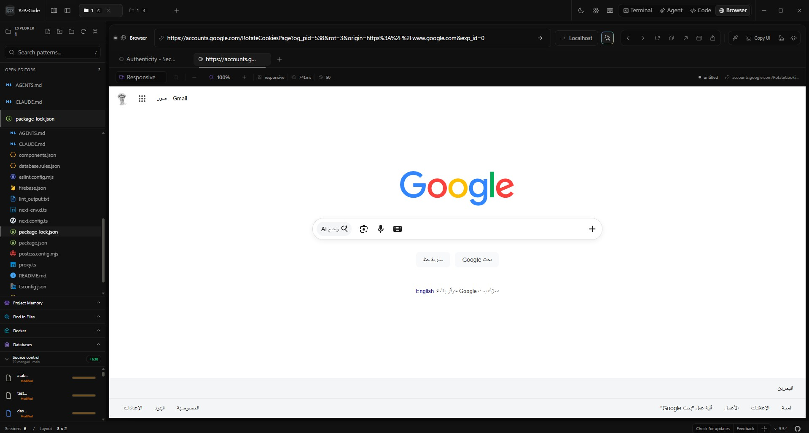
        <br /><sub><b>Integrated multi-tab webview browser</b></sub>
      </td>
      <td width="50%" align="center">
        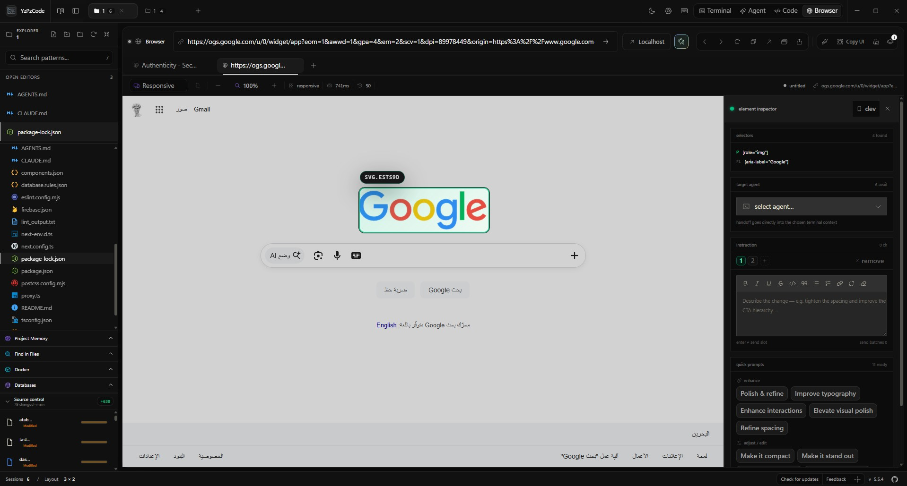
        <br /><sub><b>Deep visual element &amp; style inspector</b></sub>
      </td>
    </tr>
  </table>
</div>

---

##  Supported AI Coding CLIs

YzPzCode detects, launches and manages PTY sessions for 26 external AI coding agents. The core integrations:

```
                     ┌─── Claude (Anthropic)
                     ├─── Antigravity (Google)
                     ├─── Codex (OpenAI)
                     ├─── OpenCode
  YzPzCode Host ─────┼─── Cursor
                     ├─── Kilo
                     ├─── Hermes
                     ├─── Pi (earendil-works)
                     └─── Command Code
```

| Agent | CLI command | Primary role & strengths |
| :--- | :---: | :--- |
| **Claude Code** | `claude` | Deep reasoning, autonomous refactoring, large context |
| **Antigravity CLI** | `agy` | Autonomous task execution, agentic workflows, Google AI |
| **Codex CLI** | `codex` | Precision code generation and unit test authoring |
| **OpenCode** | `opencode` | Open-source agent for customizable local workflows |
| **Cursor CLI** | `cursor` | Agentic file editing and codebase indexing |
| **Kilo** | `kilo` | Fast, terminal-native agent workflows |
| **Hermes** | `hermes` | Compact autonomous terminal assistant |
| **Pi** | `pi` | Minimalist coding agent harness with extension hooks |
| **Command Code** | `cmd` / `cmdc` | Interactive command and script orchestration |

<details>
<summary><b>Show the 17 additional integrations</b></summary>

<br />

| Agent | CLI command | Agent | CLI command |
| :--- | :---: | :--- | :---: |
| **Cline CLI** | `cline` | **Grok CLI** | `grok` |
| **Devin for Terminal** | `devin` | **Trae CLI** | `traecli` |
| **Kimi Code CLI** | `kimi` | **Qoder CLI** | `qoder` |
| **GitHub Copilot CLI** | `copilot` | **Kiro CLI** | `kiro-cli` |
| **Mistral Vibe** | `vibe` | **DeepSeek TUI** | `deepseek` |
| **Aider** | `aider` | **Amp** | `amp` |
| **DeepSeek Reasonix** | `reasonix` | **CodeBuddy Code** | `codebuddy` |
| **DeepSeek Harness** | `dsh` | **AtomCode CLI** | `atomcode` |
| **MiMo Code** | `mimo` | | |

</details>

See [the CLI integration reference](docs/cli-integrations.md) for vendor install instructions, documentation and platform notes.

> [!IMPORTANT]
> YzPzCode integrates with third-party CLIs via PTY bridges and is **not affiliated with or endorsed by their respective vendors** unless explicitly stated.

---

##  SaaS & Developer Tool CLIs

Installation status, executable paths and authentication state for popular cloud and developer CLIs are tracked for you:

<div align="center">

| Service | Command | Service | Command |
| :--- | :---: | :--- | :---: |
| **GitHub CLI** | `gh` | **PostHog** | `posthog-cli` |
| **Supabase** | `supabase` | **ElevenLabs** | `elevenlabs` |
| **Stripe** | `stripe` | **Google Workspace** | `gws` |
| **Vercel** | `vercel` | **AgentMail** | `agentmail-cli` |
| **Valyu** | `valyu-cli` | **Ramp** | `ramp` |

</div>

See [the Tool CLIs reference guide](docs/ToolCLIs.md) for workflows, common commands and authentication details.

---

##  Graphical Workspace Extensions

Run graphical coding assistants right next to your shells and agents, inside the workspace grid. Press **`Ctrl+Shift+X`** or click the Extensions icon in the header to open the catalog.

| Extension | Publisher | Description |
| :--- | :--- | :--- |
| **Google Antigravity** | Google | Google's official agentic assistant with chat, plans and code edits. |
| **Kilo Code** | Kilo | Code, plan and debug with Kilo's visual extension panel. |
| **Cline** | Cline | Autonomous coding assistant with plan/act modes and tool approval gates. |
| **OpenAI Codex** | OpenAI | OpenAI's coding extension with ChatGPT sign-in and code assistance. |
| **Claude Code** | Anthropic | Anthropic's visual coding assistant and conversation panel. |
| **Continue** | Continue | Open-source agent and code chat with cloud or local model backends. |
| **Amazon Q Developer** | AWS | Code chat and inline feature development with Amazon Q. |
| **Tabby** | TabbyML | Self-hosted coding assistant connected to a private Tabby server. |
| **Windsurf Plugin** | Windsurf | Codeium assistant with AI code chat and codebase index. |
| **Mistral Vibe** | Mistral AI | Mistral's visual coding agent with context, conversations and tools. |
| **Roo Code** | Roo Code | Cline-family agent with custom modes, multi-model support and per-step approvals. |
| **Qoder CN** | Alibaba Cloud | Alibaba Cloud's agentic coding assistant with chat and agent modes; requires sign-in. |
| **Augment** | Augment Code | Coding agent with a context engine built for large codebases; requires sign-in. |
| **Nexrall Code** | Nexrall | Autonomous coding agent with per-step approvals, checkpoints and MCP tools; requires an account. |

- 🎛️ **Side-by-side grid layouts**: panels mount inside the terminal grid with drag-and-drop reordering, interactive resizing, focus presets and split layouts.
- 📌 **Editor side dock**: dock a panel to the right of the editor (`Ctrl+Alt+B`) and move it between grid and dock without restarting it.
- 📨 **Prompt handoff**: send a browser-inspector selection or a UI reference straight into an assistant panel; the prompt is inserted and submitted, and the outcome shows on the panel header.
- 🌈 **Activity glow**: panels get the same working ring and finish effect as agent terminals.
- 📦 **Zero-config managed runtime**: a verified VSCodium `reh-web` runtime is provisioned with pinned SHA-256 digests and Open VSX packages. No VS Code or Node install needed.
- 🛡️ **Hardened sandboxing**: every assistant runs in an isolated child webview on its own `panel-<uuid>.localhost:<port>` origin with persistent storage, and cannot call Tauri host commands.
- 🔒 **Workspace trust & persistence**: trust approvals (`workspace-trust.json`) and IndexedDB workbench state (`workbench-state.json`) are kept per workspace.

See [the graphical workspace extensions documentation](docs/extensions.md) for architecture, runtime specifications and validation details.

---

##  Writing, Presentation & Sheets Studios

<div align="center">
  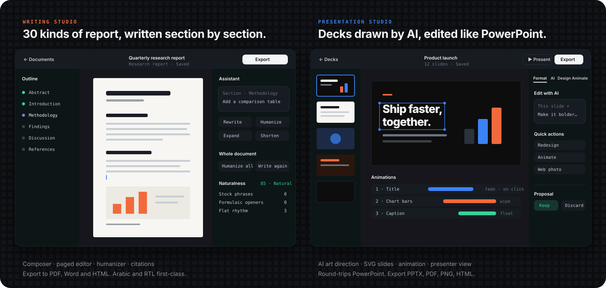
</div>

<br />

Besides coding, the setup page's mode switch opens three document studios. They need no terminals or IDEs, run the AI through the CLIs you already have installed (Claude Code, Codex, Grok, Antigravity, OpenCode) in a headless runner, and save into one folder, `Documents/YzPzCode`, so reports, decks and workbooks are found again after a reinstall.

<table>
<tr>
<td width="50%" valign="top">

###  Writing Studio

- **30 report kinds**: pick a kind and answer one question in a single-box composer; attach files, paste material, add references
- **Streaming paged editor**: outline with live section status, tables, figures, citations and footnotes, with your reading place held while sections stream in
- **Assistant**: write the remaining sections, rewrite the selection or section, humanize or rewrite the whole document, with a review card for every change
- **Humanizer & lint**: naturalness score, stock-phrase, opener, rhythm and em-dash checks, optional highlighting
- **Design panel**: six templates, fonts, colours, page and structure controls, and **Restyle with AI** with one-click undo
- **Real web photos**: openly licensed images from Openverse, Unsplash or Pexels with credit, never AI images
- **Export**: PDF, Word `.docx`, standalone HTML; import existing `.docx`

</td>
<td width="50%" valign="top">

###  Presentation Studio

- **AI-designed decks**: describe the deck; the AI invents a design system, writes a storyline with per-page briefs, then draws every slide as SVG
- **Real slide editor**: select, marquee, drag with guides, resize, type in place, shapes, pictures, tables, groups, format bar
- **Edit with AI**: change one slide, several or the whole deck; every change is a proposal with Keep or Discard, batches are reviewed side by side
- **Animation**: entrance, emphasis and exit effects, click order, paragraph builds and AI-designed motion
- **Pictures**: drop files or folders, mention paths in the prompt, or add real web photos
- **PowerPoint round trip**: import `.pptx` as PowerPoint draws it; export editable PowerPoint, "exact look" PowerPoint, PDF, PNG and HTML
- **Presenter mode**: fullscreen show, presenter view with notes, timer and pace, transitions and narration

</td>
</tr>
</table>

###  Arabic and right-to-left, first-class

Arabic, Hebrew, Persian and Urdu work in both studios: paragraph direction follows the text, printed labels (Chapter, Table, Figure, Contents…) follow the document language, Word and PowerPoint exports write real bidirectional paragraphs, and a catalog of about 150 fonts (Latin and Arabic, with bundled `@fontsource` faces) feeds every font picker.

---

##  Mobile Device Window

<div align="center">
  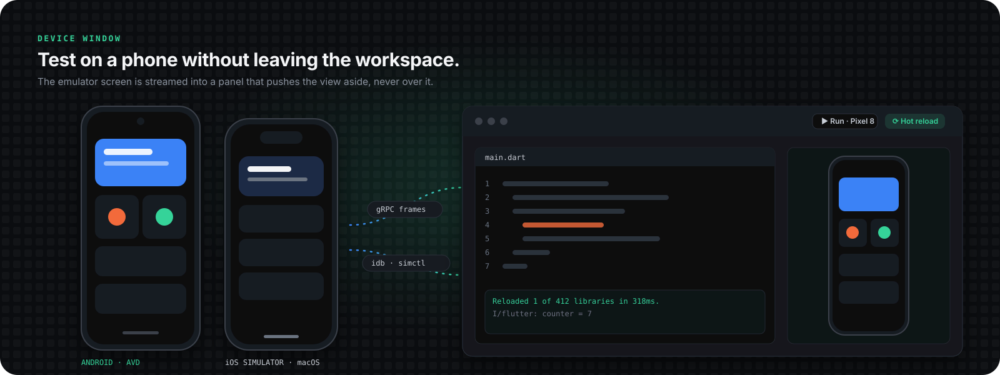
</div>

<br />

A device window slides in from the right edge of every workspace view (terminal, extensions, editor, browser) and pushes the view aside instead of floating over it, so native webviews are never covered.

- 🤖 **Embedded Android emulator**: create and start AVDs from the app; the screen streams into the window (gRPC frames through the shared `frame-codec` crate) with touch, multi-touch, keyboard, scroll, rotation, skins and screenshots.
- 🍎 **iOS Simulator (macOS)**: discovery and lifecycle through `simctl`, screen and input through `idb_companion`. Off macOS it is reported as unavailable.
- 🐦 **Flutter run bar**: run the workspace's app on the chosen device with hot reload (also on `.dart` save), hot restart and a live log.
- 🛠️ **Guided setup**: **Settings → Environment** inspects the Flutter, Android (and Xcode on macOS) toolchain and offers one-click fixes for missing SDK parts and hardware acceleration.

---

##  Local Narration

<div align="center">
  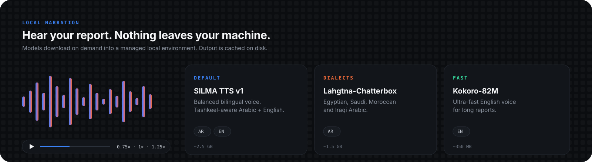
</div>

<br />

Reports and slides can be read aloud without sending text to a cloud service. Narration runs in a managed local Python environment and downloads models on demand (**Settings → Narration**).

| Model | Languages | Size | Notes |
| :--- | :---: | :---: | :--- |
| **SILMA TTS v1** (default) | Arabic + English | ~2.5 GB | Balanced bilingual voice, Tashkeel-aware |
| **Lahgtna-Chatterbox** | Arabic | ~1.5 GB | Egyptian, Saudi, Moroccan and Iraqi dialects |
| **Kokoro-82M** | English | ~350 MB | Very fast, suited to long reports |

Language is detected from the text, speed is 0.75× / 1× / 1.25×, and synthesized audio is cached on disk (LRU, 500 MB cap). Narrate the selection or a section in the Writing Studio, and slides in the Presentation Studio and presenter mode.

---

##  Application Run & Build System

Launch, build and debug your applications with zero configuration. Project manifests and runnable entry points are discovered across 15+ ecosystems, right inside terminal headers.

<div align="center">

| Ecosystem | Detection & execution |
| :--- | :--- |
| **Python** | Detects `.py` scripts, `main.py`, `app.py`, Django `manage.py`, Flask and FastAPI servers. Prefers a local `.venv`, `venv` or system Python. |
| **JavaScript / TypeScript** | Discovers `package.json` dev, start and build scripts. Invokes `npm`, `pnpm`, `Yarn` or `Bun` from the lockfile. |
| **Rust / Go / Flutter** | Cargo (`cargo run`), Go modules (`go run .`) and Flutter project manifests (`flutter run`). |
| **C / C++** | Finds sources with `main()`, compiles via GCC or Clang into `.yzpz-run/` and runs the binary. |
| **CMake** | Reads the CMake File API to locate Debug targets in `.yzpz-build/`, building before launch. |
| **C# (.NET)** | Discovers and runs executable `.csproj` files in projects and solutions with the .NET SDK. |
| **Java** | Single-file source execution via JDK 11+ and project launch configurations. |
| **Ruby, PHP, Dart, Swift, Lua, Perl, R** | Runs entry points with installed interpreters; Rails and Laravel manifest commands. |

</div>

- ▶️ **One-click run & build** from the terminal header with instant target switching.
- 💬 **Interactive stdin console**: send input to running programs (`input()`, `scanf`, `Console.ReadLine()`) from the terminal input bar.
- 🌐 **Dev-server auto-discovery**: localhost URLs in terminal output become a 1-click preview in the browser bar.
- ⚙️ **Custom run configurations**: commands, environment variables, arguments and working directories in **Settings → Application runs**, global or per workspace.

See [the application runs guide](docs/application-runs.md) for configuration schemas, multi-target switching and compiler details.

---

##  Core Features

<details open>
<summary><b> Multi-agent terminal grid</b></summary>

<br />

- **Real PTY backend**: xterm.js 6 frontend powered by Rust's `portable-pty`
- **Managed commands**: non-interactive and background tasks with PID, exit code and live output streaming
- **Terminal mouse modes**: full xterm mouse reporting (click, drag, any-event, application tracking) for TUIs
- **Hardware-accelerated rendering**: canvas/WebGL pipeline with dirty-rectangle updates for low latency
- **Workspace scoping**: sessions are isolated per project workspace
- **Spawn dialog**: searchable, grouped by shells, primary agents, additional agents and SaaS tool CLIs, with live status badges
- **Agent activity indicator**: idle → working → done per pane, with a working ring, finish effect and optional completion sound
- **Dynamic layouts**: layouts adapt to the number of panes, with drag-reordering and a layout picker
- **Editor terminal panel**: a VS Code-style terminal under the editor (<kbd>Ctrl</kbd>+<kbd>`</kbd> toggles, <kbd>Ctrl</kbd>+<kbd>Shift</kbd>+<kbd>`</kbd> opens a new shell) with a shell picker and per-workspace scrollback
- **External terminal tiling**: native consoles (Windows Terminal, macOS Terminal, Linux) with auto-tiling

</details>

<details>
<summary><b> Editor, previews & source control</b></summary>

<br />

- **Multi-tab workspace**: split views and tab management (close others / right / saved)
- **Syntax highlighting & minimap**: Monaco and CodeMirror engines
- **Rich previews**: Markdown, PDF, CSV, Excel (`.xlsx`), Word (`.docx`) and Draw.io diagrams
- **Media & binary previews**: audio (waveform, transport, speed, loop) and video streamed with HTTP range support, plus a hex view for other binary files
- **Transactional file sync**: a recursive watcher (`notify`) with debounced sync keeps open tabs in step with external IDEs and agents
- **Integrated Git**: branch switching, diff stats, stage/unstage files or hunks, discard, commit and remote sync
- **OS clipboard in the explorer**: copy, cut and paste files (and clipboard images) between the explorer and the operating system, with per-item outcomes and undo
- **Open in terminal**: any folder into a new integrated pane or an external terminal

</details>

<details>
<summary><b> In-app browser & visual inspector</b></summary>

<br />

- **Quick prompt card**: pick an element and a small card appears beside it: choose an agent or extension panel, type one line, send. **More controls** opens the full inspector with the draft carried over
- **Deep element inspector**: computed CSS, pseudo-elements, box model and DOM hierarchy
- **Style picker & generator**: capture styles, generate atomic CSS classes, apply with a full undo stack
- **UI element capture**: structure, layout, typography, pseudo-elements, assets and design intent as reusable UI references
- **Tabs, start page & device emulation**: per-workspace tabs, a start page listing live dev servers, device presets and custom viewports
- **Dev-server integration**: 1-click preview when a dev server emits a local URL

</details>

<details>
<summary><b> AI designer & layered image editor</b></summary>

<br />

- **Prompt-to-UI generator**: responsive HTML/CSS/JS interfaces from natural language
- **Layered canvas**: raster, vector, text and shape layers powered by Konva
- **16 blend modes**, opacity, rotation, masking, marquee and lasso selections, history
- **Export**: PNG, JPG, WebP, SVG, GIF, BMP, AVIF, TIFF

</details>

<details>
<summary><b> Customization</b></summary>

<br />

- 🌗 **Dark / light modes** with dynamic theming across the whole UI
- 🎨 **8 accent colours**: Default, Blue, Purple, Green, Orange, Red, Pink, Cyan
- 🧪 **Custom theme engine**: build a theme from 9 colours, a light/dark base and a radius, with WCAG contrast checks, 40+ presets and JSON import/export (**Settings → Appearance → Custom themes**)
- 🌌 **Animated backgrounds**: aurora, galaxy and light rays for the setup screen and workspaces, with intensity, speed, blur and opacity controls
- 💎 **Modern app chrome**: view switcher tabs, status indicators and real-time process monitoring in the footer
- 📐 **3 density presets**: Compact, Comfortable, Spacious
- ⌨️ **Terminal styling**: fonts, ligatures, cursor styles, mouse tracking and opacity
- ♿ **Accessibility**: animation disable toggle (reduced motion), custom cursor toggle

</details>

---

##  Architecture

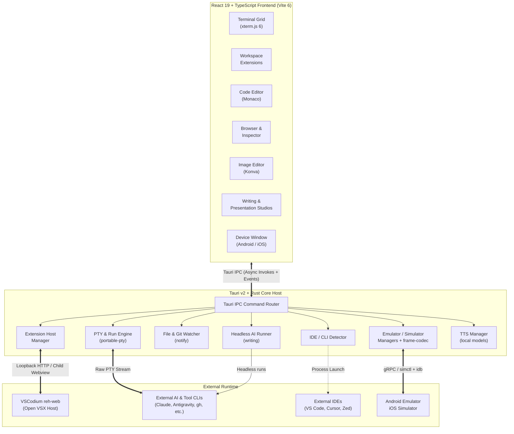

<details>
<summary><b>Technology matrix</b></summary>

<br />

| Layer | Technologies |
| :--- | :--- |
| **Desktop shell** | [Tauri v2](https://v2.tauri.app/), [Rust](https://www.rust-lang.org/) (2021 Edition) |
| **Concurrency & PTY** | `tokio`, `portable-pty`, `notify`, `which` |
| **Extension host** | VSCodium `reh-web` (Open VSX), sandboxed child webviews (`panel-*.localhost`) |
| **Frontend** | [React 19](https://react.dev/), [TypeScript 5.6](https://www.typescriptlang.org/), [Vite 6](https://vitejs.dev/) |
| **Styling & motion** | [Tailwind CSS v4](https://tailwindcss.com/), [Framer Motion](https://www.framer.com/motion/) |
| **Terminal & editor** | [@xterm/xterm 6](https://xtermjs.org/), [Monaco Editor](https://microsoft.github.io/monaco-editor/), CodeMirror 6 |
| **Canvas & media** | [Konva](https://konvajs.org/), `pdfjs`, `xlsx`, `mammoth` |
| **Documents** | [TipTap](https://tiptap.dev/) (paged writing editor), `docx`, `pptxgenjs` + JSZip, SVG slide pipeline |
| **Mobile devices** | Android emulator gRPC streaming, `simctl` + `idb_companion` (iOS), Flutter CLI, `frame-codec` crate |
| **Speech** | Managed local Python environment with SILMA TTS, Lahgtna-Chatterbox and Kokoro models |
| **State** | [Zustand 5](https://github.com/pmndrs/zustand) with persistent storage |

</details>

<details>
<summary><b>Project structure</b></summary>

<br />

```text
yzpzcode/
├── .github/workflows/          # CI/CD release workflows (multi-platform builds)
├── docs/                       # Guides, screenshots and README graphics (docs/readme)
└── app/
    ├── src-tauri/              # Rust backend
    │   ├── crates/
    │   │   └── frame-codec/    # Shared screen-frame codec for device streaming
    │   └── src/
    │       ├── agent/          # Autonomous agent task orchestration & retry logic
    │       ├── agent_cli/      # AI & tool CLI detection, installation & auth
    │       ├── android/        # Android SDK, embedded emulator, Flutter run & setup
    │       ├── ios/            # iOS Simulator (simctl) and idb_companion streaming
    │       ├── writing/        # Headless AI runner for the studios, PDF printing
    │       ├── tts/            # Local narration: managed env, model catalog, bridge, cache
    │       ├── browser/        # Webview management & visual inspector bridge
    │       ├── commands/       # Tauri IPC commands (~100+ endpoints)
    │       ├── extension_host/ # Embedded VSCodium web runtime manager, Open VSX & VSIX sandboxing
    │       ├── terminal/       # PTY sessions, run engine & managed commands
    │       ├── filesystem/     # Recursive watcher, transactional file sync, Git ops & diffs
    │       ├── ide/            # External IDE launcher (VS Code, Cursor, Zed, etc.)
    │       └── discord_presence/ # Discord Rich Presence integration
    │
    └── src/                    # React 19 frontend
        ├── components/
        │   ├── workspace/      # Terminal grid, extension panels, editor terminal, dock, browser, device window
        │   ├── writing/        # Writing Studio (composer, paged editor, assistant, design, references)
        │   ├── presentation/   # Presentation Studio (AI-designed decks, slide editor, presenter mode)
        │   ├── studio/         # Shared studio chrome (top bar, inspector parts, font options)
        │   ├── tts/            # Narration controls and model picker
        │   ├── editor/         # Editor tabs & rich file previews
        │   ├── explorer/       # Virtualized file tree & Git panels
        │   ├── designer/       # AI design generation studio
        │   ├── image/          # Layered canvas image editor
        │   ├── settings/       # Preferences panel
        │   └── setup/          # Interactive onboarding wizard
        ├── hooks/              # Custom React hooks (useTerminal, useBrowser, useFileWatcher, ...)
        ├── stores/             # Zustand stores (appStore, runConfigStore, extensionStore, deviceStore, ...)
        ├── utils/              # Pure, dependency-free modules (writing/, presentation/, tts/, ...) with node --test suites
        └── types/              # TypeScript mirrors of Rust structs
```

</details>

---

##  Download & Installation

### Option 1: Pre-built binaries (recommended)

Grab the latest installer from the **[Releases page](https://github.com/wolfenazz/YzPzCode/releases/latest)**:

| Platform | Package format | Architecture |
| :--- | :--- | :--- |
| **🪟 Windows** | `.msi` / `.exe` installer | x86_64 |
| **🍎 macOS** | `.dmg` installer | Apple Silicon (`aarch64`) & Intel (`x86_64`) |
| **🐧 Linux** | `.deb` / `.AppImage` | x86_64 |

> [!TIP]
> **macOS**: for an unsigned build, open with **Right Click → Open**, or allow it under *System Settings → Privacy & Security → Open Anyway*.

### Option 2: Build from source

**Prerequisites:** Node.js `22.x` or higher, the latest stable Rust toolchain (`rustup update stable`), and C++ build tools (Visual Studio Build Tools on Windows, Xcode CLI Tools on macOS, `build-essential` on Linux).

```bash
git clone https://github.com/wolfenazz/YzPzCode.git
cd YzPzCode/app

npm install            # frontend dependencies
npm run tauri dev      # development mode (port 8745)
npm run tauri build    # production installers
```

The compiled binaries land in `app/src-tauri/target/release/bundle/`.

---

##  Security & Privacy

YzPzCode is built **local-first**:

- 🛡️ **Your code stays local**: project files and source code are never uploaded to third-party servers by YzPzCode itself.
- 🔑 **Locally stored secrets**: API keys and tokens live only on your machine.
- 📡 **Direct provider connections**: requests go straight to the official endpoints of the providers you configure.
- 🔊 **On-device narration**: text-to-speech models run locally; nothing is sent to a speech service.

---

##  Contributing

Contributions make open source incredible. Bug reports, improvements and new features are all appreciated. Check [open issues](https://github.com/wolfenazz/YzPzCode/issues) or start a discussion before proposing major architectural changes.

```bash
# Typecheck the frontend
cd app && npx tsc --noEmit

# Check Rust formatting & lints, then run Rust tests
cd src-tauri
cargo fmt --check
cargo clippy -- -D warnings
cargo test

# Frontend pure-module suites (from app/)
npm run test:writing
npm run test:presentation
npm run test:browser
npm run test:explorer
npm run test:custom-theme
npm run test:workspace-setup
npm run test:workspace-view
npm run test:device
```

---

##  Contributors

<div align="center">
  <a href="https://github.com/wolfenazz/YzPzCode/graphs/contributors">
    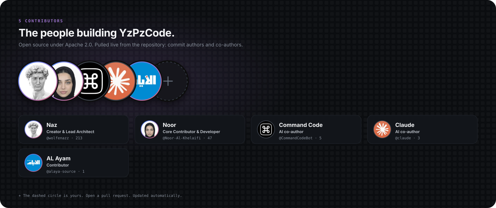
  </a>
  <br /><br />
  <sub>
    <a href="https://github.com/wolfenazz"><b>@wolfenazz</b></a> · Creator &amp; Lead Architect &nbsp;&nbsp;|&nbsp;&nbsp;
    <a href="https://github.com/Noor-Al-Khelaifi"><b>@Noor-Al-Khelaifi</b></a> · Core Contributor &amp; Developer
  </sub>
</div>

---

##  License

YzPzCode is open-source software licensed under the **[Apache License 2.0](LICENSE)**.

<div align="center">
  <br />
  <b>Build with your AI agents, not around them.</b>
  <br /><br />
  <a href="https://github.com/wolfenazz/YzPzCode/releases/latest">Download YzPzCode</a> •
  <a href="docs/userguid.md">Documentation</a> •
  <a href="https://github.com/wolfenazz/YzPzCode/issues/new">Report a bug</a> •
  <a href="https://github.com/wolfenazz/YzPzCode/issues/new">Request a feature</a>
  <br /><br />
</div>
