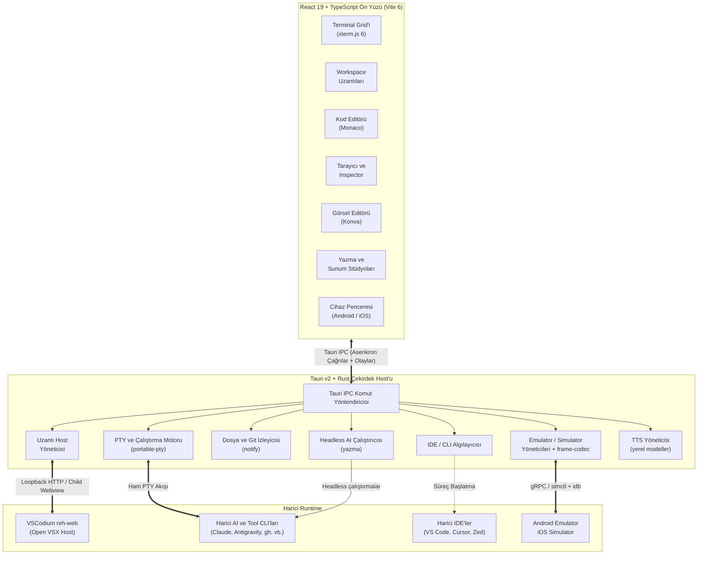

<div align="center">

<a href="https://github.com/wolfenazz/YzPzCode/releases/latest">
  
</a>
<br />
<p align="center">
  <a href="https://github.com/wolfenazz/YzPzCode/releases/latest">
    
  </a>
  <a href="https://github.com/wolfenazz/YzPzCode/blob/main/LICENSE">
    
  </a>
  <a href="docs/userguid.md">
    
  </a>
  <a href="https://github.com/wolfenazz/YzPzCode/issues">
    
  </a>
  
</p>

<p align="center">
  <a href="README.md">English</a> &nbsp;|&nbsp;
  <a href="ARREADME.MD">العربية</a> &nbsp;|&nbsp;
  <a href="DEREADME.MD">Deutsch</a> &nbsp;|&nbsp;
  <a href="ESREADME.MD">Español</a> &nbsp;|&nbsp;
  <a href="FRREADME.MD">Français</a> &nbsp;|&nbsp;
  <a href="PTREADME.MD">Português (BR)</a> &nbsp;|&nbsp;
  <b>Türkçe</b>
</p>

<p align="center">
  <a href="#-neden-yzpzcode">Neden</a> •
  <a href="#-her-şey-tek-pencerede">Genel Bakış</a> •
  <a href="#desteklenen-yapay-zeka-kodlama-cliları">Ajanlar</a> •
  <a href="#grafiksel-workspace-uzantıları">Uzantılar</a> •
  <a href="#yazma-sunum-ve-hesap-tablosu-stüdyoları">Stüdyolar</a> •
  <a href="#mobil-cihaz-penceresi">Cihazlar</a> •
  <a href="#yerel-seslendirme">Seslendirme</a> •
  <a href="#uygulama-çalıştırma-ve-build-sistemi">Çalıştırma ve Build</a> •
  <a href="#i̇ndirme-ve-kurulum">İndirme</a> •
  <a href="#katkıda-bulunanlar">Katkıda Bulunanlar</a>
</p>

</div>

> [!NOTE]
> **YzPzCode aktif olarak geliştirilmektedir.** Özellikler deneysel olabilir veya sürümler arasında değişebilir. Geri bildirimler, hata raporları ve pull request'ler memnuniyetle karşılanır.

---

## ⚡ Neden YzPzCode?

Yapay zeka destekli geliştirme genellikle terminal sekmeleri, ajanlar, tarayıcılar, IDE'ler ve tek seferlik CLI'lar arasında gidip gelmeye dönüşür. **YzPzCode, pencere karmaşasını tek bir native komuta merkezinde ortadan kaldırır.**

| Geleneksel iş akışı | YzPzCode ile |
| :--- | :--- |
| 🪟 Birbirinden kopuk 8+ terminal penceresi | 🖥️ Özel layout'lara sahip **tek native workspace** |
| 🔄 Sürekli `Alt+Tab` ile bağlam değiştirme | 🎛️ Gerçek PTY oturumlarından oluşan **yan yana terminal grid'i** |
| 🔌 Harici IDE'lere kilitlenmiş asistan panelleri | 🧩 Grid'e gömülü **grafiksel uzantılar** |
| ⚙️ Manuel build script'leri ve çalıştırma komutları | ⚡ 15+ ekosistemi otomatik algılayan **Çalıştırma ve build** |
| 🧩 Harici editör ve dosya görüntüleyici | 📝 Sanallaştırılmış dosya ağacı ve Git içeren **gömülü editör** |
| 🌐 UI kontrolleri için ayrı tarayıcı | 🔍 Ajanlara prompt gönderen görsel inspector'a sahip **uygulama içi tarayıcı** |
| 📱 Ayrı emulator penceresi | 📲 Flutter hot reload özellikli **Android ve iOS cihaz penceresi** |
| 📄 Word, PowerPoint ve ayrı bir AI sohbeti | ✍️ Aynı AI CLI'lar üzerinde **Yazma ve Sunum stüdyoları** |
| 🔑 Tekrarlanan CLI kurulum ve auth kontrolleri | 🔐 **Algılama, tek tıkla kurulum ve auth takibi** |
| 🎨 Hızlı düzenlemeler için Photoshop veya Figma | 🖌️ Blend mode'lu **katmanlı görsel editörü** |

---

## 🧭 Her şey tek pencerede

<div align="center">
  
</div>

<br />

<table>
  <tr>
    <td align="center" width="16%"><h3>26</h3><sub>AI kodlama CLI'ı</sub></td>
    <td align="center" width="16%"><h3>10</h3><sub>SaaS ve araç CLI'ı</sub></td>
    <td align="center" width="16%"><h3>14</h3><sub>grafiksel uzantı</sub></td>
    <td align="center" width="16%"><h3>15+</h3><sub>çalıştırma ve build ekosistemi</sub></td>
    <td align="center" width="16%"><h3>30</h3><sub>rapor türü</sub></td>
    <td align="center" width="16%"><h3>3</h3><sub>yerel ses</sub></td>
  </tr>
</table>

---

## 📸 Uygulamada görün

<div align="center">
  <a href="docs/capture/yzpzcode-showreel.mp4">
    
  </a>
  <br />
  <sub>▶ <a href="docs/capture/yzpzcode-showreel.mp4"><b>Sesli, 45 saniyelik tanıtım videosunun tamamını izleyin</b></a></sub>
  <br /><br />
  <table>
    <tr>
      <td width="50%" align="center">
        
        <br /><sub><b>Terminal grid'i ve workspace explorer'ı</b></sub>
      </td>
      <td width="50%" align="center">
        
        <br /><sub><b>Çok ajanlı işbirlikçi layout</b></sub>
      </td>
    </tr>
    <tr>
      <td width="50%" align="center">
        
        <br /><sub><b>Entegre çok sekmeli webview tarayıcısı</b></sub>
      </td>
      <td width="50%" align="center">
        
        <br /><sub><b>Derin görsel öğe ve stil inspector'ı</b></sub>
      </td>
    </tr>
  </table>
</div>

---

##  Desteklenen Yapay Zeka Kodlama CLI'ları

YzPzCode, 26 harici AI kodlama ajanı için PTY oturumlarını algılar, başlatır ve yönetir. Temel entegrasyonlar:

```
                     ┌─── Claude (Anthropic)
                     ├─── Antigravity (Google)
                     ├─── Codex (OpenAI)
                     ├─── OpenCode
  YzPzCode Host ─────┼─── Cursor
                     ├─── Kilo
                     ├─── Hermes
                     ├─── Pi (earendil-works)
                     └─── Command Code
```

| Ajan | CLI komutu | Temel rol ve güçlü yönler |
| :--- | :---: | :--- |
| **Claude Code** | `claude` | Derin muhakeme, otonom refactoring, geniş context |
| **Antigravity CLI** | `agy` | Otonom görev yürütme, agentic workflow'lar, Google AI |
| **Codex CLI** | `codex` | Hassas kod üretimi ve unit test yazımı |
| **OpenCode** | `opencode` | Özelleştirilebilir yerel workflow'lar için açık kaynak ajan |
| **Cursor CLI** | `cursor` | Agentic dosya düzenleme ve codebase indexing |
| **Kilo** | `kilo` | Hızlı, terminal-native ajan workflow'ları |
| **Hermes** | `hermes` | Kompakt otonom terminal asistanı |
| **Pi** | `pi` | Extension hook'larına sahip minimalist kodlama ajanı altyapısı |
| **Command Code** | `cmd` / `cmdc` | Etkileşimli komut ve script orkestrasyonu |

<details>
<summary><b>17 ek entegrasyonu göster</b></summary>

<br />

| Ajan | CLI komutu | Ajan | CLI komutu |
| :--- | :---: | :--- | :---: |
| **Cline CLI** | `cline` | **Grok CLI** | `grok` |
| **Devin for Terminal** | `devin` | **Trae CLI** | `traecli` |
| **Kimi Code CLI** | `kimi` | **Qoder CLI** | `qoder` |
| **GitHub Copilot CLI** | `copilot` | **Kiro CLI** | `kiro-cli` |
| **Mistral Vibe** | `vibe` | **DeepSeek TUI** | `deepseek` |
| **Aider** | `aider` | **Amp** | `amp` |
| **DeepSeek Reasonix** | `reasonix` | **CodeBuddy Code** | `codebuddy` |
| **DeepSeek Harness** | `dsh` | **AtomCode CLI** | `atomcode` |
| **MiMo Code** | `mimo` | | |

</details>

Satıcı kurulum yönergeleri, dokümantasyon ve platform notları için [CLI entegrasyon referansına](docs/cli-integrations.md) bakın.

> [!IMPORTANT]
> YzPzCode, üçüncü taraf CLI'larla PTY bridge'leri üzerinden entegre olur ve açıkça belirtilmedikçe **ilgili satıcılarla bağlantılı değildir ve onlar tarafından desteklenmez**.

---

##  SaaS ve Geliştirici Aracı CLI'ları

Popüler cloud ve geliştirici CLI'ları için kurulum durumu, çalıştırılabilir dosya yolları ve auth durumu sizin için izlenir:

<div align="center">

| Hizmet | Komut | Hizmet | Komut |
| :--- | :---: | :--- | :---: |
| **GitHub CLI** | `gh` | **PostHog** | `posthog-cli` |
| **Supabase** | `supabase` | **ElevenLabs** | `elevenlabs` |
| **Stripe** | `stripe` | **Google Workspace** | `gws` |
| **Vercel** | `vercel` | **AgentMail** | `agentmail-cli` |
| **Valyu** | `valyu-cli` | **Ramp** | `ramp` |

</div>

Workflow'lar, yaygın komutlar ve auth ayrıntıları için [Tool CLI referans kılavuzuna](docs/ToolCLIs.md) bakın.

---

##  Grafiksel Workspace Uzantıları

Grafiksel kodlama asistanlarını shell'lerinizin ve ajanlarınızın hemen yanında, workspace grid'inin içinde çalıştırın. Kataloğu açmak için **`Ctrl+Shift+X`** tuşlarına basın veya header'daki Extensions simgesine tıklayın.

| Uzantı | Yayıncı | Açıklama |
| :--- | :--- | :--- |
| **Google Antigravity** | Google | Google'ın sohbet, planlar ve kod düzenlemeleri içeren resmi agentic asistanı. |
| **Kilo Code** | Kilo | Kilo'nun görsel uzantı paneliyle kod yazın, planlayın ve debug edin. |
| **Cline** | Cline | Plan/act modları ve araç onay kapıları olan otonom kodlama asistanı. |
| **OpenAI Codex** | OpenAI | ChatGPT oturum açma ve kod desteği içeren OpenAI kodlama uzantısı. |
| **Claude Code** | Anthropic | Anthropic'in görsel kodlama asistanı ve sohbet paneli. |
| **Continue** | Continue | Cloud veya yerel model backend'leriyle açık kaynak ajan ve kod sohbeti. |
| **Amazon Q Developer** | AWS | Amazon Q ile kod sohbeti ve satır içi özellik geliştirme. |
| **Tabby** | TabbyML | Özel bir Tabby sunucusuna bağlı, self-hosted kodlama asistanı. |
| **Windsurf Plugin** | Windsurf | AI kod sohbeti ve codebase index'i olan Codeium asistanı. |
| **Mistral Vibe** | Mistral AI | Context, sohbetler ve araçlarla Mistral'ın görsel kodlama ajanı. |
| **Roo Code** | Roo Code | Özel modlar, çoklu model desteği ve adım bazlı onayları olan Cline ailesi ajanı. |
| **Qoder CN** | Alibaba Cloud | Sohbet ve ajan modlarına sahip Alibaba Cloud agentic kodlama asistanı; oturum açmak gerekir. |
| **Augment** | Augment Code | Büyük codebase'ler için oluşturulmuş context engine'e sahip kodlama ajanı; oturum açmak gerekir. |
| **Nexrall Code** | Nexrall | Adım bazlı onaylar, checkpoint'ler ve MCP araçları olan otonom kodlama ajanı; hesap gerekir. |

- 🎛️ **Yan yana grid layout'ları**: Paneller terminal grid'inin içine yerleşir; sürükle bırak ile yeniden sıralama, etkileşimli boyutlandırma, focus preset'leri ve split layout'lar sunar.
- 📌 **Editör yan dock'u**: Bir paneli editörün sağına dock edin (`Ctrl+Alt+B`) ve yeniden başlatmadan grid ile dock arasında taşıyın.
- 📨 **Prompt aktarımı**: Browser inspector seçimini veya UI referansını doğrudan asistan paneline gönderin; prompt eklenip gönderilir, sonuç panel header'ında görünür.
- 🌈 **Aktivite parıltısı**: Paneller, ajan terminalleriyle aynı çalışma halkasını ve bitiş efektini alır.
- 📦 **Sıfır konfigürasyonlu managed runtime**: Sabitlenmiş SHA-256 digest'leri ve Open VSX paketleriyle doğrulanmış bir VSCodium `reh-web` runtime'ı sağlanır. VS Code veya Node kurulumu gerekmez.
- 🛡️ **Güçlendirilmiş sandbox**: Her asistan, kalıcı depolamaya sahip kendi `panel-<uuid>.localhost:<port>` origin'inde izole bir child webview olarak çalışır ve Tauri host komutlarını çağıramaz.
- 🔒 **Workspace trust ve kalıcılık**: Trust onayları (`workspace-trust.json`) ve IndexedDB workbench durumu (`workbench-state.json`) workspace başına tutulur.

Mimari, runtime özellikleri ve doğrulama ayrıntıları için [grafiksel workspace uzantıları dokümantasyonuna](docs/extensions.md) bakın.

---

##  Yazma, Sunum ve Hesap Tablosu Stüdyoları

<div align="center">
  
</div>

<br />

Kodlamanın yanı sıra setup sayfasındaki mode switch üç belge stüdyosu açar. Terminal veya IDE gerektirmezler, AI'ı zaten kurulu CLI'larınız (Claude Code, Codex, Grok, Antigravity, OpenCode) üzerinden headless runner'da çalıştırır ve raporların, deck'lerin ve workbook'ların reinstall sonrasında da bulunabilmesi için tek bir klasöre, `Documents/YzPzCode`, kaydeder.

<table>
<tr>
<td width="50%" valign="top">

### Writing Studio

- **30 rapor türü**: Bir tür seçin ve tek kutulu composer'da tek bir soruyu yanıtlayın; dosya ekleyin, materyal yapıştırın, referans ekleyin
- **Streaming sayfalı editör**: Canlı bölüm durumu, tablolar, şekiller, alıntılar ve dipnotlarla outline; bölümler akarken okuma konumunuz korunur
- **Asistan**: Kalan bölümleri yazın, seçimi veya bölümü yeniden yazın, tüm belgeyi humanize edin ya da yeniden yazın; her değişiklik için review card
- **Humanizer ve lint**: Doğallık skoru, kalıp ifade, açılış, ritim ve em dash kontrolleri, isteğe bağlı vurgulama
- **Tasarım paneli**: Altı template, fontlar, renkler, sayfa ve yapı kontrolleri ile tek tıkla geri almalı **Restyle with AI**
- **Gerçek web fotoğrafları**: Openverse, Unsplash veya Pexels'ten atıflı, açık lisanslı görseller; hiçbir zaman AI görseli değil
- **Dışa aktarma**: PDF, Word `.docx`, bağımsız HTML; mevcut `.docx` içe aktarma

</td>
<td width="50%" valign="top">

### Presentation Studio

- **AI tasarımlı deck'ler**: Deck'i açıklayın; AI bir tasarım sistemi oluşturur, sayfa başına brief'lerle hikaye akışını yazar ve her slide'ı SVG olarak çizer
- **Gerçek slide editörü**: Seçin, marquee kullanın, guide'larla sürükleyin, boyutlandırın, yerinde yazın, şekiller, görseller, tablolar, gruplar ve format bar
- **AI ile düzenleme**: Bir slide'ı, birkaçını veya tüm deck'i değiştirin; her değişiklik Keep veya Discard içeren bir öneridir, batch'ler yan yana incelenir
- **Animasyon**: Giriş, vurgu ve çıkış efektleri, tıklama sırası, paragraf build'leri ve AI tasarımlı hareket
- **Görseller**: Dosya veya klasör bırakın, prompt'ta yolları belirtin ya da gerçek web fotoğrafları ekleyin
- **PowerPoint round trip**: `.pptx` dosyasını PowerPoint'in çizdiği şekilde içe aktarın; düzenlenebilir PowerPoint, "exact look" PowerPoint, PDF, PNG ve HTML dışa aktarın
- **Presenter mode**: Tam ekran gösteri, notlar, zamanlayıcı ve tempo içeren presenter görünümü, geçişler ve seslendirme

</td>
</tr>
</table>

### Arapça ve sağdan sola, birinci sınıf destek

Arapça, İbranice, Farsça ve Urduca her iki stüdyoda çalışır: paragraf yönü metni izler, yazdırılan etiketler (Chapter, Table, Figure, Contents…) belge dilini izler, Word ve PowerPoint dışa aktarımları gerçek çift yönlü paragraflar yazar ve yaklaşık 150 fonttan oluşan katalog (Latin ve Arapça, paketlenmiş `@fontsource` yüzleriyle) her font seçiciyi besler.

---

##  Mobil Cihaz Penceresi

<div align="center">
  
</div>

<br />

Bir cihaz penceresi her workspace görünümünün (terminal, uzantılar, editör, tarayıcı) sağ kenarından içeri kayar ve üzerinde yüzmek yerine görünümü yana iter; böylece native webview'ların üzeri hiçbir zaman kapanmaz.

- 🤖 **Gömülü Android emulator**: Uygulamadan AVD'ler oluşturun ve başlatın; ekran dokunma, multi-touch, klavye, kaydırma, döndürme, skin'ler ve screenshot'larla birlikte paylaşılan `frame-codec` crate'i üzerinden gRPC frame'leri olarak pencereye aktarılır.
- 🍎 **iOS Simulator (macOS)**: Keşif ve yaşam döngüsü `simctl`, ekran ve input `idb_companion` üzerinden. macOS dışında kullanılamaz olarak bildirilir.
- 🐦 **Flutter çalıştırma bar'ı**: Workspace uygulamasını seçilen cihazda hot reload (`.dart` kaydında da), hot restart ve canlı log ile çalıştırın.
- 🛠️ **Yönlendirmeli kurulum**: **Settings → Environment**, Flutter, Android (ve macOS'ta Xcode) toolchain'ini inceler ve eksik SDK parçaları ile hardware acceleration için tek tıkla düzeltmeler sunar.

---

##  Yerel Seslendirme

<div align="center">
  
</div>

<br />

Raporlar ve slide'lar, metni bir cloud servisine göndermeden sesli okunabilir. Seslendirme managed local Python environment'ta çalışır ve modelleri isteğe bağlı indirir (**Settings → Narration**).

| Model | Diller | Boyut | Notlar |
| :--- | :---: | :---: | :--- |
| **SILMA TTS v1** (varsayılan) | Arapça + İngilizce | ~2.5 GB | Dengeli iki dilli ses, Tashkeel farkındalığı |
| **Lahgtna-Chatterbox** | Arapça | ~1.5 GB | Mısır, Suudi Arabistan, Fas ve Irak lehçeleri |
| **Kokoro-82M** | İngilizce | ~350 MB | Çok hızlı, uzun raporlar için uygun |

Dil metinden algılanır, hız 0.75× / 1× / 1.25× değerlerindedir ve sentezlenen ses diskte cache'lenir (LRU, 500 MB sınırı). Writing Studio'da seçimi veya bir bölümü, Presentation Studio'da ve presenter mode'da slide'ları seslendirin.

---

##  Uygulama Çalıştırma ve Build Sistemi

Sıfır konfigürasyonla uygulamalarınızı başlatın, build edin ve debug edin. Proje manifest'leri ve çalıştırılabilir entry point'ler, doğrudan terminal header'larında 15+ ekosistemde keşfedilir.

<div align="center">

| Ekosistem | Algılama ve çalıştırma |
| :--- | :--- |
| **Python** | `.py` script'lerini, `main.py`, `app.py`, Django `manage.py`, Flask ve FastAPI sunucularını algılar. Yerel `.venv`, `venv` veya sistem Python'ını tercih eder. |
| **JavaScript / TypeScript** | `package.json` içindeki dev, start ve build script'lerini keşfeder. Lockfile'dan `npm`, `pnpm`, `Yarn` veya `Bun` çağırır. |
| **Rust / Go / Flutter** | Cargo (`cargo run`), Go module'leri (`go run .`) ve Flutter proje manifest'leri (`flutter run`). |
| **C / C++** | `main()` içeren source'ları bulur, GCC veya Clang ile `.yzpz-run/` içine derler ve binary'yi çalıştırır. |
| **CMake** | CMake File API'yi okuyarak `.yzpz-build/` içindeki Debug target'larını bulur, başlatmadan önce build eder. |
| **C# (.NET)** | Proje ve solution'larda çalıştırılabilir `.csproj` dosyalarını .NET SDK ile keşfeder ve çalıştırır. |
| **Java** | JDK 11+ ile tek dosya source çalıştırma ve proje launch konfigürasyonları. |
| **Ruby, PHP, Dart, Swift, Lua, Perl, R** | Entry point'leri kurulu interpreter'larla çalıştırır; Rails ve Laravel manifest komutları. |

</div>

- ▶️ **Tek tıkla çalıştırma ve build**: Terminal header'ından anında target değiştirin.
- 💬 **Etkileşimli stdin konsolu**: Çalışan programlara (`input()`, `scanf()`, `Console.ReadLine()`) terminal input bar'ından girdi gönderin.
- 🌐 **Dev-server otomatik keşfi**: Terminal çıktısındaki localhost URL'leri browser bar'ında tek tıkla preview'a dönüşür.
- ⚙️ **Özel çalıştırma konfigürasyonları**: Global veya workspace'e özel **Settings → Application runs** altında komutlar, environment variable'lar, argümanlar ve çalışma dizinleri.

Konfigürasyon şemaları, çoklu target değiştirme ve compiler ayrıntıları için [uygulama çalıştırma kılavuzuna](docs/application-runs.md) bakın.

---

##  Temel Özellikler

<details open>
<summary><b> Çok ajanlı terminal grid'i</b></summary>

<br />

- **Gerçek PTY backend'i**: Rust'ın `portable-pty`'ı ile çalışan xterm.js 6 frontend'i
- **Managed komutlar**: PID, exit code ve canlı çıktı akışı olan interaktif olmayan ve background görevleri
- **Terminal mouse modları**: TUI'lar için tam xterm mouse reporting (click, drag, any-event, application tracking)
- **Donanım hızlandırmalı rendering**: Düşük gecikme için dirty-rectangle güncellemeli canvas/WebGL pipeline'ı
- **Workspace kapsamı**: Oturumlar proje workspace'i başına izole edilir
- **Spawn dialog'u**: Shell'lere, ana ajanlara, ek ajanlara ve SaaS tool CLI'larına göre gruplanmış, aranabilir; canlı durum badge'leri
- **Ajan aktivite göstergesi**: Her pane'de idle → working → done; çalışma halkası, bitiş efekti ve isteğe bağlı tamamlanma sesi
- **Dinamik layout'lar**: Layout'lar pane sayısına uyum sağlar; sürükleyerek sıralama ve layout seçici
- **Editör terminal paneli**: Editörün altında VS Code tarzı terminal (<kbd>Ctrl</kbd>+<kbd>`</kbd> açıp kapatır, <kbd>Ctrl</kbd>+<kbd>Shift</kbd>+<kbd>`</kbd> yeni shell açar); shell seçici ve workspace başına scrollback
- **Harici terminal döşeme**: Auto-tiling özellikli native konsollar (Windows Terminal, macOS Terminal, Linux)

</details>

<details>
<summary><b> Editör, preview'lar ve source control</b></summary>

<br />

- **Çok sekmeli workspace**: Split view'lar ve sekme yönetimi (diğerlerini / sağı / kaydedilmişleri kapat)
- **Syntax highlighting ve minimap**: Monaco ve CodeMirror engine'leri
- **Zengin preview'lar**: Markdown, PDF, CSV, Excel (`.xlsx`), Word (`.docx`) ve Draw.io diagram'ları
- **Medya ve binary preview'ları**: HTTP range destekli waveform, transport, hız ve loop özellikli ses ile streaming video; diğer binary dosyalar için hex görünümü
- **Transactional file sync**: Debounced sync'li recursive watcher (`notify`), açık sekmeleri harici IDE'ler ve ajanlarla eşit tutar
- **Entegre Git**: Branch değiştirme, diff istatistikleri, dosyaları veya hunk'ları stage/unstage etme, discard, değişiklik kaydı ve remote sync
- **Explorer'da OS clipboard**: Explorer ile işletim sistemi arasında dosyaları (ve clipboard görsellerini) kopyalayın, kesin ve yapıştırın; öğe bazlı sonuçlar ve undo ile
- **Terminalde aç**: Her klasörü yeni bir entegre pane'de veya harici terminalde açın

</details>

<details>
<summary><b> Uygulama içi tarayıcı ve görsel inspector</b></summary>

<br />

- **Hızlı prompt card'ı**: Bir öğe seçin, yanında küçük bir card görünür: ajan veya uzantı paneli seçin, bir satır yazın, gönderin. **More controls**, taslağı taşıyarak tam inspector'ı açar
- **Derin öğe inspector'ı**: Hesaplanmış CSS, pseudo-element'ler, box model ve DOM hiyerarşisi
- **Stil seçici ve generator**: Stilleri yakalayın, atomic CSS class'ları üretin, tam undo stack'iyle uygulayın
- **UI öğesi yakalama**: Yapı, layout, typography, pseudo-element'ler, asset'ler ve tasarım amacı; yeniden kullanılabilir UI referansları olarak
- **Sekmeler, başlangıç sayfası ve cihaz emülasyonu**: Workspace başına sekmeler, canlı dev server'ları listeleyen başlangıç sayfası, cihaz preset'leri ve özel viewport'lar
- **Dev-server entegrasyonu**: Dev server local URL yayınladığında tek tıkla preview

</details>

<details>
<summary><b> AI tasarımcı ve katmanlı görsel editörü</b></summary>

<br />

- **Prompt'tan UI generator'ı**: Doğal dilden responsive HTML/CSS/JS arayüzleri
- **Katmanlı canvas**: Konva ile çalışan raster, vector, text ve shape katmanları
- **16 blend mode**, opacity, rotation, masking, marquee ve lasso selection'ları, history
- **Dışa aktarma**: PNG, JPG, WebP, SVG, GIF, BMP, AVIF, TIFF

</details>

<details>
<summary><b> Özelleştirme</b></summary>

<br />

- 🌗 Tüm UI'da dinamik theming ile **dark / light mode'lar**
- 🎨 **8 accent rengi**: Default, Blue, Purple, Green, Orange, Red, Pink, Cyan
- 🧪 **Özel theme engine**: 9 renk, light/dark base ve radius'tan theme oluşturun; WCAG contrast kontrolleri, 40+ preset ve JSON import/export (**Settings → Appearance → Custom themes**)
- 🌌 **Animasyonlu arka planlar**: Setup ekranı ve workspace'ler için aurora, galaxy ve light ray'ler; intensity, hız, blur ve opacity kontrolleri
- 💎 **Modern app chrome**: View switcher sekmeleri, status indicator'ları ve footer'da gerçek zamanlı process monitoring
- 📐 **3 density preset'i**: Compact, Comfortable, Spacious
- ⌨️ **Terminal styling**: Fontlar, ligature'lar, cursor stilleri, mouse tracking ve opacity
- ♿ **Erişilebilirlik**: Animasyonu kapatma toggle'ı (reduced motion), custom cursor toggle'ı

</details>

---

##  Mimari



<details>
<summary><b>Teknoloji matrisi</b></summary>

<br />

| Katman | Teknolojiler |
| :--- | :--- |
| **Desktop shell** | [Tauri v2](https://v2.tauri.app/), [Rust](https://www.rust-lang.org/) (2021 Edition) |
| **Concurrency ve PTY** | `tokio`, `portable-pty`, `notify`, `which` |
| **Extension host** | VSCodium `reh-web` (Open VSX), sandbox'lanmış child webview'lar (`panel-*.localhost`) |
| **Frontend** | [React 19](https://react.dev/), [TypeScript 5.6](https://www.typescriptlang.org/), [Vite 6](https://vitejs.dev/) |
| **Styling ve motion** | [Tailwind CSS v4](https://tailwindcss.com/), [Framer Motion](https://www.framer.com/motion/) |
| **Terminal ve editör** | [@xterm/xterm 6](https://xtermjs.org/), [Monaco Editor](https://microsoft.github.io/monaco-editor/), CodeMirror 6 |
| **Canvas ve medya** | [Konva](https://konvajs.org/), `pdfjs`, `xlsx`, `mammoth` |
| **Belgeler** | [TipTap](https://tiptap.dev/) (sayfalı writing editor), `docx`, `pptxgenjs` + JSZip, SVG slide pipeline'ı |
| **Mobil cihazlar** | Android emulator gRPC streaming, `simctl` + `idb_companion` (iOS), Flutter CLI, `frame-codec` crate'i |
| **Konuşma** | SILMA TTS, Lahgtna-Chatterbox ve Kokoro modelleriyle yönetilen yerel Python environment'ı |
| **Durum** | Kalıcı depolama özellikli [Zustand 5](https://github.com/pmndrs/zustand) |

</details>

<details>
<summary><b>Proje yapısı</b></summary>

<br />

```text
yzpzcode/
├── .github/workflows/          # CI/CD release workflow'ları (çok platformlu build'ler)
├── docs/                       # Kılavuzlar, screenshot'lar ve README grafikleri (docs/readme)
└── app/
    ├── src-tauri/              # Rust backend'i
    │   ├── crates/
    │   │   └── frame-codec/    # Cihaz streaming'i için paylaşılan screen-frame codec'i
    │   └── src/
    │       ├── agent/          # Otonom ajan görev orkestrasyonu ve retry mantığı
    │       ├── agent_cli/      # AI ve tool CLI algılama, kurulum ve auth
    │       ├── android/        # Android SDK, gömülü emulator, Flutter run ve setup
    │       ├── ios/            # iOS Simulator (simctl) ve idb_companion streaming'i
    │       ├── writing/        # Stüdyolar için headless AI runner, PDF printing
    │       ├── tts/            # Yerel seslendirme: managed env, model kataloğu, bridge, cache
    │       ├── browser/        # Webview yönetimi ve görsel inspector bridge'i
    │       ├── commands/       # Tauri IPC komutları (~100+ endpoint)
    │       ├── extension_host/ # Gömülü VSCodium web runtime yöneticisi, Open VSX ve VSIX sandbox'ı
    │       ├── terminal/       # PTY oturumları, run engine ve managed komutlar
    │       ├── filesystem/     # Recursive watcher, transactional file sync, Git işlemleri ve diff'ler
    │       ├── ide/            # Harici IDE launcher'ı (VS Code, Cursor, Zed, vb.)
    │       └── discord_presence/ # Discord Rich Presence entegrasyonu
    │
    └── src/                    # React 19 frontend'i
        ├── components/
        │   ├── workspace/      # Terminal grid'i, uzantı panelleri, editör terminali, dock, browser, cihaz penceresi
        │   ├── writing/        # Writing Studio (composer, sayfalı editör, asistan, tasarım, referanslar)
        │   ├── presentation/   # Presentation Studio (AI tasarımlı deck'ler, slide editörü, presenter mode)
        │   ├── studio/         # Paylaşılan studio chrome (top bar, inspector parçaları, font seçenekleri)
        │   ├── tts/            # Seslendirme kontrolleri ve model seçici
        │   ├── editor/         # Editör sekmeleri ve zengin dosya preview'ları
        │   ├── explorer/       # Sanallaştırılmış dosya ağacı ve Git panelleri
        │   ├── designer/       # AI tasarım üretim stüdyosu
        │   ├── image/          # Katmanlı canvas görsel editörü
        │   ├── settings/       # Tercihler paneli
        │   └── setup/          # Etkileşimli onboarding wizard'ı
        ├── hooks/              # Özel React hook'ları (useTerminal, useBrowser, useFileWatcher, ...)
        ├── stores/             # Zustand store'ları (appStore, runConfigStore, extensionStore, deviceStore, ...)
        ├── utils/              # Saf, bağımlılıksız modüller (writing/, presentation/, tts/, ...) ve node --test suite'leri
        └── types/              # Rust struct'larının TypeScript karşılıkları
```

</details>

---

##  İndirme ve Kurulum

### Seçenek 1: Hazır binary'ler (önerilen)

En son installer'ı **[Releases sayfasından](https://github.com/wolfenazz/YzPzCode/releases/latest)** alın:

| Platform | Paket biçimi | Mimari |
| :--- | :--- | :--- |
| **🪟 Windows** | `.msi` / `.exe` installer | x86_64 |
| **🍎 macOS** | `.dmg` installer | Apple Silicon (`aarch64`) ve Intel (`x86_64`) |
| **🐧 Linux** | `.deb` / `.AppImage` | x86_64 |

> [!TIP]
> **macOS**: İmzalanmamış bir build için sağ tıklayıp **Open** ile açın veya *System Settings → Privacy & Security → Open Anyway* üzerinden izin verin.

### Seçenek 2: Source'tan build

**Ön koşullar:** Node.js `22.x` veya üstü, en güncel stable Rust toolchain'i (`rustup update stable`) ve C++ build araçları (Windows'ta Visual Studio Build Tools, macOS'ta Xcode CLI Tools, Linux'ta `build-essential`).

```bash
git clone https://github.com/wolfenazz/YzPzCode.git
cd YzPzCode/app

npm install            # frontend bağımlılıkları
npm run tauri dev      # geliştirme modu (port 8745)
npm run tauri build    # production installer'ları
```

Derlenen binary'ler `app/src-tauri/target/release/bundle/` içine gelir.

---

##  Güvenlik ve Gizlilik

YzPzCode **local-first** olarak geliştirilmiştir:

- 🛡️ **Kodunuz yerel kalır**: Proje dosyaları ve source code, YzPzCode'un kendisi tarafından üçüncü taraf sunuculara asla yüklenmez.
- 🔑 **Yerel saklanan secret'lar**: API key'leri ve token'lar yalnızca makinenizde bulunur.
- 📡 **Sağlayıcılara doğrudan bağlantılar**: İstekler yapılandırdığınız sağlayıcıların resmi endpoint'lerine doğrudan gider.
- 🔊 **Cihaz üzerinde seslendirme**: Text-to-speech modelleri yerel çalışır; hiçbir şey bir speech servisine gönderilmez.

---

##  Katkıda Bulunma

Katkılar open source'u olağanüstü kılar. Hata raporları, iyileştirmeler ve yeni özelliklerin tümü değerlidir. Büyük mimari değişiklikler önermeden önce [açık issue'lara](https://github.com/wolfenazz/YzPzCode/issues) bakın veya bir tartışma başlatın.

```bash
# Ön yüz tip kontrolü
cd app && npx tsc --noEmit

# Rust formatını ve lint'leri kontrol edin, ardından Rust test'lerini çalıştırın
cd src-tauri
cargo fmt --check
cargo clippy -- -D warnings
cargo test

# Frontend saf modül suite'leri (app/ içinden)
npm run test:writing
npm run test:presentation
npm run test:browser
npm run test:explorer
npm run test:custom-theme
npm run test:workspace-setup
npm run test:workspace-view
npm run test:device
```

---

##  Katkıda Bulunanlar

<div align="center">
  <a href="https://github.com/wolfenazz/YzPzCode/graphs/contributors">
    
  </a>
  <br /><br />
  <sub>
    <a href="https://github.com/wolfenazz"><b>@wolfenazz</b></a> · Creator ve Lead Architect &nbsp;&nbsp;|&nbsp;&nbsp;
    <a href="https://github.com/Noor-Al-Khelaifi"><b>@Noor-Al-Khelaifi</b></a> · Core Contributor ve Developer
  </sub>
</div>

---

##  Lisans

YzPzCode, **[Apache License 2.0](LICENSE)** kapsamında lisanslanan açık kaynaklı bir yazılımdır.

<div align="center">
  <br />
  <b>AI ajanlarınızın etrafında değil, onlarla birlikte build edin.</b>
  <br /><br />
  <a href="https://github.com/wolfenazz/YzPzCode/releases/latest">YzPzCode'u indirin</a> •
  <a href="docs/userguid.md">Dokümantasyon</a> •
  <a href="https://github.com/wolfenazz/YzPzCode/issues/new">Hata bildirin</a> •
  <a href="https://github.com/wolfenazz/YzPzCode/issues/new">Özellik isteyin</a>
  <br /><br />
</div>
